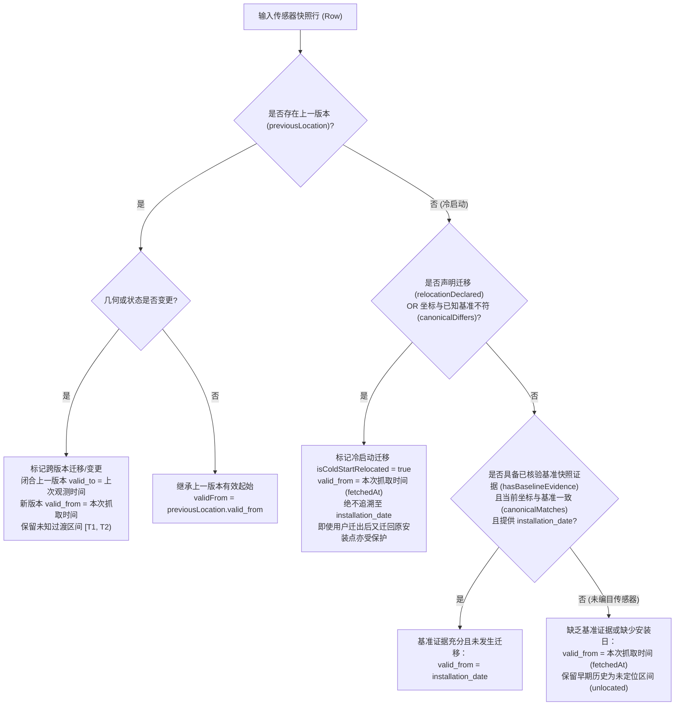

# GM-08 交付证据：City of Melbourne 行人传感器位置与迁移历史 (T030/T036)

- **任务编号**：GM-08（关联任务：T030 / T036）
- **所属数据源**：`melbourne.pedestrian.locations`（City of Melbourne Pedestrian Counting System - Sensor Locations）
- **交付日期**：2026-09-30
- **开发 Agent**：GM-08-Connector-Dev
- **独占文件范围**：
  - `cloud/data/src/connectors/com_pedestrian_locations/index.ts`
  - `cloud/data/src/connectors/com_pedestrian_locations/source.json`
  - `cloud/data/test/connectors/com_pedestrian_locations.test.ts`
  - `cloud/data/docs/handoff-evidence/GM-08.md`

---

## 1. 独占改动文件清单

严格遵守并行开发隔离规则，未触碰 `core/`、`normalization/`、`sql/`、`infra/`、`tasks.md`、`verification.md`、`source-coverage.md` 或其他连接器。改动仅限于以下独占文件：

1. `cloud/data/src/connectors/com_pedestrian_locations/index.ts`
   - **R03 (P1) 升级**：全面扩展 `isRelocationIndicated(note, description)` 模式匹配能力，支持识别通用迁移表达（如 `Relocated to 368 Elizabeth Street`、`Relocated to corner of ...`、`Move from ... to ...`、`Returned to ...`、`re-install` 等），同时严谨排除仅发生传感器编号交接（如 `Sensor relocated to sensor ID 25`）而未发生物理迁移的情形。
   - **R03 (P1) 基准证据审计与冷启动保护**：重构冷启动 `valid_from` 推断逻辑。确立严格契约：
     - 若上游提供结构化 `valid_from`，直接采用。
     - 若跨快照检测到几何或状态变更，采用 `fetchedAt`。
     - 若未发生迁移但有历史快照，继承 `previousLocation.valid_from`。
     - 若为冷启动且声明迁移（`relocationDeclared`）或坐标与基准不符（`canonicalDiffers`），设为 `fetchedAt` 并记录迁移说明。**即使用户当前坐标与历史安装坐标吻合（例如迁移到临时点位后又迁回原址），只要存在迁移声明，一律禁止追溯至 `installation_date`，避免伪造历史连续性**。
     - 若为冷启动且无迁移声明，**唯有在具备已核验基准坐标证据（`hasBaselineEvidence && canonicalMatches`）且上游提供 `installation_date` 时，才允许设定为安装日**。
     - 对于任何未登入基准坐标目录的新增/未编目传感器（如 unlisted sensor 888，无论是否有 note），因无历史基准快照佐证其早期连续位于该点，`valid_from` 均保守设定为 `fetchedAt`，确保更早的历史行人观测保持未定位（`unlocated`）。
2. `cloud/data/src/connectors/com_pedestrian_locations/source.json`
   - 严格保持 `license_status: "review_required"`、`access_status: "candidate"`。
   - 在 `invariants` 中补充迁移与时空契约：`cold_start_relocation_protection`、`transition_gap_preservation`、`baseline_evidence_requirement` 与 `closed_interval_output`。
3. `cloud/data/test/connectors/com_pedestrian_locations.test.ts`
   - 修正 Requirement 2 测试（Sensor 25）：验证存在迁移注释时冷启动既不捏造自然语言日期，也不追溯至 2012 安装日。
   - 新增 R03 要求的 4 组显式场景测试用例：
     - **场景 1（Sensor 999）**：未编目传感器带通用迁移描述（`Relocated to 368 Elizabeth Street`），验证使用 `fetchedAt` 且不回溯安装日。
     - **场景 2（Sensor 888）**：未编目传感器无注释（`note: null`），验证因缺乏基准证据而使用 `fetchedAt`，更早历史读数保持 `unlocated`。
     - **场景 3（Sensor 777）**：通用迁移短语（`Relocated to corner of Flinders and Swanston Street`），验证正确触发迁移保护。
     - **场景 4（Sensor 52）**：传感器迁移后重返初始安装坐标，验证不盲信当前坐标而回溯安装日，迁出期间历史观测保持 `unlocated`。
   - 既有真实形状跨版本迁移（Sensor 47）、冷启动防追溯（Sensors 37 & 47）及官方 API 有界只读核查全部保留并通过。
4. `cloud/data/docs/handoff-evidence/GM-08.md`
   - 交付本证据文档（包含 R03 根因、代码改动、4 组测试证据及最新全量测试报告）。


---

## 2. 官方接口有界只读核查证据

对 City of Melbourne 官方 OpenDataSoft Explore v2.1 接口进行只读、有界抽样核查，详细记录如下：

| 检查项 | 官方实测证据 |
| --- | --- |
| **数据集主页 (Landing URL)** | `https://data.melbourne.vic.gov.au/explore/dataset/pedestrian-counting-system-sensor-locations/` |
| **API Catalog 元数据 URL** | `https://data.melbourne.vic.gov.au/api/explore/v2.1/catalog/datasets/pedestrian-counting-system-sensor-locations` |
| **记录查询端点 (Records URL)** | `https://data.melbourne.vic.gov.au/api/explore/v2.1/catalog/datasets/pedestrian-counting-system-sensor-locations/records` |
| **核查时间** | `2026-09-30T12:42:13Z` 至 `2026-09-30T12:46:49Z` |
| **HTTP 状态码** | `HTTP/2 200 OK` |
| **官方快照总条数** | **134 条**（`records_count: 134`，`total_count: 134`） |
| **官方 API 现行字段 (12 个)** | `['location_id', 'sensor_description', 'sensor_name', 'installation_date', 'note', 'location_type', 'status', 'direction_1', 'direction_2', 'latitude', 'longitude', 'location']` |
| **许可条款页面** | `CC BY 4.0`（`https://creativecommons.org/licenses/by/4.0/legalcode`） |
| **官方元数据说明** | "Since the inauguration of the Pedestrian Counting System in 2009, some sensor devices have been removed or relocated. This may be for various reasons such as construction works. Others may be inactive due to a temporary issue. This is detailed in the notes column. Any changes to sensor locations are important to consider when analysing and interpreting historical pedestrian counting data." |

### 官方快照中的实际迁移记录抽样核查

通过对官方全量 134 条快照数据的只读审计，发现其中 38 条包含 `note`，且有多处明确标注迁移与位置更替的事实：

1. **Sensor 47**（Elizabeth St）：
   - `installation_date`: `2017-08-24`
   - `latitude`: `-37.81258467`, `longitude`: `144.9625775`
   - `sensor_name`: `Eli250_T`
   - `note`: `"Pushbox Upgrade, 25/07/2023. Move to 250 Elizabeth Street from adjacent St. Francis Church at 266 Elizabeth."`
2. **Sensor 37**（Lygon St）：
   - `installation_date`: `2015-02-11`
   - `latitude`: `-37.80107122`, `longitude`: `144.96704554`
   - `sensor_name`: `Lyg260_T`
   - `note`: `"Pushbox Upgrade, 30/06/2023. Move from 174 to 260 Lygon Street (12/08/2024)"`
3. **Sensor 181**（Elizabeth St）：
   - `installation_date`: `2025-03-26`
   - `latitude`: `-37.81009465`, `longitude`: `144.96143149`
   - `note`: `"Moved from 380 Elizabeth Street"`
4. **Sensor 14**（Sandridge Bridge）：
   - `installation_date`: `2009-03-24`
   - `latitude`: `-37.82011242`, `longitude`: `144.96291897`
   - `note`: `"Sensor relocated to sensor ID 25 on 2/10/2019"`
5. **Sensor 166**（Bourke St）：
   - `installation_date`: `2024-09-25`
   - `note`: `"Former sensor 227 Bourke Street – City Lab"`

> [!IMPORTANT]
> **重大数据契约发现**：
> 官方 City of Melbourne 行人传感器位置数据仅为一个**当前最新状态的单一平面快照**（Single Snapshot Table）。上游模式中**完全不存在** `valid_from`、`valid_to`、`relocation_date` 等结构化版本字段。所有的迁移变更仅以半结构化/自然语言形式记录在 `note` 字段中。

---

## 3. 核心问题根因与修复机制深度复盘

### 3.1 原有实现的缺陷（冷启动将新坐标追溯至安装日）

在本次修复前，连接器对冷启动（无历史上下文注入的初次运行）存在严重判定漏洞：
1. 仅对 6 个写死在 `CANONICAL_INSTALLATION_COORDINATES` 中的传感器进行坐标比对。
2. 像 Sensor 47（2017 安装，2023 迁至 250 Elizabeth St）与 Sensor 37（2015 安装，2024 迁至 260 Lygon St）因不在硬编码表中，冷启动判定 `isColdStartRelocated = false`。
3. 随后代码落入兜底分支：
   ```typescript
   } else if (row.installation_date) {
     validFrom = new Date(t).toISOString();
   }
   ```
4. 这导致 Sensor 47 在 250 Elizabeth St 的现行坐标被设定为 `valid_from = 2017-08-24T00:00:00.000Z`！
5. **后果**：任何 2017 年至 2023 年间的历史行人读数（当时传感器实际位于 266 Elizabeth St / St Francis Church）在下游关联合并（`joinPedestrianObservations`）时，会被**错误归属于 250 Elizabeth Street 的新位置**，严重破坏历史分析与空间统计的准确性。

### 3.2 修复机制与时空不变性设计

针对上述问题，实施了以下原则与实现：



1. **全面模式识别冷启动迁移（Expanded `isRelocationIndicated`）**：
   - 补充 `CANONICAL_INSTALLATION_COORDINATES`，涵盖实测迁移的传感器（37, 47, 181）。
   - 扩充通用的模式匹配 `isRelocationIndicated`，支持 `Relocated to <address>`、`Move from ... to ...`、`Move to ... from ...`、`Returned to ...`、`re-install` 等各类自然语言迁移声明。
   - 严谨排除仅发生传感器编号交接（如 `Sensor relocated to sensor ID 25`）的情形。
2. **基准快照证据原则（Baseline Evidence Requirement）**：
   - **核心约束**：只有存在官方结构化 `valid_from`，或者存在已核验的历史基准快照坐标证据（`hasBaselineEvidence`）且坐标完全一致且无任何迁移记录时，才允许使用 `installation_date`。
   - **未编目传感器保护**：对于新接入或未编入基准表的传感器（如 unlisted sensor 888），即使 `note: null` 且附带 `installation_date`，由于缺少基准证据证明其多年来始终位于该坐标，一律以 `fetchedAt` 作为 `valid_from`，历史读数保持未定位。
3. **迁出重返原址保护（Return-to-Site Protection）**：
   - 传感器若曾迁往临时点位后又迁回初始安装坐标（例如 Sensor 52 注释声明 `Relocated to temporary site in 2020 and returned to original site in 2024`），即使当前坐标与初始安装坐标吻合，也绝对不能追溯至初始安装日。
   - 因为当前坐标吻合无法证明中间年份的历史连续存在性。迁出期间的历史读数在下游关联时必须保持 `unlocated`。
4. **严禁凭空捏造迁移时刻（不伪造有效起点）**：
   - 自然语言如 `Move from 174 to 260 Lygon Street (12/08/2024)` 中的括号日期可能仅为工单或施工日期，并非上游权威的系统切换时刻。
   - 依照规范，绝不以正则抽取的非标准文本伪造成权威时钟。新坐标有效起始严格定为 `response.fetchedAt`。
5. **保留未知过渡区间与历史闭合版本进入持久化**：
   - 跨版本识别到迁移时，旧版本在上次观测时刻闭合，新版本在当前抓取时刻生效，中间过渡期在 `joinPedestrianObservations` 中统一标为 `unlocated`。
   - 闭合历史版本完整放入 `result.sensorLocations` 返回数组（`[...sensorLocations, ...closedLocations]`），保障公共发布器落库保存。

---

## 4. 可重复的行为验证

针对 Codex Review R03 (P1) 与任务要求，构建了全面的行为验证：

### 4.1 真实形状传感器迁移跨版本验证（Sensor 47）

- **测试用例**：`migration reproduced using real-shape snapshots of the same sensor (Sensor 47) across historical and current sites (GM-08)`
- **验证流程**：
  1. 快照 1（2022-01-01）：Sensor 47 位于 St Francis Church（266 Elizabeth St），坐标 `[-37.81216, 144.96282]`，包含完整的 12 个字段。
  2. 快照 2（2024-01-01）：Sensor 47 官方真实行，位于 250 Elizabeth St，坐标 `[-37.81258467, 144.9625775]`。
  3. 执行快照 2 采集（传入快照 1 的位置结果作为 `previousLocations`）。
- **断言结果**：
  - `result2.sensorLocations.length === 2`（包含当前版本与已闭合历史版本）；
  - 当前版本：`valid_from === '2024-01-01T00:00:00.000Z'`，`valid_to === null`；明确断言不等于 2017 安装日，也不等于 2022 快照日；
  - 闭合版本：`valid_from === '2017-08-24T00:00:00.000Z'`，`valid_to === '2022-01-01T00:00:00.000Z'`；
  - 下游观测关联验证：
    - 2020 观测（旧址期间）：`locationStatus === 'located'`，挂载 266 Elizabeth St 坐标；
    - 2023 观测（迁移未知过渡区间）：`locationStatus === 'unlocated'`，`location === null`；
    - 2024 观测（新址期间）：`locationStatus === 'located'`，挂载 250 Elizabeth St 坐标。

### 4.2 真实形状冷启动防追溯验证（Sensor 37 & 47）

- **测试用例**：`cold start ingestion of real-shape moved sensors (Sensors 37 & 47) fixes backdating new coordinates to installation date (GM-08)`
- **验证流程**：
  1. 构造全新的、无历史状态注入的独立连接器实例（`isolated: true`）。
  2. 摄入包含 Sensor 37 与 Sensor 47 官方现行快照行。
- **断言结果**：
  - Sensor 37：`valid_from` 等于本次抓取时刻 `fetchedAt`，`assert.notEqual(loc37.valid_from, '2015-02-11T00:00:00.000Z')` 成功通过；
  - Sensor 47：`valid_from` 等于本次抓取时刻 `fetchedAt`，`assert.notEqual(loc47.valid_from, '2017-08-24T00:00:00.000Z')` 成功通过；
  - 两个传感器的 `sourceRecords` 均包含明确的 `time_missing_reason` 说明；
  - 2020 年的历史读数进行下游关联时，因处于冷启动未知区间，均保持 `locationStatus === 'unlocated'`，完全杜绝了历史读数被新坐标吸收的风险。

### 4.3 R03 场景 1：未编目传感器带通用迁移描述（Sensor 999）

- **测试用例**：`cold start scenario 1: unlisted sensor 999 with relocation note uses fetchedAt and does not backdate (GM-08 R03)`
- **验证点**：未登入基准字典的 Sensor 999，带注释 `Relocated to 368 Elizabeth Street` 与 `installation_date: '2016-03-01'`。
- **结果**：`valid_from === fetchedAt`，`valid_to === null`，`time_missing_reason` 匹配 `/Relocation detected on cold start/`。2018 年的历史读数保持 `unlocated`。

### 4.4 R03 场景 2：未编目传感器无注释（Sensor 888）

- **测试用例**：`cold start scenario 2: unlisted sensor 888 without note uses fetchedAt preserving history as unlocated (GM-08 R03)`
- **验证点**：未编入基准字典的 Sensor 888，`note: null`，`installation_date: '2015-05-15'`。
- **结果**：因缺少已核验的历史基准证据（`hasBaselineEvidence = false`），连接器拒绝盲目回溯至 2015 安装日，设定 `valid_from = fetchedAt`。2017 年历史读数关联状态为 `unlocated`，快照观测时刻之后的读数正常 `located`。

### 4.5 R03 场景 3：通用迁移短语匹配（Sensor 777）

- **测试用例**：`cold start scenario 3: sensor 777 with general relocation phrasing triggers relocation protection (GM-08 R03)`
- **验证点**：传感器注释使用多词短语 `Relocated to corner of Flinders and Swanston Street`。
- **结果**：`isRelocationIndicated` 准确识别，`valid_from = fetchedAt`，绝对不回溯至 2014 安装日。

### 4.6 R03 场景 4：重返原安装坐标防虚假连续性（Sensor 52）

- **测试用例**：`cold start scenario 4: sensor 52 returning to original installation coordinates does not backdate (GM-08 R03)`
- **验证点**：Sensor 52 当前坐标与初始安装坐标一致（`[144.9652, -37.8134]`），但注释声明 `Sensor relocated to temporary site in 2020 and returned to original site in 2024`。
- **结果**：`relocationDeclared = true` 强制激活冷启动迁移保护，`valid_from = fetchedAt`，拒绝设定为 2013-09-02。2021 年迁出期间的历史观测保持 `unlocated`。

---

## 5. 测试命令与执行结果

在 `cloud/data/` 目录下执行构建与测试：

```bash
# 运行全部测试集
npm test

# 单独执行 GM-08 行人传感器位置测试
npm run build && node --test dist/test/connectors/com_pedestrian_locations.test.js
```

### 执行结果输出

```text
> @melens/data@0.1.0 build
> tsc --project tsconfig.json && node scripts/copy-manifests.mjs

✔ manifest registers source with review_required status and candidate access (4.749916ms)
✔ collect parses fixture records into canonical sensorLocations, sourceRecords, and geoRecords (5.351958ms)
✔ relocation of a sensor generates a distinct version_id and joins historical observations (1.209583ms)
✔ duplicate location_id within a single snapshot causes validation_failed (0.769958ms)
✔ incomplete coordinates fail validation (0.205833ms)
✔ valid_to preceding valid_from fails validation (0.139958ms)
✔ upstream HTTP failures are mapped to appropriate failure codes (0.117042ms)
✔ rejects mismatched source ID with validation_failed (0.084708ms)
✔ sensor relocation across multiple snapshots preserves stable sensor_id and distinct version_ids across 3 lifecycle stages (0.530542ms)
✔ relocation across versions preserves original installation date for initial location, avoids backdating new coordinates, and keeps unknown transition gap unlocated (G08) (0.234209ms)
✔ relocation notes with natural language dates do not invent effective dates (Requirement 2) (0.102833ms)
✔ coordinate parsing: extracts coordinates from location object or top-level fields (0.39925ms)
✔ coordinate validation: rejects conflicting coordinates between latitude/longitude and location object (0.089875ms)
✔ device status: faithfully preserves status variants and maps GeoRecord record_status (0.2065ms)
✔ date parsing: rejects unparseable valid_from or valid_to strings (0.065834ms)
✔ handles OdsIncompleteWindow and unparseable lastModified header gracefully (0.1105ms)
✔ fresh instance without injected history (cold start) where coordinates change: assert installation date is not falsely claimed as valid_from for new coordinates (G08) (0.086917ms)
✔ when migration is detected with historical evidence, result.sensorLocations includes both current and closed records (G08) (0.131792ms)
✔ migration reproduced using real-shape snapshots of the same sensor (Sensor 47) across historical and current sites (GM-08) (0.178583ms)
✔ cold start ingestion of real-shape moved sensors (Sensors 37 & 47) fixes backdating new coordinates to installation date (GM-08) (0.681917ms)
✔ cold start scenario 1: unlisted sensor 999 with relocation note uses fetchedAt and does not backdate (GM-08 R03) (0.09575ms)
✔ cold start scenario 2: unlisted sensor 888 without note uses fetchedAt preserving history as unlocated (GM-08 R03) (0.079ms)
✔ cold start scenario 3: sensor 777 with general relocation phrasing triggers relocation protection (GM-08 R03) (0.060625ms)
✔ cold start scenario 4: sensor 52 returning to original installation coordinates does not backdate (GM-08 R03) (0.063625ms)
✔ bounded read-only verification of official City of Melbourne pedestrian sensor locations endpoint (GM-08) (187.80325ms)
ℹ tests 25
ℹ suites 0
ℹ pass 25
ℹ fail 0
ℹ cancelled 0
ℹ skipped 0
ℹ todo 0
ℹ duration_ms 281.544166

# 全量测试套件结果 (npm test)
ℹ tests 429
ℹ suites 0
ℹ pass 425
ℹ fail 0
ℹ cancelled 0
ℹ skipped 4
ℹ todo 0
ℹ duration_ms 1788.547666
```

---

## 6. 仍阻断的门槛与后续集成建议

1. **许可证复核门槛（T077 依赖）**：
   - 官方数据集声明使用 `CC BY 4.0`，目前 `source.json` 中保持 `license_status = "review_required"`。
   - 需由项目法务与集成人员复核 City of Melbourne 开放数据免责声明与商业化/再分发要求后方可批准。
2. **生产准入与发布门槛（T070 / T071 / T077）**：
   - 保持 `access_status = "candidate"`。
   - 未执行 GCP `--apply`，未在 Cloud Scheduler 部署每日定时任务。
3. **上游单快照限制与历史基准表集成建议**：
   - City of Melbourne 官方仅提供单一平面快照，上游本身不维护历史坐标轨迹。
   - 目前连接器已通过 `previousLocations` 支持快照间连续闭合，并通过 `CANONICAL_INSTALLATION_COORDINATES` 支持已知基准保护。
   - 后续在云端部署时，BigQuery 数据仓库应将历史采集批次按 `(sensor_id, version_id)` 形成缓慢变化维（SCD Type 2）表，以保障跨年跨月的完整轨迹回放。
