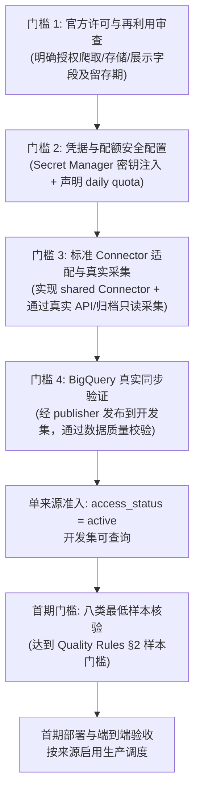

# Melbourne 公共数据源覆盖与准入核查报告 (Source Coverage & Admission Register)

> **任务标识**: T076  
> **核查依据**: [`specs/001-melbourne-data-aggregation/source-ids.md`](../../../specs/001-melbourne-data-aggregation/source-ids.md)、[`specs/001-melbourne-data-aggregation/quality-rules.md`](../../../specs/001-melbourne-data-aggregation/quality-rules.md)、[`specs/001-melbourne-data-aggregation/tasks.md`](../../../specs/001-melbourne-data-aggregation/tasks.md)、[`cloud/data/src/core/registry.ts`](../src/core/registry.ts)、[`specs/001-melbourne-data-aggregation/gemini-handoff.md`](../../../specs/001-melbourne-data-aggregation/gemini-handoff.md)
> **基准日期**: 2026-10-01
> **准入总则**: 依据 [`quality-rules.md`](../../../specs/001-melbourne-data-aggregation/quality-rules.md) §1 与运行时注册器规则，各来源分别核实官方许可、适用的凭据、调用配额、留存期和真实采集后才能激活并发布；首期八类样本门槛另行验收。公开样例（fixtures）仅证明本地解析行为，绝不代表准入通过。`active` 表示来源清单和开发集查询可用，不表示已部署定时作业。

## 当前发布状态：2026-10-01 四类别发布

12 个独立数据集已经在开发项目 `melens-510012` 实际发布；其中 11 个为 `verified_open`，Ticketmaster 为 `restricted`。本次新增停车三表、GDELT、CSA 和 Ticketmaster。一般新闻和犯罪新闻共用 GDELT，按一个来源计数。24 个连接器中的其他 12 个仍候选；警方/应急条件性来源不计入。

| 新来源 | 真实采集/发布 | 查询限制 |
| --- | --- | --- |
| `melbourne.parking.bays` | 29,053 车位点 | 点为官方位置，不推断面或合法可停 |
| `melbourne.parking.sensors` | 6,324 传感器，完整快照及业务变化版本 | 占用和新鲜度独立；节假日/施工误报限制保留 |
| `melbourne.parking.restrictions` | 4,263 输入，8,035 规则参考 | 2022 年处理资料；当前适用性未核实 |
| `gdelt.news` | 10 个核实一般新闻逻辑事件/3 发布日；6 个犯罪报道/6 发布日 | 地区提及不是精确事发点；新犯罪候选待复核 |
| `victoria.csa.recorded_offences` | 810 输入，1,620 指标；81 原始地区标签/10 统计期 | 保留原地域，未知代码/边界版本为 null |
| `ticketmaster.events` | 421 完整活动；419 未取消，372 未来有日期 | 80 km 搜索圈，非全部社区活动；24h 可见上限 |

类别样本门槛现为 5/8（一般新闻、本地犯罪、活动、行政边界、区域统计）；停车规则闭环、行人、交通中断仍待验收。63/77 原任务已勾选，完整产品 T077 仍未通过。全部实际证据及最新定时状态见 [四类别发布记录](validation/four-category-release-2026-10-01.md)。下文为此前审计快照，出现 6 来源/1 类、未发布或旧 GDELT 许可结论时以本节和当前 `source.json` 为准。

## 历史审计快照

2026-10-01 并行实现与开发部署：位置历史恢复、不可变闭合版本及 GTFS 静态引用／每模式完整快照成员已接入运行入口；无官方版本证明时仍不定位。六个已准入来源已部署 Cloud Run Jobs、读回专用 IAM 并全部通过真实执行；租金完整历史已发布 58,618 条记录。两个每日快照调度已启用，预算暂停机制已接入；T070 已完成，当前任务为 62/77。实际运行结果及调度状态以[来源部署记录](validation/source-deployment-2026-10-01.md)为准。首期仍只有六个独立来源、1/8 类通过；以下历史文字中的“未接线／来源调度全部关闭”以本次记录为准。

2026-09-30 发布补充：市界、CLUE 2025 街区、ABS ASGS 2021／2026 快照、开发项目及 Homes Victoria 租金及 ABS Census 已作为 `verified_open` / `active` 在 GCP 开发集发布，共六个独立来源。可查询边界共 1,527 个；开发项目 1,450 条（现行 326 条、完成历史 1,124 条）；租金两季度 1,106 条且均未匹配边界；2021 Census 有 144,792 个指标，其中 3,969 个匹配同版 LGA/SA2 边界。2026 ABS 快照中的 LGA 实际为 2025 版。证据见[市界](source-policies/municipal-boundary.md)、[CLUE](source-policies/clue-blocks-admission.md)、[ABS](source-policies/asgs-boundaries.md)、[开发项目](source-policies/development-monitor-admission.md)、[租金](source-policies/homes-victoria-rents-admission.md)和[Census](source-policies/abs-census-admission.md)专项记录。下文 2026-09-29 的旧审计快照若写“全部候选”或“0 active”，以本次发布结果为准。孤立 staging 清理已独立部署且连续七次定时成功；来源定时部署仍未完成。

2026-10-01 Gemini 整合补充：26 组交付和 41 个分支提交的净改动已接收，详见[整合复核](validation/gemini-merge-review-2026-10-01.md)。下文历史 G23／E01 及安装日回溯描述以本次结果为准。T033 已按官方 establishment 行粒度聚合容量，物业 100008 的 13＋6 得到年度容量 19；T056 交付记录包含恢复后的 439 个 zone 和 1,888 个 overlay，保持完整分页及空层失败关闭。T030 冷启动从首次观测开始，不追溯安装日；跨作业位置历史和不可变闭合版本仍阻断。T034 已接通已发布 BigQuery 小时历史读取与按 sensor-hour 的发布排序检查。道路 offsetless 时间改为 null 并保留原文，未取得时区依据；GTFS 双模式 revision／不可变版本已修，当前快照成员与静态同版证据仍待集成。来源 active／发布数继续为 6，来源定时仍关闭，八类覆盖仍为 1/8。

---

## 1. 准入与覆盖状态执行摘要 (Executive Summary)

依据 2026-09-30 对代码仓库 `cloud/data/src/connectors/` 下所有 24 个连接器清单（`source.json`）、实现文件（`index.ts`）、测试样例（`test/fixtures/`）及运行时注册器（`loadSourceRegistry`）的完整扫描与执行对账：

* **规范来源总数**: **24 个**（按规范编号 #1 至 #24）；其中 2 个政策冻结、无连接器。
* **配套与基础参考表 (Auxiliary / Supporting Tables)**: **4 个**：
  * 领域配套表 2 个：`melbourne.clue.blocks`（配套 1，CLUE 街区边界多边形）与 `victoria.transport.gtfs_static`（配套 2，静态 GTFS 公交时刻表/站点）；
  * 基础空间参考表 2 个：`melbourne.municipal_boundary`（#10，墨尔本市法定市界）与 `abs.asgs.boundaries`（#11，ABS ASGS 统计边界/GCCSA/LGA/SA2）。
* **连接器代码目录总数**: **24 个**连接器目录（覆盖 22 个候选来源 + 2 个领域配套表；#2 警方新闻与 #19 应急警报因法律与使用条款限制按政策冻结，尚未创建连接器目录）。
* **运行时注册器状态 (Runtime Registry)**:
  * 动态加载成功率：**24/24 个目录全部成功加载共享 `Connector` 接口**（此前关于 T032 未导出标准 Connector 的记录已失效，T032 现已导出统一实例并由注册器加载成功）；
  * 运行时准入裁决：**6 个 `verified_open` / `active`**（市界、CLUE 街区、ABS ASGS、开发项目、Homes Victoria 租金、ABS Census），其余 18 个连接器仍为 `review_required` / `candidate`；
  * 活跃已准入数：`registry.active().length === 6`（已准入 **6/24 个连接器**）。
* **工程执行四级阶段状态对账 (Four-tier Verification Status)**:
  1. **模块加载 (Module Loaded)**: **24/24 成功**。所有 24 个连接器代码目录均导出冻结的 `Connector` 接口，无模块加载失败（2 个条件源按政策冻结，无代码）；
  2. **样例解析 (Sample Parsing Verified)**: **24/24 验证**。本地单元测试与 fixture 解析逻辑通过，仅验证本地数据处理与 schema 映射；
  3. **真实采集状态 (Real Upstream Collection)**: **六个来源已采集并发布**。其他公开接口快照与离线归档有解析成功实例（如停车传感器 6,324 条、停车限制 4,263 条/8,035 规则、行人位置 134 条、GTFS 静态归档 60 线/4,485 站），但仍存在关键上游阻断、真实数据冲突及凭据与关联硬伤：
     - **T032 (#17)**: 官方配置端点返回 **HTTP 404 / NotFoundResource**，采集按规则失败关闭（G01 阻断保持）；
     - **T033 (#20)**: Gemini 交付记录已按官方 establishment 行粒度完成同物业／同类型容量聚合；物业 100008 的 13＋6 为 19，G23 原重复冲突已修。年度容量不表示实时空位，许可及云端发布另验。
     - **T055 (#21)**: 默认连接器经 DataVic 目录拉取官方 XLSX 实读 **58,618 条**（`complete = true`，无 fixture 回退，原 G03 关闭）；文件 `Last-Modified` 作为更正顺序，2025 年两季度 1,106 条已发布，全部保持边界未解析；
     - **T056 (#22)**: Gemini 记录官方服务恢复为 439 个 zone／1,888 个 overlay，完整分页及 scheme_code 分类已修；两层缺失或为空仍失败关闭。许可及开发集发布待完成。
     - **T054 (#18)**: 测量指标已接入规范化 `areaIndicators`（5 条 fixture 生成 65 条 AreaIndicator，覆盖温度、湿度、风、PM、噪声等 13 类），保留单位与 null 缺值，不再仅留在被忽略的额外数组（原 G04 关闭）；待云端真实环境拉取与发布验收；
     - **T057 (#23)**: 仅有竣工年时 `observed_at = null` 且保留缺时说明，住宅数缺失保留 null，保留年粒度（原 G10 关闭）；1,450 条真实开发项目已发布；
     - **T034 (#24)**: 从已发布 BigQuery 同窗口观测读取有界更正历史；发布器按 sensor-hour 与对应 source_record 检查修订证据，UTC coverage checkpoint 不承载历史摘要。真实行人联合发布与运行验收待完成。
     - **T030 (#8)**: 冷启动首次观测区间替代安装日回溯；跨 Cloud Run 历史状态及不可变 closure 发布仍缺，保持候选。
     - **凭据已配置**: 两个 Secret 已有启用版本 1；Transport Victoria 三个私有云端接口已成功读取，时间与版本问题仍阻断发布；Ticketmaster 的条款及留存门槛仍未通过；
     - **键脱节与版本错位**: 停车传感器 6,324 条记录中 `marker_id`/`bay_id` 完全缺失（0 条可关联），与车位/规则表仅 10 个重叠车位；CLUE 2025 年街区法定重组导致历史就业统计空间脱节。
  4. **云端发布状态 (Publication Status)**: **6/24 连接器已在开发集发布**（市界 1 条、CLUE 街区 603 条、ABS 2021 边界 443 条和 2026 快照 480 条、开发项目 1,450 条、租金两季度 1,106 条、Census 144,792 个指标）；来源定时作业和首期端到端验收未完成。
* **八类核心信息样本门槛 (FR-002 / Quality Rules §2)**: **1 / 8 类通过**。市界独立版本与 ABS 2021 Greater Melbourne GCCSA、80 个同版 LGA 已可查询；其余七类仍未通过。

---

## 2. 来源工程状态全景对账总表 (Master Implementation & Admission Register)

为彻底贯彻质量门禁，杜绝以“测试通过”混淆“真实可用”，下表将每个来源严格拆解为四个独立的工程与生命周期阶段：
* **① 模块加载 (Module Loaded)**: 是否成功导出标准 `Connector` 接口并由 `SourceRegistry` 成功加载；
* **② 样例解析 (Sample Parsing)**: 本地单元测试与 fixture 解析是否通过；
* **③ 真实采集状态与上游阻断 (Real Collection Status)**: 针对官方真实接口/归档的只读请求结果，记录真实获取条数或具体上游阻断（如 G01/G02/G03/E01 等）；
* **④ 发布与查询状态 (Publication Status)**: 是否完成 GCS 不可变归档并经由 Publisher 写入 BigQuery 开发/生产数据集。

### 2.1 来源四级执行状态全景矩阵 (Four-tier Implementation & Verification Matrix)

| 来源 # / 规范 `source_id` | 任务号 | 维护负责人 (`connector_owner`) | ① 模块加载 (Registry) | ② 样例解析 (Fixture) | ③ 真实采集状态与上游阻断 (Real Collection) | ④ 发布状态 (BigQuery) | 当前准入裁决与关键阻断 (Admission Status) |
|---|---|---|---|---|---|---|---|
| **#1** `gdelt.news` | T040 | `null` (待指定) | **成功 (True)** | **通过** (`gdelt.json`, 723 B) | **部分验证**：单文件烟雾解析通过，但维州候选事件为 0；14 天滚动提取未跑通；按 CC BY 4.0 仅存元数据不存正文 | **未发布 (0 条)** | **未准入 (Candidate)**。缺少 `connector_owner` 等 7 项元数据；30 天犯罪新闻覆盖未达标；待 T049 样本审计。 |
| **#2** `victoria.police.news` | T043, T044 | `null` (冻结) | **无代码 (None)** | **无样例** | **政策阻断**：官方无公开 API，记者邮件订阅属特权渠道不可挪用；Crown Copyright 严控抓取；连接器禁止开工 | **未发布 (0 条)** | **未准入 (Blocked)**。条件性来源审查未通过；不计入首期上线保底数；墨尔本新闻由 GDELT 替代。 |
| **#3** `victoria.csa.recorded_offences` | T041 | `null` (待指定) | **成功 (True)** | **通过** (`csa_recorded_offences.json`, 936 B) | **可拉取**：Table 01 季度统计解析成功；但缺失官方数字化 LGA 代码，纯名称匹配易受跨年行政区划重组干扰 | **未发布 (0 条)** | **未准入 (Candidate)**。缺少 `connector_owner` 等 6 项元数据；需官方 LGA 代码映射；待在 BigQuery 开发集验证。 |
| **#4** `melbourne.parking.sensors` | T026 | `melens integration` | **成功 (True)** | **通过** (`com_parking_sensors.json`, 1.29 KB) | **已采 6,324 条**：快照成功拉取 6,324 条；但 upstream 缺失历史 `marker_id`/`bay_id`（有效关联为 0），仅有 `kerbsideid` | **未发布 (0 条)** | **未准入 (Candidate)**。三表键严重脱节；与车位/规则表仅 10 个重叠车位，禁止推导 `may_park_now`。 |
| **#5** `melbourne.parking.bays` | T027 | `melens integration` | **成功 (True)** | **通过** (`com_parking_bays.json`, 438 B) | **已采 29,053 行**：官方快照获取成功，但 23,981 行（82.5%）`kerbsideid` 为空；仅有点坐标，无车位面多边形 | **未发布 (0 条)** | **未准入 (Candidate)**。缺少车位面几何与稳定键，阻断三表关联；禁止虚构车位多边形。 |
| **#6** `melbourne.parking.restrictions` | T028 | `melens integration` | **成功 (True)** | **通过** (`com_parking_restrictions.json`, 1.40 KB) | **已采 4,263 条/8,035 规则**：快照解析成功；但数据停留在 2022-11-13 快照；`bayid` 无法与 Sensors 的 `kerbsideid` 映射 | **未发布 (0 条)** | **未准入 (Candidate)**。数据版本陈旧；缺少节假日判定事实；三表无法凑齐 30 个有效车位。 |
| **#7** `melbourne.pedestrian.minute` | T029 | `melens integration` | **成功 (True)** | **通过** (`com_pedestrian_minute.json`, 312 B) | **逻辑验证**：15 分钟重叠拉取与缺口不补零逻辑验证完成；未开展连续 24 小时真实接口拉取 | **未发布 (0 条)** | **未准入 (Candidate)**。P0 核心数据源；缺少云端连续 24 小时运行证据；待 T069 联合发布验收。 |
| **#8** `melbourne.pedestrian.locations` | T030 | `melens integration` | **成功 (True)** | **通过** (`com_pedestrian_locations.json`, 2.29 KB) | **已采 134 点位**：快照拉取成功；冷启动从首次观测开始，历史更早区间保持未知；跨作业状态及不可变闭合版本仍未接通 | **未发布 (0 条)** | **未准入 (Candidate)**。历史区间持久化与作业接线待集成；待与分钟读数（#7）联合验证空间挂接。 |
| **#9** `victoria.transport.road_unplanned` | T031 | `melens integration` | **成功 (True)** | **通过** (`tv_road_unplanned.json`, 1.18 KB) | **密钥已配置**：启用版本 1 经私有云端实测成功，三页完整 291／290 个影响要素；更新时间无时区，第二次转换后 16 个来源事实落在未来，发布暂阻断 | **未发布 (0 条)** | **未准入 (Candidate)**。P0 核心数据源；依赖 Secret Manager 凭据注入与 20次/分限流实盘校验。 |
| **#10** (基础 1) `melbourne.municipal_boundary` | T022 | `melens integration` | **成功 (True)** | **通过** (`com_municipal_boundary.json`, 274 B) | **已验证 1 面要素**：City of Melbourne 市界；当前版本 `com_municipal:1:2008-07-01` | **开发集已发布 (1 条)** | **已准入 (`verified_open` / `active`)**。`v_boundaries` 可查一条有效地理面；尚未部署定时作业，不能单独满足行政边界类别门槛。 |
| **#11** (基础 2) `abs.asgs.boundaries` | T023 | `melens integration` | **成功 (True)** | **通过** (`abs_asgs_boundaries.json`, 329 B) | **官方 2021 实采 445 要素、2026 快照 482 要素**：分别 443／480 地理面，另各有 2 条官方非空间 LGA 来源事实保留 | **开发集已发布 (923 面)** | **已准入 (`verified_open` / `active`)**。2021 有 1 GCCSA、1 STE、80 LGA、361 SA2；2026 快照有 1 GCCSA、1 STE、398 SA2，另 80 LGA 为原始 2025 版。 |
| **#12** `ticketmaster.events` | T042 | `melens integration` | **成功 (True)** | **通过** (`ticketmaster.json`, 1.02 KB) | **条款阻断**：Secret Manager 已有启用版本 1；缓存与快速删除条件尚未在 BigQuery 留存流程中落实 | **未发布 (0 条)** | **未准入 (Blocked)**。密钥已配置，数据留存条款仍阻断；待完成来源政策和替代源评估。 |
| **#13** `abs.census` | T052 | `melens integration` | **成功 (True)** | **通过** (`abs_census.json`, 2.97 KB) | **官方 ZIP 实读**：六个 G01/G02 CSV，32,176 地区表事实、144,792 个指标；参考日为 2021-08-10，不延伸至 2026 | **开发集已发布 (144,792 指标)** | **已准入 (`verified_open` / `active`)**。720 指标匹配 80 个 2021 LGA，3,249 匹配 361 个 2021 SA2，其余 140,823 显式未匹配；仅一个统计期，区域类别门槛仍未通过。 |
| **#14** `melbourne.clue.employment` | T053 | `melens integration` | **成功 (True)** | **通过** (`com_clue_employment.json`, 3.34 KB) | **空间错位阻断**：2002–2024 年 CLUE 就业统计解析正常；但 2025 年官方重组 Small Blocks 边界，二者无法直接挂接 | **未发布 (0 条)** | **未准入 (Blocked)**。街区重组空间错位；官方 crosswalk 缺失前标记 `boundary_mapping_status = missing`。 |
| **配套 1** `melbourne.clue.blocks` | T053 | `melens integration` | **成功 (True)** | **通过** (`com_clue_blocks.json`, 2.74 KB) | **官方实采 603 面**：2025 年对齐的 Small Blocks 空间多边形底图 | **开发集已发布 (603 面)** | **已准入 (`verified_open` / `active`)**。独立空间来源；与 2002–2024 年就业表仍版本错位，禁止按 block ID 直接挂接。 |
| **#15** `victoria.transport.road_planned` | T061 | `melens integration` | **成功 (True)** | **通过** (`tv_road_planned.json`, 1.70 KB) | **密钥已配置**：Token 两次各 19 页完整 9,450／9,452 事件，零拒绝；更新时间缺时区，现有 Victorian 转换仍需正式依据；准入与版本发布未验证 | **未发布 (0 条)** | **未准入 (Candidate)**。依赖 Secret Manager 凭据注入与 20次/分限流实盘校验。 |
| **#16** `victoria.transport.gtfs_realtime` | T063 | `melens integration` | **成功 (True)** | **通过** (`tv_gtfs_realtime.json`, 1.04 KB) | **密钥已配置**：两个官方火车／电车 protobuf feed 完整返回 19 警报、21 来源事实；实时版本冲突和静态同版匹配仍待修订 | **未发布 (0 条)** | **未准入 (Candidate)**。P0 核心数据源；需注入凭据并与静态 GTFS 联合定位。 |
| **配套 2** `victoria.transport.gtfs_static` | T062 | `melens integration` | **成功 (True)** | **通过** (官方 ZIP 读取) | **已采 60 路线/4,485 站**：按 HTTP Range 读取官方 275MB 归档，解析 60 路线、4,485 站点、96,483 trips；子包无 `feed_info` | **未发布 (0 条)** | **未准入 (Candidate)**。独立配套表；子包版本取自验证头，与实时 feed 的版本同一性尚未证明。 |
| **#17** `melbourne.transport.activity_counts` | T032 | `melens integration` | **成功 (True)** | **通过** (共享 Connector) | **上游 404 阻断 (G01)**：2026-09-30 复测官方配置端点仍返回 **HTTP 404 / NotFoundResource**；连接器按规则 fail-closed 报错 `schema_changed (404)` | **未发布 (0 条)** | **未准入 (Blocked)**。官方端点仍不可用；严禁以 fixture 冒充上线；保持候选受阻。 |
| **#18** `melbourne.microclimate` | T054 | `melens integration` | **成功 (True)** | **通过** (`com_microclimate.json`, 3.02 KB，5 条样例产生 65 条 `AreaIndicator`) | **规范化指标已接入 (G04 已关闭)**：13 类测量指标（温度、湿度、风速风向、PM2.5、PM10、噪声等）已进入公共发布器读取的 `areaIndicators`，保留单位与 null 缺测；未开展云端实盘采集 | **未发布 (0 条)** | **未准入 (Candidate)**。候选交付已通过；测量事实已可规范化消费；待云端真实环境拉取与发布验收。 |
| **#19** `victoria.emergency.alerts` | T064, T065 | `null` (冻结) | **无代码 (None)** | **无样例** | **政策阻断**：EMV 严禁高频自动化抓取；公开 RSS 仅限个人阅读；重大生命安全法律责任；连接器禁止开工 | **未发布 (0 条)** | **未准入 (Blocked)**。条件性来源审查未通过；不计入首期上线保底数；须与 EMV 签署书面协议。 |
| **#20** `melbourne.offstreet_parks` | T033 | `melens integration` | **成功 (True)** | **通过** (`com_offstreet_parks.json`, 9.32 KB) | **行粒度修复已交付**：官方 2024 切片 7,185 行，同物业／同类型 establishment 容量确定性聚合；100008 的 13＋6 为 19。详见 GM-06 证据 | **未发布 (0 条)** | **未准入 (Candidate)**。G23 原重复冲突已修；年度容量不是实时空位，许可及开发集发布另验。 |
| **#21** `homes_victoria.rents` | T055 | `melens integration` | **成功 (True)** | **通过** (`homes_victoria_rents.json`, 59.6 KB) | **官方 XLSX 实读 58,618 条**：七张房型表、106 个季度；文件 `Last-Modified` 为 `2026-02-20T01:17:41Z`，用于更正排序；9,308 条抑制值保留 null | **开发集已发布 (1,106 条)** | **已准入 (`verified_open` / `active`)**。Jun/Sep 2025 各 553 条，182 条抑制值为 null；全部 `boundary_mapping_status = missing`，尚不能渲染为 LGA 多边形。 |
| **#22** `victoria.vicmap.planning` | T056 | `melens integration` | **成功 (True)** | **通过** (`vicmap_planning.json`, 2.51 KB) | **官方恢复记录已交付**：Melbourne 439 个 zone＋1,888 个 overlay，分页及图层分类验证。详见 GM-13 证据 | **未发布 (0 条)** | **未准入 (Candidate)**。保留双层完整性与空层失败关闭；许可及开发集发布另验。 |
| **#23** `melbourne.development_monitor` | T057 | `melens integration` | **成功 (True)** | **通过** (`com_development_monitor.json`, 28.2 KB) | **已采 1,450 条**：官方 `data_processed` 前后校验稳定；保留四种项目状态、年粒度与缺值 | **开发集已发布 (1,450 条)** | **已准入 (`verified_open` / `active`)**。历史 1,124 已完成、现行 267 拟议／获批与 59 在建；1,450 点位均有非空几何。未将无版本 CLUE block ID 连到 2025 多边形；定时仍关闭。 |
| **#24** `melbourne.pedestrian.hourly` | T034 | `melens integration` | **成功 (True)** | **通过** (`com_pedestrian_hourly.json`, 679 B) | **批次修订已修复，版本顺序待集成**：计数更正已更新 `sourceRevision`，批次复用风险已消除；夏令时异常小时 fail-closed 验证通过；但上游无更新时间证据，更正版本先后顺序待集成 | **未发布 (0 条)** | **未准入 (Candidate)**。内容更正消除旧批次复用；版本排序策略待集成方确认；待与分钟和位置联合在 BigQuery 完成发布验收。 |

---

### 2.2 24 个候选来源与配套表准入证据档案 (Master Admission Register)

下表对各来源清单（`source.json`）中声明的元数据与运行时注册器解析结果（`admissionFromManifest`）进行严格对账，重点揭示声明状态与评估状态的一致性，以及各自缺失的准入前置要求（`missing_requirements`）：

| 规范 `source_id` | 空间范围 (`scope`) | 更新节奏 (`cadence_seconds`) | 检查周期 (`check_interval_seconds`) | 原生记录主键 (`native_record_key`) | 完整性规则摘要 (`completeness_rule`) | 声明许可 / 评估许可 | 每日配额 (`quota`) | 凭据需求 (`secret_names`) | 准入待核实项 (`missing_requirements`) |
|---|---|---|---|---|---|---|---|---|---|
| `gdelt.news` | `global` | 900 | 900 | `GKGRECORDID` | One GKG ZIP per 15-min; all files required | `review_required` / `review_required` | `null` | 无 | `quota_requests_per_day`, `allowed_fields`, `raw_retention_days`, `staging_retention_days`, `license_evidence_url`, `reviewed_at`, `connector_owner` |
| `victoria.police.news` | `victoria` | `null` | `null` | 未定 (无 API) | 政策冻结，无代码 | `review_required` / `review_required` | `null` | 无 | 审查未通过，代码未创建 |
| `victoria.csa.recorded_offences` | `victoria` | `null` | `null` | Table 01 year + month + LGA | Table 01 header and all rows validated | `review_required` / `review_required` | `null` | 无 | `coverage_from`, `quota_requests_per_day`, `raw_retention_days`, `staging_retention_days`, `reviewed_at`, `connector_owner` |
| `melbourne.parking.sensors` | `city` | 60 | 60 | `kerbsideid` | All pages match total_count; unique kerbsideid | `review_required` / `review_required` | `null` | 无 | `coverage_area_refs`, `coverage_from`, `quota_requests_per_day`, `raw_retention_days`, `reviewed_at` |
| `melbourne.parking.bays` | `city` | `null` | 86400 | `roadsegmentid + kerbsideid + coord` | Full export count equals total_count; unique keys | `review_required` / `review_required` | `null` | 无 | `coverage_area_refs`, `coverage_from`, `quota_requests_per_day`, `raw_retention_days`, `reviewed_at` |
| `melbourne.parking.restrictions` | `city` | `null` | 86400 | `bayid + numbered rule slot` | All pages match total_count; parse slots 1 to 6 | `review_required` / `review_required` | `null` | 无 | `coverage_area_refs`, `coverage_from`, `quota_requests_per_day`, `raw_retention_days`, `reviewed_at` |
| `melbourne.pedestrian.minute` | `city` | 900 | 900 | `location_id + sensing_datetime` | Window match total_count; 15-min overlap; no zero fill | `review_required` / `review_required` | `null` | 无 | `coverage_area_refs`, `coverage_from`, `quota_requests_per_day`, `raw_retention_days`, `reviewed_at` |
| `melbourne.pedestrian.locations` | `city` | 86400 | 86400 | `location_id` | Fetch complete snapshot; stable location_id order | `review_required` / `review_required` | `null` | 无 | `coverage_area_refs`, `coverage_from`, `quota_requests_per_day`, `raw_retention_days`, `reviewed_at` |
| `victoria.transport.road_unplanned` | `victoria` | 60 | 60 | `properties.id + impactId` | All v3 pages agree on total_records and pages | `review_required` / `review_required` | `null` | `transport_victoria_key_id` | `coverage_area_refs`, `coverage_from`, `quota_requests_per_day`, `reviewed_at` |
| `melbourne.municipal_boundary` | `city` | `null` | `null` | `mccid_gis` | total_count = 1 and name = 'City of Melbourne' | `verified_open` / `active` | 10,000（官方响应显示的每日上限） | 无 | 无；许可、留存、真实发布证据见[专项记录](source-policies/municipal-boundary.md) |
| `abs.asgs.boundaries` | `victoria` | `null` | `null` | `ASGS scheme + code + vintage` | Every official object ID exactly once; non-spatial records retain source facts | `verified_open` / `active` | 100（Melens 保守日限，不是官方发布配额） | 无 | 无；许可与实盘发布见[专项记录](source-policies/asgs-boundaries.md) |
| `ticketmaster.events` | `greater_melbourne` | `null` | 86400 | `event.id` | Bounded start window; reject deep paging >1000 | `review_required` / `review_required` | 5,000 | `ticketmaster_discovery_api_key` | `coverage_area_refs`, `coverage_from`, `raw_retention_days`, `reviewed_at` |
| `abs.census` | `victoria` | `null` | `null` | `vintage + scheme + region + table + metric` | Six official G01/G02 CSVs, validated ZIP ranges/checksums and selected headers; suppressed/missing remain null | `verified_open` / `active` | `100`（Melens 每日上限） | 无 | 无；[准入记录](source-policies/abs-census-admission.md) |
| `melbourne.clue.employment` | `city` | 31536000 | `null` | `census_year + block_id` | Unique block_id + industry + year; null on suppression | `review_required` / `review_required` | `null` | 无 | `quota_requests_per_day`, `raw_retention_days`, `reviewed_at` |
| `melbourne.clue.blocks` | `city` | `null` | `null` | `block_id` | All 603 polygons exported; unique block_id | `verified_open` / `active` | 10,000（官方响应显示的每日上限） | 无 | 无；许可与实盘发布见[专项记录](source-policies/clue-blocks-admission.md) |
| `victoria.transport.road_planned` | `victoria` | 1800 | 1800 | `properties.id with geometry ordinal` | Numbered pages agree on totals; unique event IDs | `review_required` / `review_required` | 14,400 | `transport_victoria_key_id` | `coverage_area_refs`, `coverage_from`, `reviewed_at` |
| `victoria.transport.gtfs_realtime` | `victoria` | 60 | 60 | `feed mode + FeedEntity.id` | Train & Tram Service Alerts parse; bus absent != ok | `review_required` / `review_required` | 2,880 | `transport_victoria_key_id` | `coverage_area_refs`, `coverage_from`, `reviewed_at` |
| `victoria.transport.gtfs_static` | `victoria` | 604800 | 86400 | `archive version + route_id / stop_id` | Ranged archive must contain mode 2 train and mode 3 tram | `review_required` / `review_required` | `null` | 无 | `coverage_area_refs`, `coverage_from`, `quota_requests_per_day` |
| `melbourne.transport.activity_counts` | `city` | 3600 | 3600 | `sensor_id + time + direction` | OpenDataSoft records match total_count; no zero-fill | `review_required` / `review_required` | 50,000 | 无 | `coverage_from`, `reviewed_at` |
| `melbourne.microclimate` | `city` | 900 | 900 | `device_id + received_at` | Filtered pages match total_count; units preserved | `review_required` / `review_required` | `null` | 无 | `coverage_area_refs`, `coverage_from`, `quota_requests_per_day`, `raw_retention_days`, `reviewed_at` |
| `victoria.emergency.alerts` | `victoria` | `null` | `null` | 未定 (CAP XML/JSON) | 政策冻结，无代码 | `review_required` / `review_required` | `null` | 无 | 审查未通过，代码未创建 |
| `melbourne.offstreet_parks` | `city` | 31536000 | `null` | `census_year + property_id + type` | total_count > 0; unique key; capacity != free bays | `review_required` / `review_required` | 50,000 | 无 | `reviewed_at` |
| `homes_victoria.rents` | `victoria` | 7776000 | 86400 | `quarter + lga + suburb + type` | Moving median rent; sample < 4 suppressed as null | `verified_open` / `active` | 10（Melens 日限） | 无 | 无；许可、实盘发布及边界未匹配说明见[专项记录](source-policies/homes-victoria-rents-admission.md) |
| `victoria.vicmap.planning` | `victoria` | 604800 | 86400 | `layer_kind:ufi` | Every object ID in both Melbourne LGA layers fetched | `review_required` / `review_required` | 10,000 | 无 | `coverage_from`, `reviewed_at` |
| `melbourne.development_monitor` | `city` | 2592000 | 86400 | `development_key` | All records match total_count; preserve statuses and stable `data_processed` | `verified_open` / `active` | 100（Melens 日限） | 无 | 无；许可、版本与实盘发布见[专项记录](source-policies/development-monitor-admission.md) |
| `melbourne.pedestrian.hourly` | `city` | `null` | 86400 | `id` | Sensor-hour granularity; never backfill; DST fail-closed | `review_required` / `review_required` | `null` | 无 | `coverage_area_refs`, `coverage_from`, `quota_requests_per_day`, `raw_retention_days`, `reviewed_at` |

---

## 3. 配套表与基础参考表专项治理 (Auxiliary & Foundational Tables)

依据 [`source-ids.md`](../../../specs/001-melbourne-data-aggregation/source-ids.md) 与架构契约，配套表和空间基础表承担关联查询、空间挂接与模式映射的基石职责。**严禁将其与业务主表混用同一个 `source_id` 或混入同一发布流水**，必须在目录中独立登记、独立版本化管理并独立计数：

### 3.1 基础空间参考表 1: 墨尔本市法定市界 (`melbourne.municipal_boundary`, 已准入 #10)
* **所属任务**: T022 (Foundation)
* **定位与职责**: 提供 City of Melbourne 唯一合法的法定管辖多边形底图（当前版本 `com_municipal:1:2008-07-01`）。
* **独立性约束**:
  * 仅包含 1 个合法面要素（`total_count = 1` 且 `name = 'City of Melbourne'`）；
  * 供所有带有 `scope = 'city'` 的业务来源（停车、微气候、CLUE、开发项目等）提供最高优先级的空间包含判定；
  * 严禁将市界多边形随意推演为“大墨尔本”（Greater Melbourne）。

### 3.2 基础空间参考表 2: ABS ASGS 多级统计边界 (`abs.asgs.boundaries`, 已准入 #11)
* **所属任务**: T023 (Foundation)
* **定位与职责**: 提供大墨尔本统计区（GCCSA 2GMEL）、Victoria 州界（STE 2）、以及维州下辖各 LGA 和 SA2 的官方边界多边形。
* **独立性约束**:
  * 严格按发布版次（如 2021 版与 2026 版）记录统计代码与唯一键 `scheme + code + vintage`；
  * 承担跨地域歧义消解（如排除同名佛罗里达 Melbourne FL）与跨年份行政区划比对基准；
  * 跨年份比较必须明确转换映射，严禁隐式笛卡尔关联。

### 3.3 领域配套表 1: CLUE 街区法定边界 (`melbourne.clue.blocks`, 配套 1)
* **所属任务**: T053 (US3)
* **关联业务主表**: 候选 #14 `melbourne.clue.employment` (CLUE 分行业就业年度统计)。
* **独立登记理由**: 就业表为纯属性年度统计数据（行业、年度、雇员数、抑制标识），而街区边界表为高精度空间矢量多边形（`block_id`、几何面 GeoJSON）。二者更新生命周期与数据维度完全解耦。
* **版本错位治理规则 (详见 [`clue-vintage.md`](source-policies/clue-vintage.md))**:
  * 官方在 2025 年对 CLUE Small Blocks 边界进行了法定重组与合并；
  * 现存 CLUE 就业统计数据涵盖 2002–2024 调研年份；
  * **禁止直接将 2002–2024 年度的 `block_id` 简单以等值 Join 挂接到 2025 年度的空间边界多边形上**；在官方跨版本转换映射发布前，空间指示器标记为 `boundary_mapping_status = missing`，确保历史就业指标数据真实可查但不虚构空间落点。

### 3.4 领域配套表 2: Transport Victoria 静态 GTFS 时刻表 (`victoria.transport.gtfs_static`, 配套 2)
* **所属任务**: T062 (US4, P0 数据前置)
* **关联业务主表**: 候选 #16 `victoria.transport.gtfs_realtime` (实时公共交通 Service Alerts)。
* **独立登记理由**: 实时 GTFS Protobuf 流仅推送动态警报、受影响线路 ID (`route_id`) 或站点 ID (`stop_id`)，本身不携带物理经纬度与站点全称。必须依赖静态 GTFS 解压出的 `stops.txt`、`routes.txt` 和 `trips.txt` 提供物理空间锚定。
* **超大归档治理规则 (GTFS Audit)**:
  * 官方 GTFS Schedule 是约 275 MB 的大型 ZIP 归档，按公交调图周期（通常为每周）全量发布；
  * 为防止云端微服务实例（Cloud Run Jobs）在解压全州数百万条发车时刻时发生内存溢出（OOM），连接器实施 fail-closed 有界读取设计；
  * 已实现按 HTTP 字节范围提取火车与电车子归档，并校验 Content-Range、ZIP 长度与 CRC；2026-09-29 的官方归档实测读取到 60 条路线、4,485 个站点和 96,483 个 trip。单个 ZIP 成员仍在内存中解压，Cloud Run Job 需要足够的内存配置。子归档缺少 `feed_info`，版本取自归档响应验证头，不可当作实时 feed 的原生版本。

---

## 4. 两个条件性来源审查与隔离状态 (Conditional Sources)

依据 [`tasks.md`](../../../specs/001-melbourne-data-aggregation/tasks.md) Phase 4 与 Phase 6 的架构约束，#2 Victoria Police 与 #19 VicEmergency 被列为条件性来源（Conditional Sources），**严禁计入首期上线来源保底数（≥10 个）**。在获得明确的官方书面授权前，禁止编写爬虫或接入非公开订阅：

### 4.1 Victoria Police 新闻 (`victoria.police.news`, 候选 #2)
* **关联任务**: T043 (许可与访问审查) -> T044 (仅在允许后开发连接器)。
* **当前状态**: `license_status = review_required`, `access_status = candidate`（代码未创建）。
* **审查结论 (详见 [`victoria-police.md`](source-policies/victoria-police.md))**:
  1. **缺少公众开放 API**: 维州警方目前仅提供面向普通公众浏览的 HTML 网页，未提供开放数据 REST/JSON 接口；
  2. **特权订阅不可挪用**: 官方提供的邮件通报服务明确面向持证记者（Accredited Media），需要媒体资质认证，系统不得使用该特权渠道搭建后台自动抓取；
  3. **再利用与版权限制**: 网站版权声明遵循 Crown Copyright，未明确授予第三方自动化高频抓取、解析正文并永久留存的权限；
  4. **执行决策**: T044 保持冻结；不建立 `victoria_police` 连接器目录；墨尔本本地犯罪报道由 GDELT (#1) 经维州地理过滤提供，不足时按 T050 启动合法替代源调研。

### 4.2 VicEmergency 警报 (`victoria.emergency.alerts`, 候选 #19)
* **关联任务**: T064 (许可与访问审查) -> T065 (仅在允许后开发连接器)。
* **当前状态**: `license_status = review_required`, `access_status = candidate`（代码未创建）。
* **审查结论 (详见 [`vic-emergency.md`](source-policies/vic-emergency.md))**:
  1. **自动化采集条款未明**: 官方应急页面（包括文本精简版 `public/textonly.html`）主要用于重大灾害突发通知，其服务器受严苛的防高频访问保护，未经授权的高频轮询易遭封禁；
  2. **生命安全法律责任**: 灾害预警具有极高时效性与法律责任，若系统缓存过期可能误导公众导致避险延误；
  3. **开发接口受控**: CFA 网站明确说明应急数据由 Emergency Management Victoria (EMV) 统一管理，公开 RSS 仅限个人非商业阅读器使用；
  4. **执行决策**: T065 保持冻结；不建立 `vic_emergency` 连接器目录；必须由项目拥有者与 EMV 签署正式数据合作协议后方可解冻。

---

## 5. 运行时注册器对账与真实上游阻断专项分析 (Runtime Registry Audit & Blocker Analysis)

在 `cloud/data` 目录下执行构建 (`npm run build`) 并加载运行时注册器 `loadSourceRegistry('./dist/src/connectors')` 的执行对账结果如下：

### 5.1 运行时注册器动态加载与自动降级表现
`registry.ts` 实施严格的来源准入门槛判定（`admissionFromManifest`）：
1. 校验 `dataset_url`、`coverage_area_refs`、`coverage_from`、`native_record_key`、`completeness_rule`、`quota_requests_per_day`、`allowed_fields`、`raw_retention_days`、`staging_retention_days`、`license_evidence_url`、`reviewed_at` 及 `connector_owner`。
2. 凡存在任何一项未满足（`missing_requirements.length > 0`），系统自动将该清单强制判定为 `license_status = 'review_required'`，并将 `ready` 或 `active` 状态强制降级为 `access_status = 'candidate'`。
3. **实测表现**:
   * **24/24 个目录全部成功加载共享 `Connector` 接口**：所有目录均已导出符合规范的 `connector` 对象并通过 `loadConnector()` 校验；
   * **清单声明状态与运行时对齐**：市界、CLUE 街区、ABS ASGS、开发项目、Homes Victoria 租金及 ABS Census 声明并运行于 `verified_open` / `active`；其余 18 个连接器声明并运行于 `review_required` / `candidate`；
   * **缺项降级裁决**：除上述六个来源外的 18 个连接器目录仍存在未满足项（如 `quota_requests_per_day` 未定、`reviewed_at` 未签署、`raw_retention_days` 缺少审计等）；
   * **T032 接口状态纠正**：此前文档曾报告 `com_transport_activity_counts` (T032) 未导出标准 Connector 对象且 manifest 声明 `verified_open/ready` 缺 10 项元数据。**当前实际运行时状态为：T032 已成功导出标准 `Connector` 对象，注册器动态加载成功，其 manifest 声明状态为 `review_required` / `candidate`，缺少项仅为 `coverage_from` 与 `reviewed_at` 两项**；
   * **活跃已准入总数**：运行时注册器得出的活跃已准入来源总数为 **6 个** (`registry.active().length === 6`)。

### 5.2 真实上游阻断深度剖析 (Deep Dive on Real Upstream Blockers)

现有单元测试全绿只能证明本地代码对预设 mock/fixture 的解析行为，绝不代表真实网络环境可用。2026-09-30 现场全量复验更新了以下真实的外部上游阻断、数据冲突与待集成状态，这些是导致来源无法准入的真正根因：

#### 1. G01 · P1 · T032：`melbourne.transport.activity_counts` 真实数据集端点 404 (上游受阻保持)
* **受阻位置**: `cloud/data/src/connectors/com_transport_activity_counts/index.ts` 及 `source.json`。
* **复现证据**: 2026-09-30 复测官方配置端点 `https://data.melbourne.vic.gov.au/api/explore/v2.1/catalog/datasets/transport-activity-counts/records?limit=1` 仍返回 **HTTP 404 / NotFoundResource**。注册器加载的 Connector 真实采集按规则 fail-closed 退出并报告 `failure / schema_changed / HTTP request failed: schema_changed (404)`。
* **根本原因**: 官方 OpenDataSoft 数据集标识符已被移除、重命名或重组，原有调研 URL 已失效。
* **准入约束**: 严禁使用 fixture 或 mock 返回预设数据声称完成接入。在上游提供合法官方数据集端点前，来源保持“候选受阻 (Blocked)”。

#### 2. G23 · P1 · T033：`melbourne.offstreet_parks` 官方 2024 数据同物业同类型多行冲突导致采集失败 (原 G02 已修复)
* **受阻位置**: `cloud/data/src/connectors/com_offstreet_parks/index.ts:172-178, :443-450`。
* **原 G02 修复与复核**: 此前的日期类型比较 HTTP 400 错误与分页硬上限已修复。Connector 将普查年查询表达式规范化为 `census_year = date'2024'`，实测官方 API 返回 **HTTP 200**，成功获取 **7,185 条** 记录，处于 9,999 分页硬上限以内。
* **新增 G23 真实数据冲突证据**: 默认 Connector 在拉取 2024 年官方全量数据后，在记录级唯一键校验时失败，返回 `validation_failed: Conflicting duplicate record detected for melbourne.offstreet_parks:2024:100008:private`。经核查官方真实接口，针对物业 `100008` 查询 `where=census_year = date'2024' and property_id = '100008'` 实际返回 2 条记录，二者的年份、物业 ID、车位类型 (`private`)、地址与空间坐标完全相同，但 `parking_spaces` 容量分别为 **13 和 6**。
* **根本原因与准入约束**: 在官方 2024 真实数据中，`year + property_id + parking_type` 并非行级唯一键。必须核实官方行粒度语义，在确认上游语义前保持来源受阻，禁止随意保留首行、将数组下标当稳定主键或伪造实体 ID。同时年度容量严禁被解释为实时空位数。

#### 3. T055：`homes_victoria.rents` 官方 XLSX 实读及开发集发布 (原 G03 已关闭)
* **受阻位置**: `cloud/data/src/connectors/homes_victoria_rents/index.ts`。
* **原 G03 关闭证据**: 默认 Connector 不再读取 `test/fixtures/`，通过官方 DataVic CKAN 目录实读最新 Sep 2025 官方 XLSX，解析七张房型表共 **58,618 条** 记录（`complete = true`，9,308 条抑制值保留 null）。定向测试覆盖缺少资源与错误 envelope 失败路径。
* **版本与发布证据**: 数值更正会改变内容摘要；官方文件 `Last-Modified` 进入每条事实的 `source_updated_at`，作为文件级更正顺序。Jun/Sep 2025 两季度 1,106 条已在开发集发布并复跑幂等；全部边界挂接标记 `missing`，未伪造 LGA 多边形。
* **待集成项**: 后续文件若变更却保留相同 `Last-Modified`，共享发布器会拒绝不可排序版本，须调查。官方记录仍无可核实的 LGA 代码与边界版次，不能通过区域地图类别门槛。

#### 4. E01 · 外部阻断 · T056：`victoria.vicmap.planning` 官方 Zone 图层返回空要素 (外部受阻保持)
* **受阻位置**: `cloud/data/src/connectors/vicmap_planning/index.ts`。
* **复现证据**: 官方 [Vicmap Planning FeatureServer](https://services-ap1.arcgis.com/P744lA0wf4LlBZ84/ArcGIS/rest/services/Vicmap_Planning/FeatureServer?f=pjson) 包含 layer 2 (planning overlays) 与 layer 3 (planning zones)。现场测试显示：layer 2 对 Melbourne LGA (`vicmap_lga:343`) 可正常解析多边形（计数 1,888）；但 layer 3 查询 `where=lga='MELBOURNE'&returnIdsOnly=true` 返回 **`objectIds: []`**，同层 `where=1=1` 全量查询亦为空。
* **判定结论**: 连接器按规则 fail-closed 退出属于正确行为。在维州规划局恢复 layer 3 数据服务前，不能认定该数据源真实可用。禁止绕过空层校验或仅以 overlay 冒充完整规划现状。

#### 5. G04 · 已修复 · T054：`melbourne.microclimate` 测量指标进入规范化发布事实 (原 G04 已关闭)
* **核查位置**: `cloud/data/src/connectors/com_microclimate/index.ts` 与公共发布器消费契约。
* **修复与复核证据**: 此前实测温度仅存入非标准 `microclimateObservations` 导致发布器忽略的问题已彻底修复。5 条 fixture 已生成 **65 条规范化的 `AreaIndicator`**，涵盖温度（`ambient_temperature_celsius`）、相对湿度、风速、风向、PM2.5、PM10、噪声等 13 类环境测量指标，全部进入公共发布器读取的 `areaIndicators` 数组；保留了来源测量时间、物理单位与 null 缺测状态。
* **当前状态**: 候选实现交付通过；待云端真实环境拉取与发布验收。

#### 6. G10 · 已修复 · T057：`melbourne.development_monitor` 事实精度伪造修复 (原 G10 已关闭)
* **核查位置**: `cloud/data/src/connectors/com_development_monitor/index.ts`。
* **修复与复核证据**: 此前仅有竣工年时伪造 1 月 1 日时刻及住宅缺值填 0 的问题已彻底修复。仅有竣工年时输出 `observed_at = null` 且保留缺时说明，竣工年保留年粒度区间；缺失住宅数量严格保留为 null，真实来源为 0 时才输出 0；完整保留 mooted / approved / under construction / completed 四种项目状态，测试全数通过。
* **当前状态**: 官方元数据 `data_processed` 在分页前后校验稳定；1,450 条已开发集发布，`v_change_timeline` 可查 59 在建、267 拟议／获批及 1,124 完成历史。完整快照成员过滤已部署并通过 BigQuery 行为验证；最新完整版本缺少的项目退出当前视图，保留历史、不伪造取消状态。定时发布仍关闭。

#### 7. T034：`melbourne.pedestrian.hourly` 批次修订修复，版本顺序待集成
* **核查位置**: `cloud/data/src/connectors/com_pedestrian_hourly/index.ts`。
* **修复与复核证据**: G09 批次修订已修复，修改相同 sensor-hour 的计数会生成不同的 `sourceRevision`，消除了同窗口旧批次被复用的风险；夏令时异常小时 fail-closed 逻辑与粒度测试保持通过。
* **待集成项**: 官方上游小时数据无来源更新时间戳，更正版本先后顺序在缺乏上游依据时仍不可确定（`source_updated_at` / `source_version_ordinal` 仍为 null），更正发布策略待与集成方确定。

#### 8. G08 · T030：`melbourne.pedestrian.locations` 传感器迁移有效区间待集成
* **核查位置**: `cloud/data/src/connectors/com_pedestrian_locations/index.ts`。
* **复核证据**: G08 部分修复。在内存中或显式注入历史时能识别迁移；但冷启动时仍回填安装日期，关闭的旧区间未进入 Connector 返回结果（共享发布器只消费 Connector 返回数组）。
* **待集成项**: 历史区间持久化、旧版本更正及作业接线待与集成方协同完成；在链路实现前保持待集成，不把安装日当作新坐标的生效证据。

#### 9. 凭据配置与接口验证
* **Transport Victoria 体系 (#9, #15, #16)**: `tv_road_unplanned`、`tv_road_planned`、`tv_gtfs_realtime` 均已完成 v3 REST 或 Protobuf 解码适配，但生产调用强依赖 Secret Manager 中的 `transport_victoria_key_id`。用户已加入启用版本 1，云端运行时通过 Secret 引用进行接口验证；
* **Ticketmaster (#12)**: `ticketmaster_discovery_api_key` 已有启用版本 1；且其 API 使用条款严格限制本地长期缓存，并要求 24 小时事件删除流水线，当前 BigQuery 尚未实现来源级下架机制。

#### 10. 核心业务键脱节与版本错位阻断
* **停车三表脱节 (#4, #5, #6)**: 现场拉取传感器快照 6,324 条，其中历史关键键 `marker_id`/`bay_id` 缺失率为 100%（0 条可匹配）；车位表 29,053 行中 82.5% 缺失 `kerbsideid` 且无车位多边形面；规则表停留在 2022 年快照。三表重叠可关联车位仅 10 个，远低于门槛要求的 30 个，严格禁止计算或暴露 `may_park_now = yes`；
* **CLUE 街区重组错位 (#14, 配套 1)**: 2025 年墨尔本官方对 CLUE Small Blocks 进行法定空间重组与合并，2002–2024 年的历史统计指标禁止与 2025 年空间多边形直接等值 Join，必须保持 `boundary_mapping_status = missing` 直至官方 crosswalk 出台。

---

## 6. 八类核心信息首期最低样本门槛审计 (Quality Rules §2 Gate)

对照 [`quality-rules.md`](../../../specs/001-melbourne-data-aggregation/quality-rules.md) §2 规定的八类信息首期最低验收样本标准，当前实际达标审计结果如下：

| # | 信息类别 | 最低验收样本门槛 (Quality Rules §2) | 对应候选来源 | 当前状态与关键证据核查 | 准入达标判定 |
|---|---|---|---|---|---|
| **1** | **一般新闻** | 最近 14 天至少 10 个不同逻辑事件，来自至少 2 个发布日期；每条有维州地理证据和原文链接 | #1 `gdelt.news` | 本地具 GDELT GKG 解析管道；但单文件烟雾测试中维州候选事件为 0，尚未跑通 14 天窗口批量提取，且正文按许可限制不存。需 T049 样本审计。 | **未达标** (样本窗口未验证) |
| **2** | **本地犯罪资讯** | 最近 30 天至少 5 个不同本地犯罪报道，来自至少 2 个发布日期；另有 CSA 的区域统计样本，二者分开显示 | #1 `gdelt.news`, #2 `victoria.police.news` (条件性), #3 `victoria.csa.recorded_offences` | CSA 季度统计已具备测试样本（仅 LGA 级）；警方网页条件性冻结；GDELT 过滤出的本地犯罪报道 30 天内数量未知（DOC 接口超时）。处于替代源调查状态（T050）。 | **未达标** (犯罪新闻证据不足) |
| **3** | **路边停车** | 至少 30 个三表可关联车位及 10 个限制缺失、冲突或过期样本，按 SC-005 验证 | #4 `melbourne.parking.sensors`, #5 `melbourne.parking.bays`, #6 `melbourne.parking.restrictions` | **核心阻断**: 实测 API 数据发现 Sensors 与 Bays 仅有 4,825 个重叠 `kerbsideid`，而 Restrictions 仅有 10 个与二者重合。三表无法凑齐 30 个有效关联车位。严格禁止输出 `may_park_now = yes`。 | **严重阻断** (Key Join 破裂) |
| **4** | **行人** | 至少 2 个传感器、2 个不同小时的真实观测及对应有效位置；缺分钟不补零 | #7 `melbourne.pedestrian.minute`, #8 `melbourne.pedestrian.locations`, #24 `melbourne.pedestrian.hourly` | 分钟读数、传感器位置、历史小时三个连接器均已实现；夏令时异常小时处理已就绪。小时更正已更新批次修订消除复用风险（原 G09 已修复），但版本排序策略待集成；传感器迁移在内存中可识别但冷启动与历史区间持久化待集成（G08 待集成）；待在 BigQuery 开发集完成连续多小时发布与联合验收 (T069)。 | **未达标** (P0 链路待实盘发布) |
| **5** | **交通中断** | 最近 14 天至少 3 个不同道路事件，覆盖 2 个来源日期；当前与解除状态可由真实或独立验收样例验证 | #9 `victoria.transport.road_unplanned`, #15 `victoria.transport.road_planned`, #16 `victoria.transport.gtfs_realtime` (+ 配套静态 GTFS) | 接口契约与限流已冻结；但 Transport Victoria 全线接口强依赖 Secret Manager 中的 `transport_victoria_key_id`。密钥已配置，三类交通接口已完整读取；时间与版本校验尚未完成，无真实批次发布。 | **未达标** (未发布和未验收) |
| **6** | **行政边界** | City of Melbourne 市界、Greater Melbourne 所属 GCCSA 及至少 2 个 LGA 的同版边界可查询 | #10 `melbourne.municipal_boundary`, #11 `abs.asgs.boundaries` | `v_boundaries` 可查询 City 市界（市府 2008 版）、Greater Melbourne GCCSA（ABS 2021 版）及 Melbourne、Port Phillip、Yarra 等 80 个 ABS 2021 同版 LGA；地理面非空，样例 LGA 面积为正。 | **已达标** (市府与 ABS 方案、版本分别标注) |
| **7** | **活动** | 未来 30 天至少 5 个不同活动，覆盖至少 2 个场馆，且有日期、状态和原始链接 | #12 `ticketmaster.events` | 依赖 Secret Manager 注入 Ticketmaster Developer Key；且其 API 使用条款严格限制长期缓存并要求 24 小时删除机制，当前 BigQuery 缺少下架机制。替代源（如 What's On）尚未建立。 | **未达标** (条款与发布验收待完成) |
| **8** | **区域统计** | 至少 2 个地区、2 个统计期的真实指标，保留原始统计地域和边界版本 | #3 `victoria.csa.recorded_offences`, #13 `abs.census`, #14 `melbourne.clue.employment`, #21 `homes_victoria.rents` | Homes Victoria Jun/Sep 2025 各 553 条已发布，原始 LGA 名称与抑制值均保留，但 1,106 条全部缺少可核实的 LGA 代码／边界版次并明确标记 `boundary_mapping_status = missing`；ABS Census 144,792 指标已发布，3,969 匹配 ASGS 2021 面，但仅一个参考日，CLUE 历史边界错位、CSA 缺官方 LGA 代码。 | **未达标** (地图边界版本未匹配) |

---

## 7. 来源准入前置核查清单与上线路径 (Admission Checklist & Path)

来源准入和首期产品验收分别核对；单个来源通过许可、配额、留存、真实采集与开发集发布后可设为 `active`，八类样本门槛决定首期产品能否上线：

1. **凭据安全入库 (Secret Manager)**:
   * 项目拥有者通过 Google Cloud Console 将第三方 Key 放入 Secret Manager；
   * 需配置密钥标识（严格维护零明文凭据原则）：
     * `transport_victoria_key_id`: 服务于 #9, #15, #16；
     * `ticketmaster_discovery_api_key`: 服务于 #12；
   * 严禁在代码、日志、测试脚本、配置示例或对话中打印或提交明文密钥。
2. **上游阻断针对性解除路径**:
   * **T032 (#17)**: 官方配置端点 404 仍未恢复，核实官方 OpenDataSoft 新的数据集 ID、端点 URL 与字段映射；若上游确已撤除，保持候选阻断；
   * **T033 (#20)**: 原年份日期语法 400 与分页硬上限已修复（`census_year = date'2024'` 实测 HTTP 200 返回 7,185 条）；当前阻断为官方 2024 年同物业同车位类型多行记录冲突（G23），需核实官方行粒度语义或确认聚合规则，严格限制年度容量不得充当实时空位；
   * **T054 (#18)**: 13 类环境测量指标已接入规范化 `areaIndicators`（原 G04 关闭），待云端真实环境拉取与发布验收；
   * **T055 (#21)**: 官方 DataVic XLSX 58,618 条实读通过（原 G03 关闭），Jun/Sep 2025 两季度 1,106 条已开发集发布；文件级 `Last-Modified` 作为更正顺序。LGA 边界版次仍缺，全部保持 `boundary_mapping_status = missing`；
   * **T056 (#22)**: 追踪 Vicmap Planning layer 3 zone 数据服务恢复进度（目前 zone 全层为空，overlay 正常 1,888 个），两层要素均可完整获取前保持 fail-closed；
   * **T057 (#23)**: 竣工年精度伪造与住宅缺值强制填 0 已修复（原 G10 关闭），保留年粒度与 null 缺测；1,450 条开发项目已开发集发布，完整快照成员过滤已部署并验证，消失项目退出当前视图且保留历史；
   * **T034 (#24)**: 计数更正更新批次修订消除复用风险，更正版本排序策略待与集成方确认；
   * **T030 (#8)**: 传感器迁移在冷启动与历史区间持久化方面的接线待与集成方协同完成。
3. **数据关联破裂修复方案**:
   * **停车数据 (#4, #5, #6)**: 现存 `kerbsideid` / `bayid` 无法凑齐 30 个车位；应考虑引入官方 Parking Zones 方案（参见 [`parking-joins.md`](source-policies/parking-joins.md)），在获得稳定关联前，保持停车规则判定为 `unknown`；
   * **CLUE 街区 (#14, 配套 1)**: 建立 2025 街区重组转换映射表，避免 2002–2024 年指标发生空间错位；
   * **犯罪新闻 (#1, #2)**: 针对 GDELT 墨尔本报道不足问题，继续推进 T050 替代源调研。
4. **云端发布流水线验收 (T019, T025, T069, T077)**:
   * 使用 `cloud/data/src/jobs/ingest.ts` 执行真实批次拉取；
   * 按许可证据验证 GCS 原始存档策略与 BigQuery Load/Storage Write 发布；市界来源不留原始响应；
   * 运行 `cloud/data/src/jobs/verify.ts` 确认发布状态、去重结果、来源延迟与视图暴露。

---

## 8. 文档更新记录 (Changelog for T076)

* **2026-09-30 (开发项目与租金发布)**：开发项目 1,450 条一次性发布，`v_change_timeline` 暴露 1,124 条已完成历史，现行规划视图保留 326 条；官方 `data_processed` 用于版本顺序。Homes Victoria Jun/Sep 2025 两季度 1,106 条发布，182 条抑制值保留 null，全部地区边界保持未匹配。两来源均通过许可复核、真实抓取与开发集查询；当前五个 active、19 个 candidate，八类门槛仍仅行政边界 1/8。孤立 staging 清理已连续七次自动调度成功。

* **2026-09-30 (三个边界来源开发集发布)**：市界、CLUE 街区和 ABS ASGS 2021／2026 快照各自完成官方许可核查、真实采集、独立批次发布和 `v_boundaries` 查询；共 1,527 条可查询面。市界和 CLUE 同快照重跑幂等。边界历史视图已按同批次来源记录的时间／序号选择可排序的更正；无可排序证据时拒绝多版本发布。当前 24 个连接器中 3 个 active、21 个 candidate；行政边界类 1/8 门槛达标。下列较早的“0 active”描述保留为当时审计历史，不代表当前状态。

* **2026-09-30 (T076 全量复验更新与当前阻断事实核准)**:
  * **核准基准日期与复验事实**: 更新报告基准日期为 2026-09-30，基于最新全量复验事实核对全部 24 个来源与配套表的“样例解析、真实采集、待集成、实际发布”状态；
  * **纠正 T033 真实阻断认知 (G02 关闭，更新为 G23)**: 彻底移除过时的“普查年查询 HTTP 400 与 9,999 分页硬上限”描述。核实 `census_year = date'2024'` 已正常返回 HTTP 200 及 7,185 条记录；记录当前真实阻断为 G23：官方 2024 年真实数据中存在同物业、同车位类型的多行冲突记录（如物业 100008 private 出现 13 和 6 两条记录），导致 Connector 重复记录冲突校验失败；
  * **核准 T054 规范化指标状态 (G04 关闭)**: 纠正此前“温度存入非标准数组导致指标丢失”的过时描述。核实 5 条 fixture 已生成 65 条规范化的 `AreaIndicator`，涵盖温度、相对湿度、风速风向、PM2.5、PM10、噪声等 13 类测量指标并已进入公共发布器读取的 `areaIndicators`，保留物理单位与 null 缺测；
  * **核准 T057 精度与缺值处理状态 (G10 关闭)**: 纠正此前“竣工年伪造为精确时刻且缺值强制填 0”的过时描述。核实仅有竣工年时 `observed_at = null` 且附带缺时说明，缺失住宅数严格保持 null，保留年粒度区间与四种项目状态；
  * **核准 T034 与 T055 批次修订与版本顺序状态 (G09 批次修订修复，版本排序待集成)**: 核实两者的内容更正均已生成新的内容摘要并更新 `sourceRevision`，消除了同窗口旧批次被复用的风险；同时明确记录因官方数据缺乏原生更新时间戳/序号，不可排序多版本的发布策略仍待集成方处理；
  * **核准 T030 迁移历史状态 (G08 部分修复，待集成)**: 记录内存中及显式历史已能识别迁移，但冷启动回填安装日期及关闭旧区间未进入返回值问题，仍待历史区间持久化与作业接线集成；
  * **保持准确的基石数据与上游受阻事实**: 确认 24/24 Connector 成功动态加载、0 active 来源、T055 官方 XLSX 实读 58,618 条（`complete = true`，无 fixture 回退）、T032 官方配置端点 404（G01 未关闭）以及 T056 layer 3 zone 全层空要素（E01 未关闭）等事实完全一致。

* **2026-09-29 (T076 评审返工与全量对账更新)**:
  * **纠正 Connector 加载认知**: 彻底移除此前关于“T032 导出失败”、“缺少共享 Connector 导出”及“manifest 声明 verified_open/ready”的陈旧过时描述；如实记录 **24/24 个连接器目录均已成功导出共享 `Connector` 接口并由 `SourceRegistry` 加载成功**；
  * **对齐运行时准入裁决**: 经 `loadSourceRegistry()` 实测证明，全部 24 个连接器均因准入元数据未完备（如缺 `reviewed_at`、`quota` 等）被 `admissionFromManifest()` 自动判定为 `license_status = review_required` 与 `access_status = candidate`，确凿证明**当前已准入来源为 0 个 (0%)**；
  * **建立四级工程状态清晰分离规范**: 在矩阵与档案中严格将工程生命周期划分为：**① 模块加载 (Module Loaded)**、**② 样例解析 (Sample Parsing)**、**③ 真实采集状态与上游阻断 (Real Collection Status)**、**④ 发布与查询状态 (Publication Status)**，坚决杜绝用 fixture 冒充真实可用；
  * **深度暴露真实上游阻断根因**:
    * **G01 (T032)**: 详细记录 `transport-activity-counts` 官方配置端点返回 **HTTP 404 / NotFoundResource**，真实采集报错 `schema_changed (404)`；
    * **G02 (T033)**: 详细记录普查年查询触发官方 API **HTTP 400 IncompatibleTypesInComparisonFilter**（`census_year` 属 date 类型）及 151,199 条全量数据击穿 9,999 分页硬上限；
    * **G03 (T055，已修复)**: 默认生产实例曾静默回退到 122 条 fixture；现必须校验官方目录与 XLSX 内容，实读 58,618 条，测试回退已移除；
    * **E01 (T056)**: 详细记录 ArcGIS REST layer 3 (zone) 对 Melbourne LGA 及全量查询均返回**空要素列表 (`objectIds: []`)**，连接器按规则 fail-closed；
  * **逐来源完善准入证据档案**: 逐一补齐 24 个候选来源与 2 个配套表的维护负责人 (`connector_owner`)、原生记录键、完整性规则、每日调用配额、Secret Manager 凭据需求及具体的准入待核实项（`missing_requirements`）；
  * **维护零明文凭据标准**: 仅引用 Secret Manager 规范标识符（`transport_victoria_key_id`、`ticketmaster_discovery_api_key`），杜绝任何示例或真实明文凭据。

* **2026-09-30 (Census 与云端防护)**：ABS Census 批次 `batch_f090301c8942cbb474b9ee3dc9447eb2fbd8d400` 真实发布并重跑返回同 ID，32,176 来源事实与 144,792 指标无拒绝；80 LGA／361 SA2 同版匹配共 3,969 指标。当前六个 active、18 个 candidate，仍仅行政边界 1/8 通过。GCS 请求限额／并发锁和 BigQuery 扫描限额已通过[云端检查](validation/cloud-guards.md)。Transport Victoria／Ticketmaster Secret 名称已存在，但版本列表为空；用户确认尚无 Transport Victoria KeyID。

* **2026-09-30（用户补充凭据）**：两个 Secret 的版本 1 已启用，已通过仅元数据检查确认。早前版本为空的记录是当时状态；当前转为云端接口验证。密钥值未在本地读取或记录，Ticketmaster 条款／留存门槛保持待审。

* **2026-10-01（并行审查）**：三个 subagent 独立处理部署／HTTP 安全、GTFS 关联与新闻验收。当前全量 457 通过、6 个默认跳过的 GCP 验收、0 失败。预算普通消息、阈值暂停、重复投递和清理均已通过，四项全局防护验证为 true。三个交通接口私有云端读取成功，但时间、版本及发布门槛仍待关闭；Ticketmaster 保留条款门槛。

* **2026-10-01（交通云端实测）**：Transport Key 经 Cloud Run Secret 引用读取，三个接口完整成功，未保存 raw 或发布 BigQuery。非计划道路更新时间缺时区并产生未来时间；GTFS 多模式修订及生产关联待修。详见[交通实测记录](validation/transport-private-probe-2026-10-01.md)；GM-14/GM-16 可按其证据并行修订，交接原始范围保持有效。
