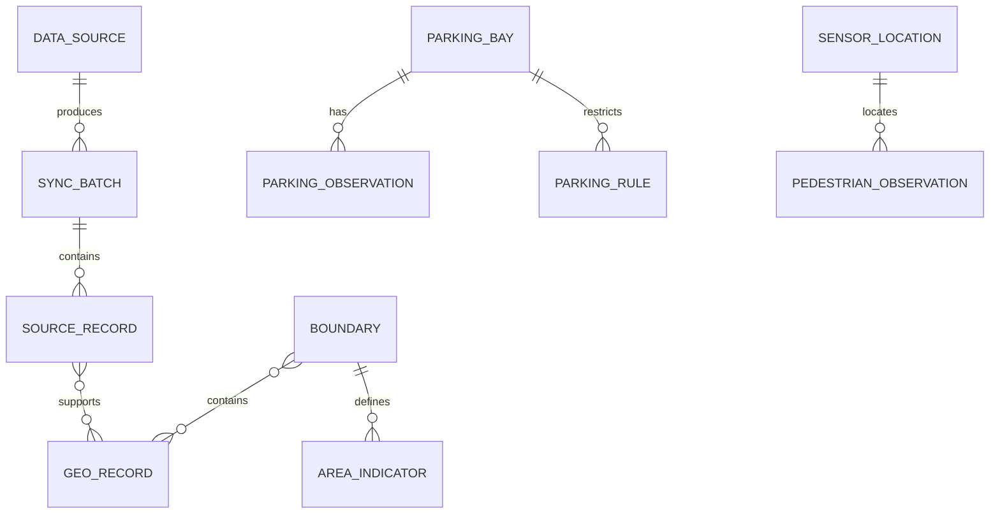

# Data Model: 来源、位置、时间与状态

**目标**：公开数据先以来源本身的事实和时间为准，再产生统一的可查询记录。所有时间在存储中统一为 UTC timestamp；展示时转换为 `Australia/Melbourne`。所有坐标采用 WGS84，经纬度不得颠倒。字段缺失用 `null` 和原因表示，不用零或空字符串冒充事实。

## 关系概览

## Core entities

### DataSource

| Field | Type | Rule |
| --- | --- | --- |
| `source_id` | string | 稳定、唯一，例如 `melbourne.parking.sensors`；规范值见 [source-ids.md](source-ids.md) |
| `legacy_ids` | string[] | 若既有设计使用不同 ID，只作可追溯别名；规范化记录只写一个规范 `source_id` |
| `provider`, `dataset_title`, `landing_url` | string | 来源页面和机构必须可追溯 |
| `topic` | string | 来源主主题；与记录级 `GeoRecord.topic` 分开 |
| `scope` | enum | `city`, `greater_melbourne`, `victoria`, `global` |
| `coverage_area_refs`, `coverage_from`, `coverage_to` | boundary refs／timestamps／null | 已核实的实际空间/时间覆盖；`scope` 只是粗粒度摘要，未知覆盖不得当作全域 |
| `cadence_seconds` | integer／null | 静态或不定期来源为 null |
| `check_interval_seconds` | integer／null | 需要持续监测的动态来源必填；更新不定期时供 SC-002 计算时效预算，不表示上游保证按此发布 |
| `admission_evidence`, `connector_owner` | JSON／string | 许可证据、字段范围、完整性规则、配额、凭据 secret 名称、保留期限和负责人；未知准入条件保持 `review_required`，不得写 secret 值 |
| `license_status` | enum | `verified_open`, `restricted`, `review_required` |
| `access_status` | enum | `candidate`, `ready`, `active`, `paused` |
| `last_checked_at`, `last_success_at`, `last_source_update_at` | timestamp／null | 分开追踪抓取与上游发布时间 |
| `record_granularity` | string | 如 `bay`, `sensor_minute`, `article`, `LGA_year` |

### SyncBatch

| Field | Type | Rule |
| --- | --- | --- |
| `batch_id` | string | `source_id + window + source_revision` 的稳定摘要 |
| `source_id`, `window_from`, `window_to` | string, timestamps | 精确记录本次覆盖窗口 |
| `started_at`, `finished_at` | timestamps | 完成前 `finished_at = null` |
| `state` | enum | `running` → `validated` → `published`；任何阶段可到 `failed` |
| `raw_uri`, `staging_uris` | URI／URI[] | 仅保存来源条款允许的字段；短期导入文件按许可与保留期限清理，原始对象不可就地改写但可按条款删除 |
| `published_at` | timestamp／null | BigQuery 完整写入并通过 SQL 校验后才填写；查询视图仅接受 `published` 批次 |
| `input_count`, `output_count`, `rejected_count` | integer | 非负；失败批次不得算作最新成功 |
| `checkpoint_before`, `checkpoint_after` | string／null | `checkpoint_after` 只随成功发布生效 |
| `error_code` | string／null | 失败时必填；日志不含令牌与原始敏感内容 |

规范化事实表均包含 `batch_id`、`source_id`、`schema_version`、`fetched_at` 与稳定逻辑键；同一批次重试产生的物理重复行，在已发布视图中按稳定键与版本确定性去重。`sync_batches` 的发布标记只在所有行可查询且校验通过后写入。清单以 GCS 对象 generation 做条件更新。两个任务读取相同旧版本时，最多一个推进清单；另一个重新读取后判断该窗口是否已有新版本。清单记录已完成窗口集合，只将 checkpoint 推到**无缺口的最高连续窗口**；较晚窗口先成功不会吞掉失败窗口。

### SourceRecord

| Field | Type | Rule |
| --- | --- | --- |
| `source_record_id` | string | `source_id + native_id`；无原生 ID 时用规范化 URL 与来源时间的摘要 |
| `version_id` | string | 来源更新时间与内容摘要组合；更正产生新版本 |
| `batch_id`, `source_id` | string | 必须引用已存在批次和已知来源；批次发布前该行不对外可见 |
| `original_url`, `raw_uri` | URI／null | 至少有一个可追溯引用；受许可限制时仅保留允许的链接／元数据 |
| `published_at`, `observed_at`, `fetched_at` | timestamp／null | `fetched_at` 必填，其他缺失有原因 |
| `first_accessible_at` | timestamp／null | 首次在上游查询窗口中可见的时间；用于新鲜度抽样，若无法证明则为 null 且该记录不冒充已测得时延 |
| `time_missing_reason` | string／null | 来源未给 `published_at`/`observed_at` 时记录原因，不能仅以 `fetched_at` 冒充来源时间 |
| `valid_from`, `valid_to` | timestamp／null | 活动／规则／中断的生效区间；`valid_to` 不早于 `valid_from` |
| `record_status` | enum | `active`, `corrected`, `cancelled`, `withdrawn` |
| `assertion_kind` | enum | `observation`, `report`, `prediction`, `plan`；来源记录保留原始事实类型，不以抓取时间推断 |
| `rights_status` | enum | 从来源许可继承；不能扩张可公开内容 |

同一 `source_record_id` 可有多个版本；“当前”版本由明确的来源更新时间、状态和确定性的 tie-break 规则选择，不以最近抓取时间覆盖较新的来源版本。

### GeoRecord

| Field | Type | Rule |
| --- | --- | --- |
| `geo_record_id` | string | 稳定逻辑事件／观测 ID；合并报道仍只保留一个逻辑事件 |
| `topic` | enum | `news`, `crime_news`, `parking`, `pedestrian`, `road_disruption`, `event`, `planning`, `other` |
| `assertion_kind` | enum | `observation`, `report`, `prediction`, `plan`；与生命周期及新鲜度分开。本阶段无预测来源；预测记录不能标为现场观测 |
| `title`, `summary` | string／null | 仅包含许可允许的内容 |
| `geometry_geojson` | string／null | Point、LineString 或 Polygon；无可靠位置则 null |
| `centroid_lat`, `centroid_lon` | number／null | 只在有可靠 geometry 时提供；经度 -180..180、纬度 -90..90 |
| `location_role` | enum | `event_site`, `mentioned_place`, `sensor_site`, `area_only`, `unknown` |
| `location_confidence` | enum | `source_coordinate`, `official_join`, `resolved_area`, `unverified` |
| `area_refs` | boundary code/version[] | 保留所用边界版本；区域统计不伪造点位 |
| `observed_at`, `valid_from`, `valid_to`, `fetched_at` | timestamp／null | 支持分别查询报道时间、事发／生效时间及抓取时间 |
| `freshness_state` | enum | `current`, `late`, `stale`, `unknown`，由来源节奏和时间计算 |
| `record_status` | enum | `active`, `planned`, `cancelled`, `resolved`, `withdrawn` |

只读查询列 `is_prediction` 由 `assertion_kind = prediction` 推导，不再单独存储，避免两列矛盾。当前视图可排除取消／解除／撤稿；受许可控制的历史视图保留这些状态供条件查询。`GeoRecordSource` 关联表保存 `geo_record_id`、`source_record_id`、`version_id`、`evidence_role`。多个报道可以支持同一逻辑事件，但不得丢失原文链接。仅有 `mentioned_place` 的新闻不能自动升级为 `event_site`。

`freshness_state` 依 [quality-rules.md](quality-rules.md#4-时间新鲜度与查询空结果) 中的来源时间与检查预算计算；来源失败与“没有匹配事件”是不同结果。对空结果，查询层应同时读取来源覆盖与健康视图并产生类别级 `coverage_status`，该值不是 `GeoRecord` 物理字段。

### Boundary

`boundary_id`、`scheme`（CoM municipal、ASGS LGA／SA2／GCCSA 等）、`code`、`name`、`vintage`、`geometry_geojson`、`valid_from`、`valid_to`、`source_record_id`。唯一键为 `scheme + code + vintage`。跨年份比较必须注明映射或使用各自年份边界。

### ParkingBay, ParkingObservation, ParkingRule

- `ParkingBay`：`bay_id`、`marker_id`、位置、来源、有效期、是否公开可用设施。车位多边形和传感器通过 `marker_id` 关联。
- `ParkingObservation`：`sensor_id`、`bay_id`、`observed_at`、`occupied`（true／false／null）、`fetched_at`、`source_record_id`。传感器通过 `bay_id` 关联规则。
- `ParkingRule`：`bay_id`、星期／时段、节假日适用、类别、时长、豁免、有效期、`source_record_id`。同一车位允许不重叠的多条时段规则。
- 查询结果的 `may_park_now` 不从占用状态单独推断；规则缺失、冲突或过期时只能为 `unknown`。

### SensorLocation, PedestrianObservation

- `SensorLocation`：`sensor_id`、位置、设备状态、`valid_from`、`valid_to`、来源。迁移产生新的位置版本。
- `PedestrianObservation`：`sensor_id`、分钟 `observed_at`、方向计数和总计、`source_record_id`。唯一键为 `sensor_id + observed_at`，来源重复记录按版本规则处理。缺行不是零。

### AreaIndicator

`indicator_id`、`boundary_id`、`period_start`、`period_end`、`value`、`unit`、`status`（`observed`, `suppressed`, `missing`）、`assertion_kind`、`source_record_id`、`definition`。本阶段官方统计的 `assertion_kind = observation`；日后若加入预测指标须设为 `prediction` 并在查询中派生 `is_prediction`。只有 `observed` 状态可有数值；`suppressed` 与 `missing` 不填零。例：CSA 录案量、ABS 人口、季度租金。

## Validation invariants

1. 任意已发布记录可逆向找到来源、原始链接或批次对象及时间；未验证许可的内容不得进入公开列。
2. 来源时间与抓取时间独立；迟到的旧来源版本不得覆盖新版本。
3. 地理坐标必须落在合法范围；`resolved_area` 不得填街道级精确点。
4. 取消、撤稿或已解决状态保留历史版本，但不出现在默认“当前活动／事件”结果。
5. 同一批次重放后逻辑记录数、当前版本选择及 checkpoint 与重放前一致。
6. `assertion_kind`、`record_status`、`freshness_state` 分别回答事实类型、生命周期和新鲜度；历史查询可找到取消／解除／撤稿版本，当前查询不把这些版本当作正在发生。
7. 许可状态变更时，对外视图立即停止提供受限字段；原始及临时副本按来源许可删除，保留不含受限内容的批次审计信息。
