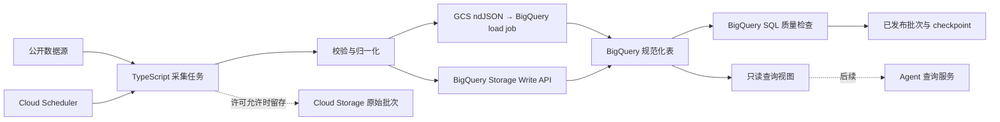

# Implementation Plan: Melbourne 公共数据获取与统一整理

**Branch**: `main`（`setup-plan.sh` 在无 feature 分支时输出目录名作为标识） | **Date**: 2026-09-28 | **Spec**: [spec.md](spec.md)

**Input**: [数据聚合 spec](spec.md)；本轮聚焦数据获取。用户指定 TypeScript、Node.js、GCP，并在评估后决定统一使用 BigQuery。

## Summary

在 GCP 上运行独立的 TypeScript/Node.js 数据采集任务，按每个来源的发布节奏获取并归一化墨尔本公共数据。Cloud Storage 在许可允许时保留有来源与版本信息的原始批次；**BigQuery 从首批来源开始就是规范化数据、质量验证和统一查询的主存储**。低频／大批次数据经 GCS 临时 ndJSON 用 BigQuery load job 导入；高频来源使用 Storage Write API。完整批次经 BigQuery 校验后才发布。地图 UI 与 Agent SQL 生成不在本轮实现范围内。

## Technical Context

**Language/Version**: TypeScript 5.x；Node.js 24 LTS（部署版本固定到具体 patch，仓库本机的 Node 26 只用于文档阶段）。  
**Primary Dependencies**: Node 内置 `fetch`／`node:test`；`@google-cloud/storage`、`@google-cloud/bigquery`；高频写入使用 `@google-cloud/bigquery-storage`；来源特定解析库在实现任务中按格式选定。  
**Storage**: Cloud Storage（Melbourne `australia-southeast2`）在来源许可允许范围内保存不可就地改写的原始批次、短期 ndJSON 导入文件和条件更新的 checkpoint；同区域 BigQuery 保存规范化记录、发布状态及当前/历史只读查询视图。许可要求删除时可清理受限副本。  
**Testing**: Node 单元测试验证字段与日期规则；录制公开来源样本进行连接器契约测试；在隔离的 BigQuery 开发数据集运行 SQL 质量检查与跨来源查询；部署后按 [quickstart.md](quickstart.md) 做端到端检查。  
**Target Platform**: GCP Cloud Run Jobs，由 Cloud Scheduler 触发；未来查询服务运行在 Node.js Cloud Run service。  
**Project Type**: 现有 Flutter 客户端项目中的独立后端数据服务；本轮只规划 `cloud/data/`。  
**Performance Goals**: 首期 ≥10 个按 FR-002 独立计数且完成真实同步的数据集；按 SC-002 对每个持续监测的动态来源衡量 24 小时窗口与两个更新周期的 95% 可查询率，更新不定期时使用预先声明的检查间隔；同步重试不产生重复当前记录。  
**Constraints**: 来源许可与配额、15 分钟 GDELT/行人窗口、停车上游延迟、云任务至少一次触发、Cloud Run 本地文件不持久、原始资料可追溯、无明文密钥。  
**Scale/Scope**: 先覆盖 City of Melbourne 核心及大墨尔本相关来源；首批优先考虑 12 个非条件性 A 级候选，再把项目 P0 必需的 #16 GTFS Realtime、#24 历史行人及 GTFS 静态配套表提前纳入；交通和活动来源需申请密钥。Victoria Police 网页直采另行通过授权门槛。24 个已调研来源保留扩展目录。

## Constitution Check

*GATE: Phase 0 前检查，并在 Phase 1 后复核。*

项目的 `.specify/memory/constitution.md` 仍是未填写模板，没有可执行的宪章条款。依据 [system-design/AGENTS.md](../../system-design/AGENTS.md) 中已写明的项目约束进行检查：

| 项目约束 | 设计对应 | 检查 |
| --- | --- | --- |
| 只使用 GCP 云服务 | Cloud Run Jobs、Scheduler、Storage、BigQuery | 通过 |
| 产品 AI 使用 Google 模型 | 本轮不运行模型；未来 Agent 仍受该约束 | 通过 |
| 不提交密钥，使用 Secret Manager | 本地使用短期身份；第三方密钥由用户存入 Secret Manager | 通过 |
| 事实可追溯、预测与观测有区别 | 数据契约保留来源、时间、状态、证据与 `assertion_kind`；预测由查询列 `is_prediction` 明示 | 通过 |
| 现有 Flutter app 约定 | 本轮不修改 app；Node.js 是后端语言决定 | 通过 |
| 先推进既定高优先级用例 | 先交付 UC-04 行人与 UC-05 道路/GTFS 的 P0 数据前置链路；P1/P2 产品上线等项目 P0 端到端完成，停车预测 UI 不在本轮 | 通过 |

## Phase 0: Research Decisions

完整证据、备选方案及来源限制见 [research.md](research.md)。

1. **采集运行方式**：每个来源或同频来源组一个 Cloud Run Job，由 Cloud Scheduler 定时触发；不能把触发成功等同于数据批次成功。
2. **持久层**：仅将来源条款允许留存的原始内容在 GCS 按来源和时间分区保存；规范化数据直接写入 BigQuery managed tables。批次只在 SQL 校验成功后发布，checkpoint 按连续完成窗口推进。来源许可改变时停止公开并删除必须清理的受限副本。
3. **统一查询**：BigQuery 同时承担本阶段的数据质量 SQL 与后续在线 Agent 查询；高频来源使用 Storage Write API，批次与历史来源使用 GCS ndJSON load job，不再引入第二个查询引擎。
4. **安全访问**：当前写计划无需 GCP 凭据。部署前由用户本机完成 GCP 登录，云任务使用专用服务身份，第三方 API key 放入 Secret Manager；不接收聊天中的密码、私钥或令牌。
5. **地理归属**：来源坐标优先，官方边界按版本落地；新闻位置保留“事发地／仅提及／未定位”与置信度，不将含糊报道标成精确点。
6. **来源身份**：每个独立上游数据集有唯一规范 `source_id`，既有 `pedestrian-live` 等设计 ID 通过 `legacy_ids` 映射；source manifest 包含 `topic`。CLUE 就业与街区边界、GTFS 实时与静态资料分别登记为独立数据集。

## Phase 1: Design

### Acquisition sequence

| 顺序 | 来源组 | 完成标准 |
| --- | --- | --- |
| P0 数据前置 | City of Melbourne 市界、行人位置及每分钟／历史每小时计数、Transport Victoria 非计划道路中断、静态 GTFS 与 GTFS Realtime | UC-04/UC-05 所需来源时间、位置、交通警报与缺口可重放验证；历史小时资料不能补分钟缺口；产品 P0 端到端验收仍在对应用例完成 |
| 首期其余 A 级 | 路边停车传感器／车位／单车位限制、GDELT 15 分钟元数据、Ticketmaster 活动 | 停车关联、墨尔本新闻筛选、分页／限流、活动更新与取消状态可验证 |
| 首期统计 | ABS 区域边界及 Census、CSA 犯罪统计 | 边界年份与统计期配对，不把季度统计写成当前事件 |
| 条件扩展 | Victoria Police 公开新闻及其他 B 级来源 | 先完成自动获取与再利用评估；未通过时由 GDELT 或经核准的替代来源承担犯罪新闻，不计警方直采已完成 |

首期由已授权且完成真实同步的独立来源达到 ≥10，并按 [quality-rules.md](quality-rules.md) 验证八类最低覆盖、来源准入、空间证据和时效。CLUE/GTFS 配套表按各自发布数据集计数，不把分页、镜像或派生视图重复计数。警方来源不纳入保底数；犯罪新闻须额外用样本证明 GDELT 筛选能提供可追溯的维州本地报道。若覆盖不足，先调查并接入许可明确的替代报道来源；未完成前 FR-002／SC-001 不通过。Ticketmaster 不可用或覆盖不足时同样须记录活动类别未达标并调查合规替代来源。所有 24 个候选来源的连接器可由多个代理基于冻结契约并行编写，云端上线先完成项目 P0 前置链路，再按用户故事及许可门槛发布；首期部署与验收不等待 B 级来源。

### Data flow



原始批次以来源、时间窗、内容摘要和来源版本标识；重复触发使用条件写入避免覆盖。规范化行先进入 BigQuery 追加表，只有整批写入完成且 SQL 质量检查通过，才写入该批的发布标记。当前视图只含已发布批次的最新有效版本；受许可控制的历史视图可按状态检索取消、解除与撤稿版本，二者均按稳定记录 ID 与版本去重。`assertion_kind` 将观测、报道、预测、计划与生命周期状态分开，`is_prediction` 由它推导；本阶段不生成预测。GCS checkpoint 仅按**连续已完成窗口**前进，不能因较晚窗口先完成而跳过缺口。动态来源分别记录“上游最后发布时间”“首次可访问时间”和“本次抓取时间”，供 SC-002 按每个来源的 24 小时窗口、唯一新/变更记录和两个更新周期计算可查询率；更新不定期来源在接入前记录检查间隔，季度／年度批次来源另行核验，样本不足 20 条不得宣称通过。行人分钟接口仅保留最近一小时；超过窗口的中断标为分钟缺口，小时历史资料不能虚构分钟数据。

### Query engine boundary

BigQuery 从第一批数据起提供托管的并发、跨实例一致视图、`GEOGRAPHY` 空间查询和质量验证 SQL；代价是写入与查询扫描成本。采集写入身份与未来 Agent 查询身份分离。生产 Agent 只获得只读视图；后续 SQL 执行必须有表白名单、只读校验、参数化条件、结果行数限制、超时、dry run 和 `maximumBytesBilled`。本轮只建立数据查询视图，不实现 Agent 自动生成 SQL。公共 GDELT BigQuery 数据集可作优化评估，但其当前更新状态和数据所在区域须先验证，不能假定能直接与 Melbourne 区域数据跨区联查。

### Failure and provenance behavior

- 连接器独立失败；其他来源照常发布。异常来源保持上一已成功批次并标记过期，不把同步失败改写为“无记录”。
- 新闻和活动只获取、保存与公开来源条款允许的元数据与链接；警方网页和其他条款未核实来源不抓取全文。原始与临时副本遵守来源保留期限，授权缩小时停止对外提供受影响字段并删除受限副本，保留非受限批次审计信息。
- 每条规范化记录保留原始来源标识、来源 URL、来源时间、抓取时间、有效区间、位置依据、地理精度和使用条件状态。
- 数据源变更模式或字段时隔离该批次，并在健康状态记录错误；不发布部分成功的数据为完整批次。

### Artifacts

- [data-model.md](data-model.md)：实体、字段、主键、版本与状态转换。
- [source-ids.md](source-ids.md)：24 个候选来源及 CLUE／GTFS 配套数据集的规范 ID 与旧 ID 映射。
- [quality-rules.md](quality-rules.md)：来源准入、八类覆盖、地理/状态/空结果、抽样与运行预算的验收规则。
- [contracts/](contracts/)：连接器与规范化数据的稳定接口、查询数据集／视图契约。
- [quickstart.md](quickstart.md)：本地与 GCP 验证情景、预计命令、凭据边界。

## Project Structure

### Documentation (this feature)

```text
specs/001-melbourne-data-aggregation/
├── spec.md
├── data-source-candidates.md
├── plan.md
├── research.md
├── data-model.md
├── source-ids.md
├── quality-rules.md
├── quickstart.md
└── contracts/
    ├── connector.md
    └── datasets.md
```

### Source Code (repository root; planned, not created in this phase)

```text
cloud/data/
├── package.json
├── src/
│   ├── connectors/
│   ├── core/
│   ├── normalization/
│   ├── jobs/
│   └── validation/
└── test/
    ├── fixtures/
    ├── contract/
    └── integration/
```

**Structure Decision**: 利用现有 `cloud/` 后端目录建立一个 Node.js 数据包；Flutter app 继续独立。各来源连接器共用发布、版本和健康状态规则，避免按来源复制调度逻辑。

## Post-Design Constitution Check

Phase 1 的数据模型与契约仍符合上表项目约束。没有实际宪章条款或需要豁免的冲突。与现有 [architecture.md](../../system-design/architecture.md) 的草案关系：本计划确定 GCS 为原始批次留存层、BigQuery 为规范化数据和统一 SQL 层；该草案对 Firestore 当前地图数据的选择由地图 spec 和整体验证再决定，实施前应同步设计文档。
