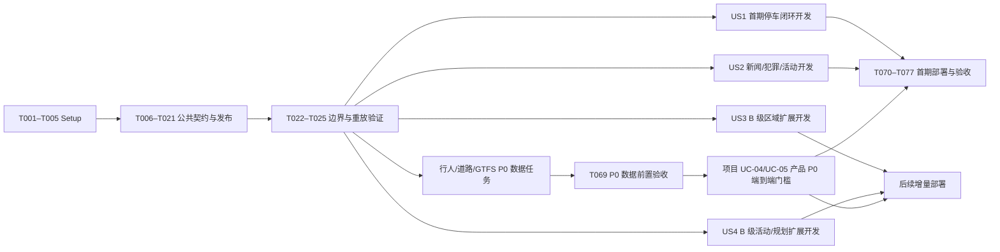

# Tasks: Melbourne 公共数据获取与统一整理

**Input**: [spec.md](spec.md)、[plan.md](plan.md)、[data-source-candidates.md](data-source-candidates.md)、[quality-rules.md](quality-rules.md)、[data-model.md](data-model.md)、[research.md](research.md)、[contracts/](contracts/)、[quickstart.md](quickstart.md)。

**Scope**: TypeScript/Node.js 采集、许可允许的 GCS 原始批次、BigQuery 规范化数据及当前/历史查询视图、GCP 定时运行；不实施地图 UI、评分模型或 Agent SQL 生成。24 个候选来源均分配独立任务；其中首期 A 级 13 个（警方直采有许可门槛），B 级 11 个。来源编号沿用候选清单，规范 `source_id` 见 [source-ids.md](source-ids.md)。`[P]` 表示在列明的前置任务完成后，与同一波次其他 `[P]` 任务可并行。

## Phase 1: Setup（共享工程）

**Goal**: 建立可复现的 Node.js 24 / TypeScript 5 数据包和可审查的 GCP 配置。此阶段编写基础设施定义，不把凭据写入仓库。

- [X] T001 建立 Node.js 24、TypeScript 5、`@google-cloud/storage`、`@google-cloud/bigquery`、`@google-cloud/bigquery-storage`、`node:test` 脚本及锁文件，固定 `ingest`、`verify`、`test` 命令于 `cloud/data/package.json`、`cloud/data/package-lock.json`。
- [X] T002 [P] 配置严格类型检查、ESM 构建和忽略 `node_modules`、构建产物与本地密钥文件，于 `cloud/data/tsconfig.json`、`cloud/data/.gitignore`。
- [X] T003 [P] 编写可在 Cloud Run Jobs 运行的 Node.js 24 容器，并固定依赖安装与非 root 执行，于 `cloud/data/Dockerfile`。
- [X] T004 [P] 编写幂等 GCP 初始化脚本：显式 `australia-southeast2`、启用 Cloud Run/Scheduler/Storage/BigQuery/BigQuery Storage/Secret Manager/Artifact Registry/IAM Credentials API，创建区域 GCS bucket、`melens_ingest`/`melens_query` 数据集及最小权限服务身份；项目 ID 由参数传入，于 `cloud/data/infra/bootstrap.sh`。
- [X] T005 [P] 记录本地 CLI 与 ADC 区别、用户经 Console 放置第三方 key 的步骤、最小 IAM、开发/生产隔离、无长期 JSON 私钥和只由集成人员执行云端变更，于 `cloud/data/infra/README.md`。

## Phase 2: Foundational（阻塞所有来源的共享契约）

**Goal**: 冻结连接器输入/输出、公共模型、BigQuery 表和发布流程；各来源代理只写自己的目录。市界与 ABS 边界在此完成，供所有故事复用。

- [X] T006 建立 `DataSource`（含覆盖范围、准入证据与负责人）、`SyncBatch`、`SourceRecord`、`GeoRecord`、`Boundary`、`AreaIndicator`、车位与行人实体类型；原样落实 `data-model.md` 的 “所有时间在存储中统一为 UTC timestamp”“所有坐标采用 WGS84，经纬度不得颠倒”“字段缺失用 `null` 和原因表示，不用零或空字符串冒充事实”，并使 `assertion_kind` 与生命周期、新鲜度独立，于 `cloud/data/src/core/types.ts`。
- [X] T007 定义 `Connector` 输入 `sourceId`、半开 UTC 窗口、`checkpoint`、`runId` 和完整性/错误返回；错误码限定 `rate_limited`、`upstream_unavailable`、`schema_changed`、`auth_failed`、`incomplete_window`、`validation_failed`，于 `cloud/data/src/core/connector.ts`。
- [X] T008 [P] 校验项目、区域、bucket、数据集和 secret **名称**配置；禁止打印密钥或令牌；缺必需值立即失败，于 `cloud/data/src/core/config.ts`。
- [X] T009 约定每个独立上游数据集独占 `index.ts`、`source.json` 和样例目录；运行时加载各 `source.json` 的规范 ID 与 `legacy_ids`，实施时对照 [source-ids.md](source-ids.md) 校验，不要求来源代理编辑中心注册表；`source_id` 必须“稳定、唯一”，清单保留 `provider`、`dataset_title`、`landing_url`、`topic`、`scope`、实际覆盖地域/时间、`cadence_seconds`、需要持续监测时的 `check_interval_seconds`、`license_status`、`access_status`、`record_granularity`、完整性规则、配额/secret 名称、许可及保留期限证据与负责人；未知准入值保持 `review_required`，按 [quality-rules.md](quality-rules.md#1-来源准入记录) 校验，于 `cloud/data/src/core/registry.ts`。
- [X] T010 [P] 实现分页/限流/`Retry-After`/退避/超时的无秘密 HTTP 客户端，并保留响应时间与来源版本，于 `cloud/data/src/core/http.ts`。
- [X] T011 实现 City of Melbourne Explore API v2.1 的分页、窗口查询和大批量 export 适配器；分页不全返回 `incomplete_window`，于 `cloud/data/src/core/opendatasoft.ts`。
- [X] T012 [P] 实现来源记录校验：`source_record_id` 用 “`source_id + native_id`；无原生 ID 时用规范化 URL 与来源时间的摘要”，`version_id` 用 “来源更新时间与内容摘要组合；更正产生新版本”，`original_url`/`raw_uri` “至少有一个可追溯引用”，`fetched_at` “必填，其他缺失有 `time_missing_reason`”，抽样记录保留 `first_accessible_at` 且无证据时为 null，`valid_to` “不早于 `valid_from`”，于 `cloud/data/src/validation/record.ts`。
- [X] T013 [P] 实现位置与状态校验：`geometry_geojson` 仅 Point/LineString/Polygon，“无可靠位置则 null”，经度 -180..180、纬度 -90..90，“只在有可靠 geometry 时提供”质心；`location_role`/`location_confidence` 依 [quality-rules.md](quality-rules.md#3-空间归属与新闻合并) 验证证据，`resolved_area` 不填精确街道点，无效坐标只隔离地理映射并保留合法来源事实，于 `cloud/data/src/validation/geography.ts`。
- [X] T014 [P] 建 BigQuery `data_sources`、`sync_batches`、`source_records`、`geo_records`、`geo_record_sources`、`boundaries`、`area_indicators`、车位及行人追加表；来源表含 `topic`/`legacy_ids`/`check_interval_seconds`、实际覆盖地域/时间及准入证据和负责人，`source_records` 含 `time_missing_reason` 与可证明时的 `first_accessible_at`，各事实表含 `batch_id`、`source_id`、`schema_version`、`fetched_at` 与稳定键，`source_records`/`geo_records`/`area_indicators` 含 `assertion_kind`，按 `DATE(fetched_at)` 分区/稳定键聚类，于 `cloud/data/sql/001_tables.sql`。
- [X] T015 创建仅暴露已发布批次的 `v_geo_records_current` 与受许可控制的 `v_geo_records_history`；历史视图可按地理、时间、主题、来源、`assertion_kind` 和取消/解除/撤稿等状态筛选，两个视图由 `assertion_kind` 推导 `is_prediction`，用 `ST_GEOGFROMGEOJSON` 产生 `GEOGRAPHY`，于 `cloud/data/sql/002_core_views.sql`。
- [X] T016 [P] 仅按来源许可保存可留存的 GCS 原始字段，支持不可就地改写、受限副本删除、内容摘要、`staging` ndJSON 按期限清理和 generation precondition 清单；checkpoint 仅推进至“无缺口的最高连续窗口”，于 `cloud/data/src/core/gcs.ts`。
- [X] T017 [P] 实现 GCS ndJSON → BigQuery 原子 load job、稳定 job ID 与重试，以及批次完成后才清理临时文件，于 `cloud/data/src/core/bigquery-load.ts`。
- [X] T018 [P] 实现高频来源 Storage Write API 写入，按默认流至少一次语义保留稳定 `batch_id`/记录 ID，不能把写入成功当作恰好一次，于 `cloud/data/src/core/bigquery-write.ts`。
- [X] T019 串联许可允许的原始存档、规范化、两种 BigQuery 写入、SQL 的不同逻辑键数/同键内容/地理/许可校验、`running → validated → published` 状态和 GCS checkpoint；许可缩小时停止公开受限字段并清理副本，失败批次不对视图可见，同批并发发布需互斥或复核，于 `cloud/data/src/core/publisher.ts`。
- [X] T020 实现 `ingest --source --from --to` 与 `--backfill`，按 manifest 选择连接器和写入路径；失败非零退出、日志无秘密，`cadence_seconds` 为 null 的静态/不定期来源不伪称实时，于 `cloud/data/src/jobs/ingest.ts`。
- [X] T021 [P] 实现 `verify --source --batch`，从 BigQuery 报告发布状态、来源时间、不同逻辑记录数、可定位数及延迟/缺口，命令输出不含原始受限内容，于 `cloud/data/src/jobs/verify.ts`。
- [X] T022 [P] 接入来源 #10 City of Melbourne 市辖边界，保留官方版本、WGS84 面和 `scheme + code + vintage` 唯一键，不把市界当大墨尔本；来源目录独占 `cloud/data/src/connectors/com_municipal_boundary/index.ts`、`cloud/data/src/connectors/com_municipal_boundary/source.json`、`cloud/data/test/fixtures/com_municipal_boundary.json`。
- [X] T023 [P] 接入来源 #11 ABS ASGS Greater Melbourne GCCSA、Victoria 州界、LGA/SA2 等边界，按发布版本导入并记录统计区代码，供海外同名地点和跨年份匹配；来源目录独占 `cloud/data/src/connectors/abs_asgs_boundaries/index.ts`、`cloud/data/src/connectors/abs_asgs_boundaries/source.json`、`cloud/data/test/fixtures/abs_asgs_boundaries.json`。
- [X] T024 建立边界版本查找与区域归属，实施 “跨年份比较必须注明映射或使用各自年份边界”，对含糊地名不虚构点，于 `cloud/data/src/normalization/areas.ts`。
- [X] T025 以分页中断、重复触发、旧版本迟到、批次失败与较晚窗口先成功场景验证 BigQuery 当前结果和 checkpoint 不变；仅对可观察行为断言，于 `cloud/data/test/integration/publish-replay.test.ts`。

**Checkpoint**: T001–T025 完成并冻结 `Connector` 与 manifest 版本后，24 个来源任务可在不同工作树分别开发。共享契约变更由一个集成人员统一处理。

**集成复核（2026-09-29）**：T032／T033／T055／T057 已成功适配共享 `Connector` 并通过注册器动态加载与单测验证；T026／T027／T028／T030／T034／T045／T046／T054／T056／T074／T075／T076 完成独立实现与单元测试。

**采集进展（2026-09-29）**：T031 已按 Transport Victoria v3 官方 schema 实现候选连接器和父事故／子影响样例，保留 API KeyID 与 20 次／分钟限额；尚无 KeyID 实时采集和来源准入，故保持未完成。T019/T025 的本地实现与重放检查已完成，完整测试为 325 通过、1 个需显式启用的 GCP 验收跳过；真实 BigQuery 当前／历史视图、两种写入路径及许可撤销仍列为 T077 云端验收门槛。

**活动进展（2026-09-29）**：T042 已有 Ticketmaster 候选连接器与样例，但使用条款限制缓存且要求快速撤除内容；统一 BigQuery 历史目前缺少已批准的来源级保留／删除机制，故来源仍不准入，活动覆盖门槛未验收。详见 `cloud/data/docs/source-policies/events-alternative.md`。

## Phase 3: User Story 1 — 可信的停车与街道状态（P1）

**Goal**: 查询车位位置、占用、停车限制、行人及道路状态，并看出每个来源的时间与过期状态。

**Independent Test**: 在有传感器覆盖的街区取得三表关联；上游断开后标为过期；传感器搬迁后分钟读数关联到当时位置。来源 #17/#20 可延后；#24 历史小时计数虽在候选清单列为 B 级，但须先完成项目 P0 的 UC-04 数据验收。

- [X] T026 [P] [US1] 接入来源 #4 City of Melbourne 路边停车传感器，保留 `marker_id`、`bay_id`、来源 `Lastupdated`、`occupied` 真/假/null 与上游延迟，不把无记录当空位；独占 `cloud/data/src/connectors/com_parking_sensors/index.ts`、`cloud/data/src/connectors/com_parking_sensors/source.json`、`cloud/data/test/fixtures/com_parking_sensors.json`。
- [X] T027 [P] [US1] 接入来源 #5 City of Melbourne 路边车位空间，以 `marker_id` 关联传感器，保留车位多边形、位置版本和数据中断标记；独占 `cloud/data/src/connectors/com_parking_bays/index.ts`、`cloud/data/src/connectors/com_parking_bays/source.json`、`cloud/data/test/fixtures/com_parking_bays.json`。
- [X] T028 [P] [US1] 接入来源 #6 City of Melbourne 单车位限制，保留 `bay_id`、星期/时段/节假日/类别/时长/豁免和规则有效期，“同一车位允许不重叠的多条时段规则”；独占 `cloud/data/src/connectors/com_parking_restrictions/index.ts`、`cloud/data/src/connectors/com_parking_restrictions/source.json`、`cloud/data/test/fixtures/com_parking_restrictions.json`。
- [X] T029 [P] [US1] 接入来源 #7 City of Melbourne 最近一小时每分钟行人计数；15 分钟重叠重取，`sensor_id + observed_at` 为唯一逻辑键，“缺行不是零”，超过最近一小时的漏取记缺口；独占 `cloud/data/src/connectors/com_pedestrian_minute/index.ts`、`cloud/data/src/connectors/com_pedestrian_minute/source.json`、`cloud/data/test/fixtures/com_pedestrian_minute.json`。
- [X] T030 [P] [US1] 接入来源 #8 City of Melbourne 行人传感器位置，保留 `sensor_id`、设备状态、`valid_from`/`valid_to`，“迁移产生新的位置版本”；独占 `cloud/data/src/connectors/com_pedestrian_locations/index.ts`、`cloud/data/src/connectors/com_pedestrian_locations/source.json`、`cloud/data/test/fixtures/com_pedestrian_locations.json`。
- [ ] T031 [P] [US1] 接入来源 #9 Transport Victoria 非计划道路中断；用 KeyID secret 引用、速率限制及记录样例开发，保留事故与受影响路段的父子关系、解除状态和来源 60 秒刷新时间；独占 `cloud/data/src/connectors/tv_road_unplanned/index.ts`、`cloud/data/src/connectors/tv_road_unplanned/source.json`、`cloud/data/test/fixtures/tv_road_unplanned.json`。
- [X] T032 [P] [US1] 接入来源 #17 City of Melbourne Transport Activity Counts，保留车辆/骑行/行人类别、五分钟采样与来源约小时级更新时间，缺时段不补零、不宣称全市街道覆盖；独占 `cloud/data/src/connectors/com_transport_activity_counts/index.ts`、`cloud/data/src/connectors/com_transport_activity_counts/source.json`、`cloud/data/test/fixtures/com_transport_activity_counts.json`。
- [X] T033 [P] [US1] 接入来源 #20 City of Melbourne 离街停车场容量与类型，仅将可公开设施标为候选；年度容量不写成实时剩余车位；独占 `cloud/data/src/connectors/com_offstreet_parks/index.ts`、`cloud/data/src/connectors/com_offstreet_parks/source.json`、`cloud/data/test/fixtures/com_offstreet_parks.json`。
- [X] T034 [P] [US1] 接入来源 #24 City of Melbourne 历史每小时行人计数，按传感器及小时/月份保留历史粒度；不得用小时数据填补缺失的分钟读数；独占 `cloud/data/src/connectors/com_pedestrian_hourly/index.ts`、`cloud/data/src/connectors/com_pedestrian_hourly/source.json`、`cloud/data/test/fixtures/com_pedestrian_hourly.json`。
- [ ] T035 [US1] 实现三表车位关联：车位多边形与传感器按 `marker_id`、传感器与规则按 `bay_id`；`occupied` 与 `may_park_now` 分开输出，按 [quality-rules.md](quality-rules.md#5-停车判定) 检查新鲜度、车辆类别、有效规则与墨尔本节假日，规则缺失、冲突或过期时返回 `unknown`，于 `cloud/data/src/normalization/parking.ts`。

**T035 上游阻碍（2026-09-29）**：当前 City of Melbourne v2.1 API 的车位／传感器行没有页面所述的 `marker_id`，传感器行也没有规则 `bay_id`；车位给的是位置点而非页面所述多边形。限制规则页面称数据静态且最近处理于 2022 年。已修正空键处理并让无已核实三表关联、规则有效期的 `mayParkNow` 保持 `unknown`，不把旧规则和空置误判为可停；样本和后续准入条件见 `cloud/data/docs/source-policies/parking-join.md`。T035 继续待真实键映射和当前规则证据。
- [X] T036 [P] [US1] 按 `sensor_id` 与位置有效时间关联行人分钟/小时观测；迁移、停用或缺位置时保留未定位和真实粒度，于 `cloud/data/src/normalization/pedestrian.ts`。
- [ ] T037 [US1] 发布 `v_parking_current`，分别显示占用时间、规则时间、来源、时效与 `may_park_now`，仅用已发布批次，于 `cloud/data/sql/003_parking_views.sql`。
- [X] T038 [P] [US1] 发布行人、道路与其他街道观测的地理/时间视图，解除的道路事故不再为当前事件，来源延迟不写成“实时”，于 `cloud/data/sql/004_street_views.sql`。
- [ ] T039 [US1] 按 [quality-rules.md](quality-rules.md#6-抽样与运行准入) 验证完整车位、规则缺失/冲突/过期、节假日依据不足、行人传感器迁移、缺分钟、道路解除和来源中断；覆盖 SC-002/SC-005 的可观察结果，于 `cloud/data/test/integration/us1-street.test.ts`。

**T037/T039 当前状态**：SQL 视图和本地集成样例已就绪，但 T035 的真实三表映射与当前规则仍缺失。2026-09-30 将视图收紧为仅在已核实唯一 `marker_id` 时展示占用；不直接按同名 `bay_id` 把限制规则关联到车位，也不输出 `may_park_now = yes`。因此 T037 的规则关联和 T039 的 SC-005 真实样本尚未验收。

**五任务并行进度（2026-10-01）**：T031/T061/T035/T037/T039 各由一个 subagent 开发并完成工程交付。道路加入完整／空快照证据和当前成员筛选；T061 从自身官方字典确认 Victorian local time，T031 仍不推断时区。新版私有云端读取分别得到 305 和 9,603 条道路记录，零拒绝；均未发布。真实 BigQuery 道路／GTFS／开发快照 SQL 3/3、停车 SQL 1/1 通过，开发环境视图已更新。停车判定修复无效或未知规则、节假日和迁移等误判，并按市府元数据将停车传感器频率修正为 120 秒。来源准入／重复发布、三表及当前规则证据、SC-002/SC-005 实测仍未齐，五项继续保持未勾选；见 `cloud/data/docs/validation/five-task-parallel-2026-10-01.md`。

**Checkpoint**: A 级来源 #4–#9 与 T035–T039 满足本故事；#24 须提前完成 P0 数据前置验收，B 级 #17/#20 可在同一接口下增量发布。

**历史行人复核（2026-09-29）**：T034 的小时计数已有样例和 Connector。官方 [小时计数说明](https://data.melbourne.vic.gov.au/explore/dataset/pedestrian-counting-system-monthly-counts-per-hour/) 对发布节奏有“每月”与质量栏“每日”的不一致描述，故清单仅规定每日检查，不声明确定发布周期。已让夏令时重复／不存在的本地小时失败关闭，不能据此伪造 UTC 观测；仍待真实窗口采集、异常小时处理策略及来源准入。

## Phase 4: User Story 2 — 附近新闻与犯罪资讯（P1）

**Goal**: 提供可追溯的墨尔本新闻、犯罪报道、季度犯罪统计和活动来源；准确区分事发地、地点提及与区域统计。警方直采仅在许可核实后加入。

**Independent Test**: Melbourne VIC、Melbourne FL、多地点、重复 URL、更正/撤稿和季度统计样本均得到预期类型及位置；警方网页未通过许可门槛时不把它计作已接入来源，GDELT 犯罪报道不足则按 T050–T051 寻找合规替代。

- [X] T040 [P] [US2] 接入来源 #1 GDELT 15 分钟新闻/GKG 元数据与 URL，按发布窗口和稳定文章/事件 ID 增量获取，保留原始地名与报道时间，不下载未经许可正文；独占 `cloud/data/src/connectors/gdelt/index.ts`、`cloud/data/src/connectors/gdelt/source.json`、`cloud/data/test/fixtures/gdelt.json`。
- [X] T041 [P] [US2] 接入来源 #3 Crime Statistics Agency 季度犯罪统计，保留 LGA/统计期/地域代码和 `observed`、`suppressed`、`missing`，不输出逐街警情；独占 `cloud/data/src/connectors/csa_recorded_offences/index.ts`、`cloud/data/src/connectors/csa_recorded_offences/source.json`、`cloud/data/test/fixtures/csa_recorded_offences.json`。
- [ ] T042 [P] [US2] 接入来源 #12 Ticketmaster Discovery API，按澳洲/墨尔本/时间分页，key 仅经 Secret Manager 注入；活动原生 ID 的改期/取消生成新版本，保存场馆坐标与来源链接，先复核使用条款；不可用或未达 [活动覆盖门槛](quality-rules.md#2-八类信息的首期覆盖) 时记录未达标并调查合规替代来源，未补足前 SC-001 不通过；独占 `cloud/data/src/connectors/ticketmaster/index.ts`、`cloud/data/src/connectors/ticketmaster/source.json`、`cloud/data/test/fixtures/ticketmaster.json`，结论记于 `cloud/data/docs/source-policies/events-alternative.md`。
- [X] T043 [P] [US2] 核查来源 #2 Victoria Police 新闻的自动访问、再利用、保存字段与刷新限制，记录官方证据和允许/不允许结论；未通过时记录 `review_required` 且不抓取正文，记者专用邮件订阅不作为接口，于 `cloud/data/docs/source-policies/victoria-police.md`。
- [ ] T044 [US2] 仅在 T043 允许后接入来源 #2 Victoria Police 公开新闻，保留许可允许的元数据/原文链接、报道日期和宽泛位置；不把该条件性来源计入首期保底数；独占 `cloud/data/src/connectors/victoria_police/index.ts`、`cloud/data/src/connectors/victoria_police/source.json`、`cloud/data/test/fixtures/victoria_police.json`。
- [X] T045 [US2] 用官方边界和来源位置证据识别 City of Melbourne、Greater Melbourne、Victoria 与海外同名地；按 [quality-rules.md](quality-rules.md#3-空间归属与新闻合并) 将仅提及地点保留 `mentioned_place`，区域级结果不伪造精确点，无效坐标隔离地理映射，于 `cloud/data/src/normalization/news-location.ts`。
- [X] T046 [P] [US2] 按来源原生 ID、规范化 URL 和 [quality-rules.md](quality-rules.md#3-空间归属与新闻合并) 的跨来源两项独立证据门槛合并重复报道，冲突时不合并；保留 `GeoRecordSource` 的每个原文链接，来源更正/撤稿保留历史版本，于 `cloud/data/src/normalization/news-dedup.ts`。
- [X] T047 [US2] 发布新闻/犯罪报道与 CSA 区域统计分开的当前和历史查询视图，公开列受 `rights_status` 限制；更正/撤稿可按状态追溯，`crime_news` 不转成犯罪率，于 `cloud/data/sql/005_news_views.sql`。
- [ ] T048 [US2] 以预先固定的维州事发、同名海外地、仅提及和多地点新闻各至少 10 条及双人裁定基准，另用重复报道、警方/统计混合、取消活动样本验证 FR-009/FR-010、SC-004 和来源可追溯，于 `cloud/data/test/integration/us2-news.test.ts`。
- [X] T049 [US2] 按 [quality-rules.md](quality-rules.md#2-八类信息的首期覆盖) 的最近 30 天、至少 5 个不同报道和 2 个发布日期核验 GDELT 墨尔本犯罪新闻覆盖、警方许可结果和首期来源计数；证据不足时标记 FR-002／SC-001 未达标并触发 T050，于 `cloud/data/docs/validation/crime-news-coverage.md`。
- [X] T050 [US2] 若 T049 发现犯罪新闻覆盖不足，调查许可明确、能按维州地理证据筛选的本地报道来源，记录公开入口、再利用条款、更新节奏与字段映射于 `cloud/data/docs/source-policies/local-crime-news-alternative.md`；选定来源后由集成人员在 `specs/001-melbourne-data-aggregation/source-ids.md` 分配规范 ID。若 GDELT 已达标则记录不启动替代来源的依据。
- [ ] T051 [US2] 仅在 T050 选定许可合规的替代来源后接入其元数据与原文链接，沿用 T045/T046 的地理和去重规则，独占 `cloud/data/src/connectors/local_crime_news_alt/index.ts`、`cloud/data/src/connectors/local_crime_news_alt/source.json`、`cloud/data/test/fixtures/local_crime_news_alt.json`；未选定时 FR-002／SC-001 保持未达标。

**Checkpoint**: GDELT/CSA/Ticketmaster 的样例和查询可独立运行；Victoria Police 为条件性扩展，不计入“≥10 个已核实来源”的保底数。犯罪新闻覆盖不足时 T050–T051 是 FR-002／SC-001 的必需补救路径。

## Phase 5: User Story 3 — 比较生活与工作区域（P2）

**Goal**: 保留人口、就业、租金、微气候、规划和开发资料的原始地域、边界版本、统计期及缺失状态。

**Independent Test**: 两个 LGA/SA2 查询返回可比指标及来源；不同年份/地域单位不直接比较，缺失/抑制值不是零。

- [X] T052 [P] [US3] 接入来源 #13 ABS Census DataPacks，保留 Census 年份、指标定义、SA1/SA2 等地域代码和同版 ASGS `vintage`；独占 `cloud/data/src/connectors/abs_census/index.ts`、`cloud/data/src/connectors/abs_census/source.json`、`cloud/data/test/fixtures/abs_census.json`。官方 SA1／SA2／LGA ZIP 按范围读取 G01／G02，实读 32,176 条地区表记录及九项选定指标；已通过许可准入并在开发集发布／重放 144,792 指标，其中 3,969 匹配 2021 LGA/SA2 同版边界；仅一个统计期，区域类别门槛仍未完成。
- [X] T053 [P] [US3] 接入来源 #14 City of Melbourne CLUE 分街区就业及配套 CLUE 街区边界，保留 block ID、年度、行业和抑制单元，不补零；同一代理独占两个**独立登记**的数据集目录 `cloud/data/src/connectors/com_clue_employment/index.ts`、`cloud/data/src/connectors/com_clue_employment/source.json`、`cloud/data/src/connectors/com_clue_blocks/index.ts`、`cloud/data/src/connectors/com_clue_blocks/source.json` 及各自样例 `cloud/data/test/fixtures/com_clue_employment.json`、`cloud/data/test/fixtures/com_clue_blocks.json`。
- [X] T054 [P] [US3] 接入来源 #18 City of Melbourne 微气候传感器，保留温度/湿度/风/颗粒物/噪声的观测时刻、单位、缺测与当前设备依据，不把历史位置表当现有清单；独占 `cloud/data/src/connectors/com_microclimate/index.ts`、`cloud/data/src/connectors/com_microclimate/source.json`、`cloud/data/test/fixtures/com_microclimate.json`。
- [X] T055 [P] [US3] 接入来源 #21 Homes Victoria 季度租金，保留季度、LGA/郊区地域、统计口径与空值，不当作当前挂牌租金；独占 `cloud/data/src/connectors/homes_victoria_rents/index.ts`、`cloud/data/src/connectors/homes_victoria_rents/source.json`、`cloud/data/test/fixtures/homes_victoria_rents.json`。官方目录发现 XLSX 后按七张房型表解析，真实读取 58,618 条记录；已通过许可准入并发布／重放 Jun/Sep 2025 两季度 1,106 条；官方统计地域版次仍缺，区域边界保持未匹配。
- [X] T056 [P] [US3] 接入来源 #22 Vicmap Planning zones/overlays，保留多边形、覆盖层类别、发布版本与有效时间；规划现状不自动标为项目获批；独占 `cloud/data/src/connectors/vicmap_planning/index.ts`、`cloud/data/src/connectors/vicmap_planning/source.json`、`cloud/data/test/fixtures/vicmap_planning.json`。
- [X] T057 [P] [US3] 接入来源 #23 City of Melbourne Development Activity Monitor，保留项目点位、月度更新及 `mooted`/`approved`/`under_construction`/`completed` 来源状态，不合并为统一“已获批”；独占 `cloud/data/src/connectors/com_development_monitor/index.ts`、`cloud/data/src/connectors/com_development_monitor/source.json`、`cloud/data/test/fixtures/com_development_monitor.json`。
- [X] T058 [US3] 将 ABS/CSA/CLUE/租金映射为 `AreaIndicator`，本阶段官方统计 `assertion_kind = observation`；`status` 仅 `observed`/`suppressed`/`missing`，“只有 `observed` 状态可有数值；`suppressed` 与 `missing` 不填零”，跨年比较要求明确边界映射，于 `cloud/data/src/normalization/area-indicators.ts`。
- [X] T059 [US3] 发布保留统计期、单位、统计地域与边界版本的 `v_area_indicators`，包含 `assertion_kind` 与派生 `is_prediction`，区域缺项显式保留，不跨版本静默 join，于 `cloud/data/sql/006_area_views.sql`。
- [X] T060 [US3] 验证两个区域、两个年份、不同地理单元、抑制值/缺值和规划状态样本，能按来源追溯，于 `cloud/data/test/integration/us3-area.test.ts`。

**Checkpoint**: 此阶段的来源可各自开发；T058–T060 在所需来源样本齐备后合并。

## Phase 6: User Story 4 — 活动、交通及规划变化（P2）

**Goal**: 分开呈现已发生、计划中、取消/解除和长期规划资料；复用 US2 活动来源与 US3 规划资料。

**Independent Test**: 同一区域本周活动、未来道路工程、交通警报、规划区域按各自有效时间查询；取消活动和解除事故不再是当前事件。

- [ ] T061 [P] [US4] 接入来源 #15 Transport Victoria 计划道路中断，保留工程开始/结束、受影响路段及 KeyID 限额，未来事件保持 `planned`；独占 `cloud/data/src/connectors/tv_road_planned/index.ts`、`cloud/data/src/connectors/tv_road_planned/source.json`、`cloud/data/test/fixtures/tv_road_planned.json`。
- [X] T062 [P] [US4] 为来源 #16 准备 Transport Victoria 静态 GTFS 站点/路线版本供实时 feed 关联，记录 mode 和有效版本；独占 `cloud/data/src/connectors/tv_gtfs_static/index.ts`、`cloud/data/src/connectors/tv_gtfs_static/source.json`、`cloud/data/test/fixtures/tv_gtfs_static.json`。
- [ ] T063 [P] [US4] 接入来源 #16 Transport Victoria GTFS Realtime Service Alerts，使用受限 KeyID、解析 protobuf、保留 alert ID/路线/站点/生效区间与取消，记录不同交通模式覆盖，不把未覆盖 bus 当“无事故”；独占 `cloud/data/src/connectors/tv_gtfs_realtime/index.ts`、`cloud/data/src/connectors/tv_gtfs_realtime/source.json`、`cloud/data/test/fixtures/tv_gtfs_realtime.json`。
- [X] T064 [P] [US4] 核查来源 #19 VicEmergency 页面或正式 feed 的自动访问、缓存、再利用和位置精度条件，记录允许/不允许及证据；未通过时记录 `review_required` 且不抓取网页正文，于 `cloud/data/docs/source-policies/vic-emergency.md`。
- [ ] T065 [US4] 仅在 T064 允许后接入来源 #19 VicEmergency 当前事件/警报，保留官方事件 ID、区域级位置和有效时间；独占 `cloud/data/src/connectors/vic_emergency/index.ts`、`cloud/data/src/connectors/vic_emergency/source.json`、`cloud/data/test/fixtures/vic_emergency.json`。
- [ ] T066 [US4] 将静态 GTFS 站点/路线与实时 alert 按版本/ID 关联，缺静态映射时保留来源实体而不虚构位置，于 `cloud/data/src/normalization/gtfs-alerts.ts`。
- [X] T067 [US4] 发布活动、道路/交通中断、规划分区与开发变化视图；VicEmergency 仅在 T064 许可通过且 T065 实际接入后加入，按 `valid_from`/`valid_to` 和状态区分当前、未来、已解除，于 `cloud/data/sql/007_changes_views.sql`。
- [X] T068 [US4] 验证活动改期/取消、未来工程、GTFS 路线警报、事故解除、宽泛应急区域和规划状态，于 `cloud/data/test/integration/us4-changes.test.ts`。

**Checkpoint**: T061/T062/T063 和 T064 可并行；T065 必须等许可结论。US4 查询视图复用 T042 Ticketmaster 与 T056/T057 规划数据。

**GTFS 复核（2026-09-30）**：T062 已用官方 [GTFS Schedule](https://opendata.transport.vic.gov.au/dataset/gtfs-schedule) 实际读取验证：按字节范围只取火车／电车子归档，检查 HTTP Content-Range、版本验证头与 ZIP 校验；当前读取 60 条路线、4,485 个站点、96,483 个 trip 和 3,062 个路线／站点关联。上游子归档缺少 `feed_info`，故版本明确标为归档验证头衍生，有效日历范围保持未知；不能据此声称与实时 feed 版本相同。T066 的关联函数现在只接受发布方 `feed_info.feed_version` 与实时版本严格一致；归档校验版本一律保持 `version_unverified`。生产采集仍未传递可核实的静态快照和实时 KeyID，T066 保持未完成。

## Phase 7: Polish & Cross-Cutting Concerns

**Goal**: 首期 A 级来源达到准入与八类覆盖后即可独立部署和验收；B 级来源与条件性来源随后增量上线。记录时效、权限和成本，未完成来源明确列出。

- [ ] T069 对 UC-04／UC-05 的 P0 数据前置链路单独验收：行人分钟/历史计数与位置版本、非计划道路中断、GTFS 静态站点与实时警报可分别按来源时间和地理证据查询，缺口不补零；此项只证明本 feature 的数据前置条件，项目 P0 产品端到端由对应 UC 验收，于 `cloud/data/test/integration/p0-pedestrian-transport.test.ts`。

**T069 本地进度**：离线集成测试已覆盖行人分钟/小时与位置迁移、缺测不补零、道路父子影响和 GTFS 警报定位失败关闭（3 项通过）。用户已将 Key 加入 Secret Manager；T031/T063 私有云端实测已成功。位置历史已从已发布 BigQuery 恢复，并产生不可变闭合事实；GTFS 已接通静态引用读取与每模式完整快照成员。行人缺口／停用／冲突与 GTFS 空快照的生产 SQL 已通过真实 BigQuery 检查。仍缺道路时间依据、实际 P0 来源准入／重复发布、可证明的静态同版关联及开发集联合查询，故保留未完成。
- [X] T070 将**选定的**已实现且许可通过的来源按各自 cadence 增量部署到 Cloud Run Jobs，建立 Cloud Scheduler 调度和 Secret Manager **引用**；脚本可先只发布 P0／首期 A 级来源，后续再发布 B 级，仅集成人员执行项目级变更，于 `cloud/data/infra/deploy.sh`。

**T070 开发环境进度（2026-10-01）**：六个选定且已准入来源均已完成独立 Cloud Run Job 的真实执行验证，配有专用身份、请求及查询上限；两个每日快照检查调度已启用，预算暂停允许列表已接入。开发项目已通过实际 Scheduler 触发；租金完整历史发布 58,618 条记录，首次自然调度仍待下一次 01:20 UTC 观察。T070 的本波选定来源部署已完成。逐来源运行和调度记录见 `cloud/data/docs/validation/source-deployment-2026-10-01.md`。本波不激活仍为 candidate 的 P0 来源，不代表 ≥10 来源、八类覆盖或首期产品发布。
- [ ] T071 [P] 定义每来源调度、重叠窗口、回补策略和成本上限；不定期动态来源接入前声明 `check_interval_seconds`，生产部署前填写每来源每日请求上限、BigQuery 单次计费字节上限和项目月度预算数值及 50%/80%/100% 告警，达到上限按 [quality-rules.md](quality-rules.md#6-抽样与运行准入) 停止相应任务；行人最近一小时 15 分钟重取、道路约 60 秒、季度/静态来源按发布版本，避免分钟级 load job 滥用，配置于 `cloud/data/infra/schedules.json`。

**T071 预算进度（2026-10-01）**：项目月度 AUD 100、50%/80%/100% 当期支出告警已读回，默认账单 IAM 收件人启用。私有 Cloud Run、认证 Pub/Sub push 与专用 IAM 已部署；普通账单通知已自然投递，Pacific 月界修复后真实阈值烟雾测试暂停临时调度，重复消息暂停零项，临时资源已清理。本轮六个已准入来源的专属身份、对象权限与作业绑定已实际读回；预算暂停允许列表已刷新为两个每日来源调度。GCS 并发锁／每日及执行请求限额、BigQuery 单次扫描上限均已云端验证，四个全局 enforcement 标志为 true。真实重放中验证查询超过 100/150 MB 后被拒绝，完整历史租金已成功，六个选定来源的单次查询上限现统一为 500 MB，以适应共享校验表增长；租金与 Census 的作业时限为 1,800 秒。剩余 P0 来源的身份、成本参数与分钟级查询总成本仍待完成，T071 保持未完成；预算通知不构成硬性停费。证据见 `cloud/data/docs/validation/budget-response.md`、`cloud-guards.md` 和 `source-deployment-2026-10-01.md`。
- [X] T072 [P] 按 [quality-rules.md](quality-rules.md#4-时间新鲜度与查询空结果) 的最近成功检查与两倍检查预算，计算最近检查、最近成功、上游最新时间、失败码、数据缺口及 `current`/`late`/`stale`/`unknown`；上游明确无变化不因旧记录时间被误报为抓取失败，不把同步失败写成“无记录”，于 `cloud/data/src/core/health.ts`。
- [X] T073 创建 `v_source_health`、`v_source_coverage` 与来源异常延迟查询，使空结果仍可按覆盖与健康区分没有匹配、未覆盖及来源故障；生产查询身份仅能访问已批准的 `melens_query` 视图，不能访问原始对象或秘密，于 `cloud/data/sql/008_health_views.sql`。
- [X] T074 [P] 验证失败来源、恢复后重放、延迟/过期状态、健康来源无匹配、地区未覆盖及至少一次调度下的逻辑去重；空记录不得单独当作“无事件”，于 `cloud/data/test/integration/source-health.test.ts`。
- [X] T075 [P] 写操作手册：新增连接器、回补、GCS 清单竞争、BigQuery 成本/配额与预算告警、失败批次隔离、原始/临时资料保留期限与许可撤销删除、密钥撤销时停调度/撤权/轮换，于 `cloud/data/docs/operations.md`。
- [X] T076 [P] 对照 [source-ids.md](source-ids.md) 与 [quality-rules.md](quality-rules.md) 记录 24 个候选来源及配套表的规范 `source_id`、旧 ID、任务号、A/B、实际地域/时间覆盖、完整性和配额证据、维护负责人、许可/KeyID、样例/真实同步及八类样本门槛状态；明确 Police/VicEmergency 条件性及 CLUE/GTFS 配套表，于 `cloud/data/docs/source-coverage.md`。
- [ ] T077 按 `quickstart.md` 与 [quality-rules.md](quality-rules.md) 在 BigQuery 开发数据集和已部署的**首期来源**上验收：≥10 个按 FR-002 独立计数且真实同步的合规数据集达到八类最低样本门槛；SC-002 对每个持续监测的动态来源记录连续 24 小时的上游唯一新/变更记录分母、首次可访问时间、两个更新周期内可见的分子、不定期来源的预设检查间隔、上游不可用窗及不足 20 条的结论；季度/年度及按版本更新来源另核每次发布后的同步成功；SC-003 至 SC-006 按分层/双人标注/停车规则抽样、计时与评分；空结果验证 `coverage_status` 能区分未覆盖、无匹配及同步故障，保留无秘密 SQL/结果及未通过项，于 `specs/001-melbourne-data-aggregation/verification.md`。

## Dependencies & Execution Order

- **共享冻结点**：T006/T007/T009/T014 的类型、连接器协议、manifest 与表结构经一个集成人员审核后，来源代理可以只改自己的 connector 目录及同名 fixture。T019/T020 与 T025 完成后才进行真实批次发布；connector 样例开发可先与它们并行。
- **任务级依赖**：T011 依赖 T010；T015 依赖 T014；T017/T018 依赖 T014；T019 依赖 T012–T018；T020/T021 依赖 T009/T019；T022/T023 依赖 T007/T011；T024 依赖 T022/T023；T025 依赖 T019–T024。T035 依赖 T026–T028；T036 依赖 T029/T030；T037 依赖 T035；T039 依赖 T035–T038。T045/T046 依赖 T040 与边界；T047/T048 依赖 T040/T041/T042/T045/T046 及通过许可门槛的 T044；T049 依赖 T040/T041/T048；GDELT 犯罪报道不足时 T050 依赖 T049、T051 依赖 T050，随后重做 T048/T049。T058/T059/T060 依赖相应区域来源；T066 依赖 T062/T063；T067 依赖 T042/T056/T057/T061/T066，T065 仅在许可通过后加入；T068 依赖 T067。T069 只依赖 T015/T020/T029/T030/T031/T034/T036/T038/T062/T063/T066，不依赖完整 US1–US4。T077 依赖已选首期来源、T070–T074 和 T076；不依赖 US3/US4 的 B 级完成。
- **许可/密钥门槛**：T044 仅在 T043 通过后运行；T065 仅在 T064 通过后运行。T031/T042/T061/T062/T063 可用公开文档和脱敏样例开发；真实采集验收必须等用户把 KeyID/developer key 直接放入 Secret Manager。许可未通过的来源标 `review_required`，不计入 T077 的 ≥10；GDELT 不足且无合规替代来源时 T077 不通过。
- **用户故事关系**：US1/US2 的首期来源经 T070/T077 可独立部署与验收；US3/US4 的 B 级扩展随后使用同一部署脚本增量上线。US4 的 T067 复用 US2 活动及 US3 规划，但这不阻止 US4 的 T062/T063/T066 先服务项目 P0。每个来源均可用自己的 fixtures 和 BigQuery 开发数据集独立校验。
- **项目优先级**：`system-design/use-cases/README.md` 要求 P0 端到端完成后再启动 P1/P2 产品工作。先并行完成 T029/T030/T031/T034 与 T062/T063 的 P0 来源模块，再由 T036/T038/T066/T069 验证本 feature 的数据前置条件；UC-04/UC-05 产品 P0 端到端结果仍由相应用例确认。其余连接器的独立样例开发可在共享契约冻结后并行，但首期或后续产品上线须经过项目 P0 门槛。任务 ID 用于稳定引用；实际开工顺序由本依赖图与 P0 门槛决定。

## Parallel Execution Examples

每个代理从同一已冻结的公共契约分支开始，独占一个来源目录及对应 fixture；不同时修改 `package.json`、`core/`、`sql/`、`infra/` 或同一 GCP 项目资源。公共代码与云端变更由集成人员顺序合并。把任务 ID、该行描述、[connector contract](contracts/connector.md)、[dataset contract](contracts/datasets.md) 和相应来源链接交给 Codex、Gemini 或 Claude；交回来源字段映射、脱敏样例、许可/配额依据及待解决问题。

| 并行波次 | 可独立分派的任务 | 汇合点 |
| --- | --- | --- |
| P0 数据前置 | T029 行人分钟、T030 传感器位置、T031 非计划道路、T034 历史行人、T062 静态 GTFS、T063 GTFS Realtime | T036/T038/T066 关联，T069 单独验收 |
| US1 首期 | T026 停车传感器、T027 车位、T028 限制 | T035/T037/T039 停车闭环 |
| US2 首期 | T040 GDELT、T041 CSA、T042 Ticketmaster、T043 Police 许可审查 | T045–T049 地理归属、去重和覆盖验收；不足时 T050/T051 |
| US3 扩展 | T052 ABS Census、T053 CLUE、T054 微气候、T055 租金、T056 Vicmap、T057 开发项目 | T058–T060 区域指标验收 |
| US4 扩展 | T061 计划道路、T064 VicEmergency 许可审查 | T067/T068 交通/活动/规划变化验收 |
| 补充来源 | T032 Transport Activity、T033 离街停车 | 分别纳入 US1 查询与覆盖报告 |

## Implementation Strategy

1. **P0 数据前置**：完成 Setup/Foundation，先并行完成行人分钟/历史计数、传感器位置、非计划道路、静态/实时 GTFS；T069 证明数据链路，UC-04/UC-05 另行证明产品 P0 端到端完成。
2. **首期 ≥10 来源**：项目 P0 门槛通过后，展开停车三表、GDELT、CSA、Ticketmaster 和其他 A 级来源；在市界、ASGS、停车三表、行人两表、道路中断、GDELT、CSA、Ticketmaster、ABS Census 中选已授权且**真实同步**者，按 T077 验收 FR-002 八类覆盖。Police/VicEmergency 不纳入保底，GDELT 本地犯罪报道不足时执行 T050/T051。
3. **增量扩展**：T070 部署脚本先发布 P0/首期 A 级，T077 不等待 B 级；B 级来源分波次合并后用同一脚本再次部署。外部 key、许可和实际更新验证是上线门槛。地图和 Agent SQL 由后续 spec 接续 BigQuery 只读视图。

**2026-10-01 并行审查补充**：T048 重新打开。40 条新闻基准尚未完成双人独立裁定，不能将状态补齐当作满分认证；已修复测试评估器的硬编码评分。T066 已阻止未经验证的班次日期／时间生成坐标；T069 的正向样例及 GM-26 测试的正向 selector 仅去除两项班次实例约束，与新共享契约对齐。三个交通接口密钥实测成功仍不等于准入／发布，具体问题见交通验证记录。

**2026-10-01 Gemini 交付整合**：GM-01 至 GM-26 的 26 组分支及返工已纳入，接收版本、补修与门槛见 `cloud/data/docs/validation/gemini-merge-review-2026-10-01.md`。小时行人采集已读取已发布历史，发布器按 sensor-hour 检查跨版本修订依据；冷启动位置不再追溯安装日，道路 offsetless 时间保持未知，新闻盲审材料单独交付。来源准入、位置历史持久化、GTFS 关联、停车规则闭环和运行验收仍待完成。本批 GM 子任务是原 T 任务的细分交付，任务总数仍为 77，已完成仍为 61，不据候选代码合并关闭真实验收任务。

**2026-10-01 本轮部署完成**：T070 对六个选定已准入来源已完成，当前任务总数 77、已完成 62、剩余 15。首次租金自然调度、P0 候选来源部署、分钟级来源成本和联合发布验收仍单独记录，不计为首期产品已发布。
