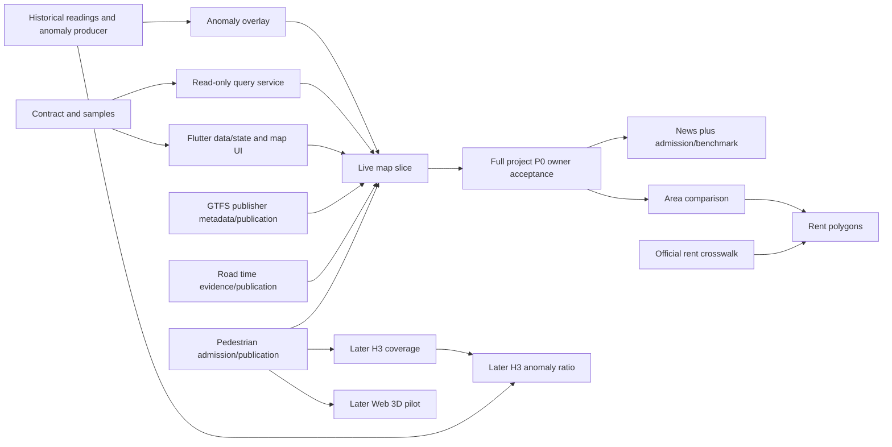

# Parallel development and delivery order

**Date**: 2026-10-01 | **Status**: G0 plus P0 T010–T019/T021–T025 jointly validated. All 17 P0 tasks received one worker each; T019 real preview is complete and T020/T026 full source/performance acceptance remain separate. See [validation.md](validation.md) and [parallel status](p0-parallel-work-status.md).
**Scope**: Feature 002 map presentation. The currently running data changes and feature001 tasks remain independently owned.
**Platform assumption**: Web first, desktop/narrow-browser layouts; native acceptance later. The platform question is pending and no approval is implied.

## Priority and release slices

| Delivery priority | Scope / task ids | Can start when | Data gate |
| --- | --- | --- | --- |
| P0 preparation | T001–T009: contract, fixtures, toolchain, shared models/query boundary | Now, following inline prerequisites | None for samples; credentials/runtime required for actual map/service |
| P0 map | US1 T010–T020 and US2 T021–T026: layers, points/lines/circles, zoom, details, time/status | G0 | Published allowed views per layer; G2 needs D01–D04/D07 |
| P0 adjacent gaps | D01/D02/D03/D04/D07 | Owner-scoped evidence/preparation can run now | See dependency register below |
| P1 product | US3 T027–T032 news; US4 T033–T039 area comparison | Full project P0 gate G3 | D06 news; D05 rent polygons |
| Optional enhancement | US5 T040–T044 H3; US6 T045–T051 3D | G3 plus selected P1 accepted | H3 coverage/3D D01; anomaly ratio D04 |
| Release checks | T052–T055 | Selected slice ready | Record accepted slice; never claim all features complete |

Spec story labels P1/P2/P3 are relative ranking within this feature; they do not replace project P0/P1/P2. News and area comparison can run in parallel after G3. H3 and 3D are independent of one another. If either is deferred, core map delivery remains valid.

Project dates: P0 target Oct12; P1 from Oct13; no feature freeze (cancelled 2026-10-15); submission target Oct17. These dates come from the existing use-case index/project rules; no unsupported duration estimate is added.

## External dependency register

Ids in this table are work packages, not new feature001 task ids and not claims of completion.

| ID | Work package / existing task mapping | Present evidence | Required handoff | Blocks |
| --- | --- | --- | --- | --- |
| D01 | Pedestrian count/history + effective locations; 001 T029/T030/T034/T036/T038 engineering; T069/T070/T071 publication/runtime | Cross-process location history and production SQL repaired; candidate P0 sources not activated; Oct1 published observation audit was empty | Admitted published windows; repeat-run results; count/location join validity, missing/conflict/inactive cases; queryable history with honest location eligibility | Live circles/replay, live 3D, live H3 coverage |
| D02 | Planned/unplanned roads; 001 T031/T061, then T070/T071 and T069 | Private upstream reads succeeded; not public publication; offsetless clock remains unknown without evidence | Per-interface time semantics, admission/quotas, repeated published extents, current/planned separation | Live road overlay and full traffic acceptance |
| D03 | Transit static/realtime; 001 T062 engineering, T063/T066 acceptance | Runtime and SQL wired; no eligible admitted publisher-version refs; buses uncovered | Static + alert publication, each mode's matching publisher feed metadata, positive and fail-closed joins | Tram/train geometry; unlocated alert list can be developed earlier |
| D04 | UC-04 anomaly producer and replay; no completed detection implementation in feature001 | UC-04 remains planned; threshold/sample eligibility open; no verified output feed | Agreed baseline/threshold/eligibility/insufficient-sample contract, historical replay, published result ids and source evidence; use producer-owned path | Real anomaly markers, anomaly-ratio H3, UC-04 acceptance |
| D05 | Rents official LGA/vintage mapping; 001 T055 data already published; new mapping work package needed | 1,106 published values; all mapping missing, 182 suppressed at audit | Official code/name/vintage crosswalk and match/conflict evidence, consumed by area view | Rent choropleth; numeric lists/quarter comparisons need no polygon |
| D06 | News admission/publication/localization benchmark; 001 T048, conditional T044/T051 only when applicable | Connector/location/dedup/view engineering exists; published news unavailable; real independent annotation remains required | Allowed fields/retention, real coverage, two genuine independent benchmark reviewers, reliable event-site evidence | Public news layer; conditional sources are not assumed fallbacks |
| D07 | P0 events/context data; 001 T042 | Key exists; terms/retention/publication still unresolved | Allowed retained fields, deletion requirements, source admission/coverage/publication | Live P0 events layer; does not block sample map shell |

Six active sources' Jobs have been deployed in the development environment. That is separate from activating candidate pedestrian/transport/events sources and from product release. Refresh data counts at integration time; do not carry audit snapshots forward as a guarantee.

Feature001 T069 is the P0 data prerequisite acceptance, not full project acceptance. Its T077 ≥10-source/eight-category/24-hour gate is broader first-release acceptance; do not require it before drawing the first sample map or validating the available-data path.

G3 additionally requires the agent/discovery/planning/chat and anomaly-analysis owners' product acceptance. Those product tasks are outside D01–D07 and feature 002; they follow or join the live map slice rather than becoming a circular prerequisite for G2.

## First parallel wave

### Preparation delivery

T001 froze the contract and seven labelled viewport envelopes plus seven catalog/query/detail/list/error/variant fixtures. Each of T001–T009 received a dedicated subagent. Setup and source preparation ran in exclusive file ranges, while interface handoffs, package resolution and generated outputs were serialized by the integrator. All nine deliveries are recorded under task-handoffs/ and validated together in validation.md.

G0 is complete. The P0 wave started with T010/T011/T021/T022 and advanced each dependency frontier with exclusive ownership. T014/T016 joined at T017; T024 released selection/details before T025 took the shared controller/screen/backend composition. All 17 T010–T026 tasks were dispatched with at most eight concurrent workers. Final 296 Flutter tests and 163 backend tests pass. T019 deployed the bounded preview; T020/T026 retain explicit real data/performance gates.

### Work lanes

| Lane / suggested owner | Initial scope | Exclusive paths | Handoff |
| --- | --- | --- | --- |
| A: Flutter map owner | T010/T015/T016; T021/T023; sample states | app/lib/features/map/ui/ and state/ except shared integration files | Layer/selection/zoom widgets against v1 DTOs; no publication changes |
| B: Query-service owner | T011–T014; T022; adapter fixtures | cloud/map/src/query/, contracts/, services/ except integration-owned viewport/server changes at merge | Catalog and bounded query outputs conforming to shared fixtures |
| C: Data owner / existing team | D01/D02/D03/D07; assign source-exclusive investigation if staffed | Existing source connector/manifest/fixtures in cloud/data | Published admitted views and evidence, not private-probe payloads |
| Integrator | T001–T009 joins; T017–T020/T024–T026; shared edits/deployment | Paths below | One working release slice with precise incomplete gates |

D04 needs a separately assigned UC-04 product/analytics owner; it is not hidden inside a generic map-render task. With limited capacity, prioritize the primary pedestrian/roads publication path and this producer gap before optional sources.

Setup T002 and T004 can run together after T001; foundational T005/T006 can run together after setup. Within the first map wave, backend and frontend logic can advance independently. Shared file integration remains serial even when surrounding tasks run concurrently.

## Shared-file ownership

The integrator controls these files during a parallel wave and may delegate an exclusive, explicitly recorded preparation range:

- app/pubspec.yaml, pubspec.lock, .fvmrc, core/config, config/example.json, l10n/app_en.arb and generated shared files.
- app/lib/features/map/ui/map_screen.dart and shared map_details.dart/selection_controller.dart integration.
- cloud/map/src/server.ts, services/viewport.ts and layer catalog activation changes.
- Existing cloud/data publisher, jobs/ingest, shared SQL, schedules/IAM/deployment and feature001 task state.
- Spec contracts, feature task status and project architecture/use-case status.

The data team's existing integrator retains ownership of cloud/data shared paths. The map integrator requests changes through a documented handoff rather than editing those files concurrently. Backend/source owners propose deltas; the relevant integrator applies them after review. Newly generated files for an exclusive feature file belong to that file's owner; shared generation is serialized.

This preparation reused the current checkout with exclusive file ownership; no worktree was created. T001 handed app/README.md to T003 before its update. T003 owned config/packages, T009 owned ARB additions, and the integrator serialized code generation and whole-package builds. Use isolated worktrees when concurrent ranges overlap; reuse existing contexts where suitable. Never copy keys or overwrite another lane's uncommitted work.

## Critical dependencies

Optional branches additionally wait for selected P1 acceptance, as specified above. H3 is not a prerequisite for 3D. Exact counts/2D details are never dependent on 3D support.

## Milestone evidence and merge order

1. G0: contracts/setup/shared DTO and request boundaries.
2. G1: independent UI/server joined; sample labels visible; real boundary/development query path demonstrated.
3. G2: real P0 map layers accepted with source-time/location proof; uncovered modes remain explicit and full transport/anomaly criteria remain open until satisfied.
4. G3: all project P0 owners accept their use cases, including adjacent AI and events paths.
5. P1: news/area separately accepted; optionally choose H3/3D.
6. Selected release: regenerated files, scoped tests/analyze/build, deployed origin and measured browser evidence.

## Remaining requirement decisions

The Web-first assumption and chosen later P1 scope remain reviewable defaults. Reference browser environments and the frontend/backend v1 contract are recorded; the pinned SDK resolves successfully. D04 threshold/sample policy and D05 crosswalk require their owning work packages. The user-provided demo Maps key now renders tiles, attribution and controls through ignored local configuration. Development explicitly reviews a 400000000-byte dynamic ceiling after a 383847461-byte planning estimate; the library default is unchanged. Boundary/pedestrian latest-record rights proof and D01–D04/D07 public source handoffs remain open; see [source readiness](p0-source-readiness.md). The reviewer-owned delivery checklist remains unchecked; task completion does not supply reviewer approval or G1–G3 acceptance.
