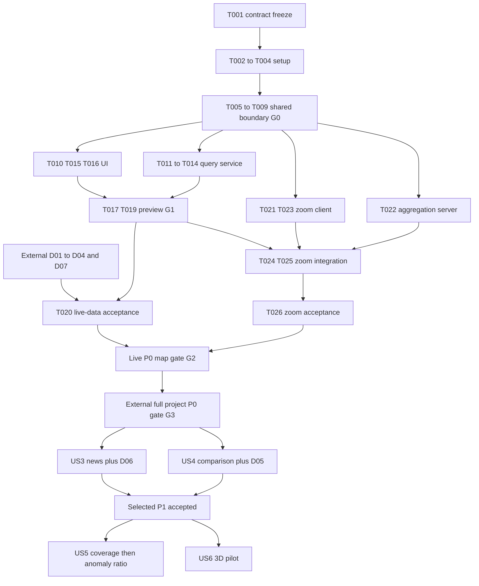

# Tasks: Map data presentation

**Input**: [spec.md](spec.md), [plan.md](plan.md), [research.md](research.md), [data-model.md](data-model.md), [contracts](contracts/map-api.md).
**Status**: G0 and P0 T010–T019/T021–T025 complete and jointly validated on 2026-10-01. The bounded development service and real Google Maps/planning preview work. T020/T026 full source/performance acceptance remain open; later T027–T055 are deferred. See [validation.md](validation.md) and [parallel status](p0-parallel-work-status.md). Existing data work belongs to feature 001.
**Organization**: Setup/foundation, then one phase per user story. Spec story priorities are preserved; [parallel-development.md](parallel-development.md) maps them to project delivery priorities.
**Tests**: Targeted validation implements the spec's Independent Test/Acceptance Scenarios and SCs. No TDD requirement is implied.

## Format and scheduling

- [P] marks an independent task at its phase's ready frontier, after the stated setup/foundation prerequisites. It never authorizes work while its prerequisite is unfinished.
- Every task below has explicit prerequisites. A production-only data dependency does not prevent labelled sample development.
- D01–D07 are external work packages defined in parallel-development.md; they are not completed by a map implementation checkbox.
- G3 means full project P0 acceptance, not completion of this map feature. Later story work waits for the applicable project priority gate.
- The integrator owns shared files and applies queued additions serially. Tasks with overlapping files cannot run concurrently even if their data logic is independent.

## Phase 1: Setup (P0 preparation)

**Goal**: Freeze the shared boundary and establish toolchains. T001 first; T002 and T004 can then run together; T003 follows T002.

- [X] T001 Freeze v1 fields, seven sample envelopes, ownership and priority gates in specs/002-map-data-presentation/contracts/map-api.md and parallel-development.md; synchronize the chosen query-service transport in system-design/architecture.md, system-design/use-cases/uc-01-layers-and-topics.md and app/README.md before implementation. Deps: none.
- [X] T002 [P] Resolve the pinned Flutter/FVM runtime and record actual desktop/narrow-browser acceptance environments in specs/002-map-data-presentation/quickstart.md; report a pin-resolution failure instead of silently changing app/.fvmrc. Deps: T001.
- [X] T003 Resolve and lock Google Maps Flutter, configure build-time Maps/API/sample-mode keys in app/pubspec.yaml, app/lib/core/config/env.dart, app/config/example.json and app/README.md; no real key in committed files. Deps: T002.
- [X] T004 [P] Create the Node24/TypeScript map-service package, dev/typecheck/test scripts, config and read-only identity requirements in cloud/map/package.json, cloud/map/tsconfig.json and cloud/map/README.md. Deps: T001.

## Phase 2: Foundational (P0 shared boundary)

**Goal**: Both implementations can consume the same bounded contract. Phase 1 is complete before this phase; ingestion dependency work may continue independently.

- [X] T005 [P] Implement typed DTOs and an explicitly labelled sample repository in app/lib/features/map/data/map_models.dart and sample_map_repository.dart; carry every variant/state and enforce “GeoJSON coordinates are [longitude, latitude], never [latitude, longitude]”, “Missing counts remain null; zero is a measured zero”, “Null geometry is never replaced by a guessed point”, and “totalMatching is null unless an exact full-query total is available”. Generate related Freezed/JSON files. Deps: T001–T004.
- [X] T006 [P] Implement v1 request/response validation in cloud/map/src/contracts/map-contract.ts; enforce nonempty requestId, supported WGS84 bbox, finite zoom 0–22, distinct registered layers, current/historical mode, UTC half-open window with from < to and ≤31 days, required areaFilter for indicator layers, enumerated states and snapshot-bound cursor rules. Deps: T001–T004.
- [X] T007 Implement view-only fixed-query execution with parameters, dry-run/byte/time/row budgets in cloud/map/src/query/query-runner.ts and cloud/map/src/config.ts; reject caller SQL and raw/staging access. Deps: T006.
- [X] T008 Implement the map repository interface and HTTP adapter in app/lib/features/map/data/map_repository.dart and http_map_repository.dart; require schemaVersion=1, preserve source/time/state and never switch live failure to samples. Deps: T005.
- [X] T009 Integrate shared status/time/provenance widgets, provider wiring and English localization in app/lib/features/map/ui/map_status.dart, app/lib/features/map/state/map_providers.dart and app/lib/l10n/app_en.arb; enforce “A noMatching state requires verified area/time coverage and a successful complete query”. Deps: T003,T007,T008.

**Checkpoint G0**: The contract, configured runtimes and shared boundary are ready. UI/server/ingestion work can proceed in separate file ranges.

## Phase 3: US1 — Topic layers and truthful details (Spec P1; project P0)

**Goal**: First usable 2D map with layer controls, selection and accurate status.
**Independent acceptance**: Sample counts/disruptions, one failed/uncovered layer and source-linked detail; no later story required.

- [X] T010 [P] [US1] Implement topic defaults, per-topic session toggles and one-area-metric policy in app/lib/features/map/state/layer_controller.dart and app/lib/features/map/ui/layer_panel.dart. Deps: G0.
- [X] T011 [P] [US1] Implement public layer catalog and coverage/freshness adapters in cloud/map/src/services/layer-catalog.ts and cloud/map/src/query/source-coverage.ts, separating query-empty from verified noMatching. Deps: G0.
- [X] T012 [US1] Adapt published development/current boundary records with stable ids, one selected geography vintage and source detail in cloud/map/src/query/planning.ts and boundaries.ts. Deps: T011.
- [X] T013 [US1] Adapt pedestrian, road/transit and event query views into separate typed items in cloud/map/src/query/pedestrian.ts, disruptions.ts and events.ts; keep null geometry, observation-effective location, unknown clock semantics and unlocated counts explicit. Deps: T011; live pedestrian: D01; roads: D02; located transit: D03; events: D07.
- [X] T014 [US1] Implement bounded viewport/detail/catalog/unlocated-list routes and snapshot-bound pagination in cloud/map/src/services/viewport.ts, details.ts, unlocated.ts and cloud/map/src/server.ts; enforce “totalMatching is null unless an exact full-query total is available”. Deps: T012,T013.
- [X] T015 [US1] Implement the 2D surface and point/line/polygon/count-circle renderers in app/lib/features/map/ui/map_surface.dart and renderers/core_renderers.dart; count controls circle area and unknown location stays undrawn. Deps: T010.
- [X] T016 [US1] Implement persistent selection, desktop side/mobile bottom details, typed source/time content and unlocated-list access in app/lib/features/map/state/selection_controller.dart, app/lib/features/map/ui/map_details.dart and unlocated_list.dart. Deps: T015.
- [X] T017 [US1] Integrate viewport/time requests, newest-request protection, partial/error/retained-old results and manual retry in app/lib/features/map/state/viewport_controller.dart and app/lib/features/map/ui/map_screen.dart. Deps: T014,T016.
- [X] T018 [US1] Consume verified external anomaly items/baselines in cloud/map/src/query/anomalies.ts and the anomaly section of app/lib/features/map/ui/map_details.dart; expose unavailable when the producer is absent. Deps: T014,T016; verified live results: D04. Shared detail edits are applied by the integrator.
- [X] T019 [US1] Deploy a bounded development query service and connect the explicit live repository using cloud/map/infra/deploy.sh and app/config/example.json; record G1 samples and published boundary/development results in specs/002-map-data-presentation/validation.md. Deps: T017,T018. This preview does not need every P0 source. Evidence: real planning map/member/original-detail path and unavailable boundary rights gate recorded; full G1 boundary acceptance remains separate.
- [ ] T020 [US1] Validate US1 state/data semantics and real P0 source integration in app/test/features/map/map_states_test.dart, cloud/map/test/viewport.test.ts and specs/002-map-data-presentation/validation.md; keep G1/G2/UC-04/UC-05 evidence separate. Deps: T019; full live acceptance: D01,D02,D03,D04,D07.

**Checkpoint**: G1 can be reached with partial source readiness. T020's full live acceptance stays open until the required external data exists.

## Phase 4: US2 — Zoom granularity (Spec P1; project P0)

**Goal**: Four bands, selection continuity, truthful grouping and manageable density.
**Independent acceptance**: Fixed sample dataset across all bands, hysteresis boundaries and same-location objects. Logic can start after G0 independently of US1's live acceptance.

- [X] T021 [P] [US2] Implement nominal bands and 0.2 hysteresis in app/lib/features/map/state/zoom_policy.dart; first classification uses nominal boundaries. Deps: G0.
- [X] T022 [P] [US2] Implement bounded topic-specific point grouping, actual member references and scope-preserving simplified extents in cloud/map/src/services/aggregation.ts; do not convert statistical areas to finer metrics. Deps: G0.
- [X] T023 [US2] Implement cluster symbols, member counts/units/windows, zoom-to-bounds and dense same-location list in app/lib/features/map/ui/renderers/aggregate_renderer.dart and aggregate_details.dart. Deps: T021.
- [X] T024 [US2] Preserve selected/offscreen/filter-excluded states and keyboard controls across granularity changes in app/lib/features/map/state/selection_controller.dart and app/lib/features/map/ui/map_details.dart. Deps: T016,T023; integrator-owned shared edits.
- [X] T025 [US2] Connect aggregation responses and zoom policy through cloud/map/src/services/viewport.ts and app/lib/features/map/ui/map_screen.dart, with recorded partial-result scope and limits. Deps: T014,T017,T022,T024; integrator only.
- [ ] T026 [US2] Validate zoom/hysteresis/geometry/selection and SC-002/003 targets in app/test/features/map/zoom_policy_test.dart, cloud/map/test/aggregation.test.ts and specs/002-map-data-presentation/validation.md. Deps: T025.

## Phase 5: US3 — Nearby news (Spec P2; project P1, deferred)

**Goal**: Three map highlights and an accessible list with trustworthy localization/dedup.
**Independent acceptance**: Precise, area-associated, mention-only, duplicate and unknown-time samples.
**Entry gate**: G3; news admission/publication is D06.

- [ ] T027 [P] [US3] Implement news query/detail adapter with article/event evidence and permitted fields in cloud/map/src/query/news.ts. Deps: G3,G0.
- [ ] T028 [P] [US3] Implement news list, precision/unknown-time labels and source details in app/lib/features/map/ui/news/news_list.dart and news_details.dart. Deps: G3,G0.
- [ ] T029 [US3] Implement at-most-three highlight ordering by reportedAt then stable eventId, unknown last, and confirmed-only event dedup in cloud/map/src/services/news-ranking.ts. Deps: T027.
- [ ] T030 [US3] Integrate news list/highlights into the selected topic via app/lib/features/map/ui/map_screen.dart and cloud/map/src/services/viewport.ts. Deps: T028,T029,T025; integrator only.
- [ ] T031 [US3] Enable admitted published news with public source/retention rules and explicit coverage in cloud/map/src/services/layer-catalog.ts; no mention-to-event-point promotion. Deps: T030,D06; integrator only.
- [ ] T032 [US3] Validate FR-011/012 and SC-010 using app/test/features/map/news_test.dart, cloud/map/test/news-ranking.test.ts and specs/002-map-data-presentation/validation.md. Deps: T031.

## Phase 6: US4 — Area comparison (Spec P2; project P1 extension, deferred)

**Goal**: One stable choropleth and comparable historical values; lists remain useful when geometry is unavailable.
**Independent acceptance**: Same-quarter/property/vintage examples plus missing/suppressed/incompatible samples.
**Entry gate**: G3; rents colouring additionally waits for D05.

- [ ] T033 [P] [US4] Adapt area indicators with values, unit, definition, period, property type and geography vintage in cloud/map/src/query/area-indicators.ts; enforce “Only matched same-vintage boundaries are drawable; missing/suppressed values are never zero”. Deps: G3,G0.
- [ ] T034 [P] [US4] Implement indicator/period/property controls and numerical comparison layout in app/lib/features/map/ui/areas/area_controls.dart and area_comparison.dart. Deps: G3,G0.
- [ ] T035 [US4] Define stable filter-specific classification and same-vintage join behavior in cloud/map/src/services/area-classification.ts, without viewport-based recolouring. Deps: T033.
- [ ] T036 [US4] Implement region style/legend and comparison eligibility in app/lib/features/map/ui/renderers/area_renderer.dart and app/lib/features/map/state/area_comparison_controller.dart; incomparable differences remain unavailable. Deps: T034,T035.
- [ ] T037 [US4] Consume independently evidenced official rents mappings in cloud/map/src/query/area-indicators.ts and record matched/unmatched/vintage evidence in specs/002-map-data-presentation/validation.md; do not recode names by guesswork. Deps: T033,D05.
- [ ] T038 [US4] Integrate area topic, published Census subset and rent list/colour eligibility in app/lib/features/map/ui/map_screen.dart and cloud/map/src/services/layer-catalog.ts. Deps: T036,T037,T025; integrator only.
- [ ] T039 [US4] Validate SC-005/004, fixed colour scale, suppression and mapping states in app/test/features/map/area_comparison_test.dart, cloud/map/test/area-indicators.test.ts and specs/002-map-data-presentation/validation.md. Deps: T038.

## Phase 7: US5 — Hex coverage/anomaly overview (Spec P2; optional enhancement)

**Goal**: Honest observation coverage first; verified anomaly ratio only with producer evidence.
**Independent acceptance**: Measured zero, no observation, missing classification and mixed-window samples.
**Entry gate**: G3 and acceptance of selected P1 features.

- [ ] T040 [P] [US5] Add bounded H3 coverage grouping from normalized eligible sensor observations in cloud/map/src/services/hex-coverage.ts; document selected resolutions against actual coverage in specs/002-map-data-presentation/research.md. Deps: optional-enhancement entry gate,G0; live counts: D01.
- [ ] T041 [P] [US5] Implement hex polygons, coverage legend/member detail and no-observation styling in app/lib/features/map/ui/renderers/hex_renderer.dart and hex_details.dart. Deps: optional-enhancement entry gate,G0.
- [ ] T042 [US5] Integrate coverage-only overview with sensor down-selection in cloud/map/src/services/viewport.ts and app/lib/features/map/ui/map_screen.dart. Deps: T040,T041,T025; integrator only. Does not depend on D04.
- [ ] T043 [US5] Add verified anomaly ratio and classified/unclassified denominators in cloud/map/src/services/hex-anomalies.ts and app/lib/features/map/ui/hex_details.dart; denominator zero yields null and mixed baseline/window classifications are excluded. Deps: T042,D04.
- [ ] T044 [US5] Validate SC-006 coverage/ratio/member scope in cloud/map/test/hex-coverage.test.ts, app/test/features/map/hex_overview_test.dart and specs/002-map-data-presentation/validation.md. Deps: T042,T043.

## Phase 8: US6 — Single-block 3D walkers (Spec P3; optional enhancement)

**Goal**: Count-driven illustrative Web pilot with complete 2D fallback.
**Independent acceptance**: Three increasing count samples, cap, pause, reduced motion and unsupported-device cases.
**Entry gate**: G3 and acceptance of selected P1 features. No H3 dependency.

- [ ] T045 [P] [US6] Complete documented JS/WebGL/vector-Map-ID integration feasibility and supported-device decision in app/web/map_3d/README.md and specs/002-map-data-presentation/research.md; use no private Flutter plugin map internals. Deps: optional-enhancement entry gate,G0.
- [ ] T046 [P] [US6] Implement the typed count-to-illustration scale/cap model in app/lib/features/map_3d/data/pedestrian_scene.dart; no individual identity, measured speed or calibrated heading is inferred. Deps: optional-enhancement entry gate,G0.
- [ ] T047 [US6] Build a bounded repeated-figure scene with synthetic paths and resource disposal in app/web/map_3d/pedestrian_scene.ts. Deps: T045 feasibility passed,T046.
- [ ] T048 [US6] Implement Web-only scene bridge and supported/unsupported surface in app/lib/features/map_3d/data/scene_bridge.dart and app/lib/features/map_3d/ui/pedestrian_scene_view.dart. Deps: T045 feasibility passed,T046.
- [ ] T049 [US6] Integrate pilot-only explicit entry, camera/state handoff and source/count/window/scale/cap labels in app/lib/features/map_3d/state/scene_controller.dart and app/lib/features/map/ui/map_details.dart. Deps: T047,T048,T016; integrator handles shared detail/localization.
- [ ] T050 [US6] Implement pause/2D return, reduced-motion defaults, context-loss/stale-observation behavior and resource cleanup in app/lib/features/map_3d/state/scene_controller.dart and app/lib/features/map_3d/ui/scene_controls.dart. Deps: T049.
- [ ] T051 [US6] Measure SC-007/008/009 and document live/sample distinction and fallback on recorded support devices in app/test/features/map_3d/scene_state_test.dart and specs/002-map-data-presentation/validation.md. Deps: T050; live pilot: D01. Feasibility failure is recorded as deferred, never marked implemented.

## Phase 9: Cross-cutting acceptance and deployment

**Scope**: Run for each chosen release slice; deferred stories do not block the P0 map milestone.

- [ ] T052 Update transport/config/map usage and accepted scope in app/README.md, cloud/map/README.md and system-design/architecture.md; amend affected use-case descriptions/status only with matching product acceptance evidence. Deps: selected story integration.
- [ ] T053 Complete keyboard/non-colour/time/source audit, required regenerated files and analyze/test/build checks; record SC evidence and unresolved gates in specs/002-map-data-presentation/validation.md. Deps: selected story validation; annotate native and 3D acceptance separately.
- [ ] T054 Deploy the selected Cloud Run/Web slice, validate real origins/permissions/limits and record reachable URLs/version in cloud/map/infra/README.md and specs/002-map-data-presentation/validation.md. Deps: T052,T053; deploy only eligible public sources.
- [ ] T055 Record G1/G2/G3 and feature001 source-acceptance boundaries plus next ready work queue in specs/002-map-data-presentation/parallel-development.md. Deps: T054. This task cannot certify external gates without their owners' evidence.

## Dependencies & Execution Order

Graph represents delivery gates; detailed task prerequisites are written inline. T020 live acceptance can wait while US2 sample logic completes. D01–D07 run in their separately owned data/product scopes.

## Parallel examples by story

| Story | Independent ready tasks | Serial join / data gate |
| --- | --- | --- |
| US1 | T010 client layers / T011 server catalog | T014 and T016 join at T017; D01–D04/D07 gate full live acceptance |
| US2 | T021 zoom policy / T022 server aggregation | T023 then T024; T025 joins both sides |
| US3 | T027 server news / T028 client news | T029/T030; D06 before public activation |
| US4 | T033 server indicators / T034 client controls | T035/T036; D05 before rent colouring integration |
| US5 | T040 server hex / T041 client hex | T042 coverage; D04 before T043 ratio |
| US6 | T045 Web feasibility / T046 scale model | T047 and T048 can be dispatched together after both prerequisites; T049 joins |

## Implementation Strategy

MVP = US1 + US2 on 2D, with real data admitted incrementally and truthful unavailable states. Start T001, then independent setup. After G0 use a frontend owner, a query-service owner and the existing data owner; the integrator merges shared files.

Use boundaries/development to prove the backend-to-Flutter path while pedestrian/roads publication proceeds. Census/rent exploration remains later feature work. Do not let H3, news, area comparison or 3D block the P0 slice. Before optional work, record G3 and selected P1 acceptance. First resolve P0 events and anomaly-producer gaps in their owning workstreams.

## Notes

The 55 tasks are implementation work, not checklist approvals. The custom delivery checklist is reviewer-owned. Shared changes, deployment and IAM are serialized by the integrator; no task here reopens or overwrites feature001's completed engineering work.
