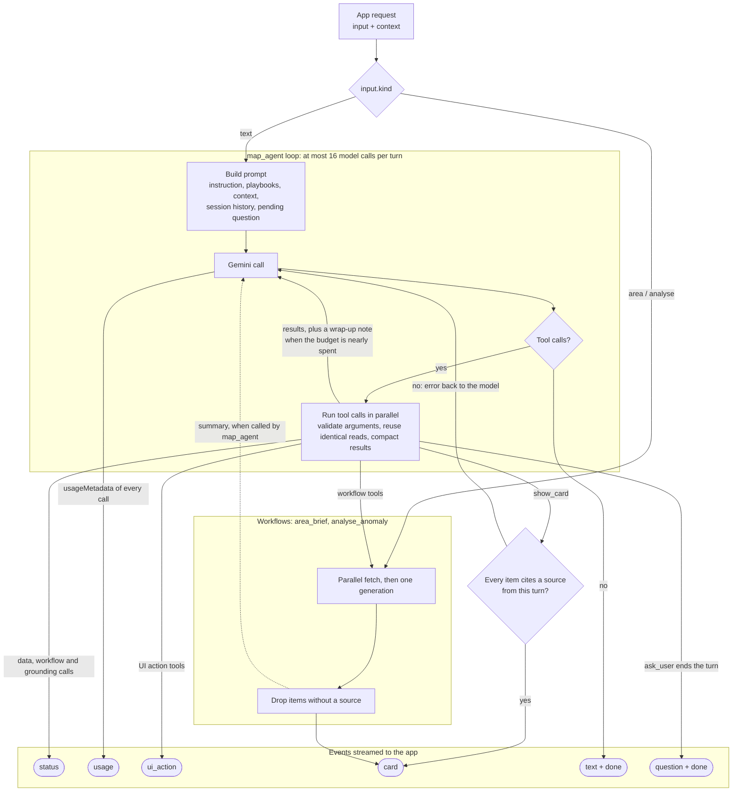

# Agent design

**Status:** Draft, first implementation in `cloud/agent` on 2026-10-09 (see [its README](../cloud/agent/README.md) for what exists and what is still planned). Revised 2026-10-09: the runtime is ADK for TypeScript on its own Cloud Run service, Gemini is called through Vertex AI only, data tools read the published BigQuery views, and chat sessions are persisted per user in Firestore. Revised 2026-09-28: one chat agent with the full tool registry replaces the earlier root agent that dispatched to separate discovery and insight agents. Tool names and arguments are working names until plan task F3 fixes the contract.

This file describes the agents inside the product, which run in the agent service on Cloud Run (`cloud/agent`, planned). The app talks to them through [agent-protocol.md](agent-protocol.md). Instructions for coding agents are in [AGENTS.md](AGENTS.md).

AI does three jobs: it turns messy data into map features (extraction), answers "where should I go and what should I do" (discovery), and explains "why" (insight). The goal is AI as an active part of the map, not a chat box in a corner.

## Runtime

| Item | Decision |
| --- | --- |
| Service | Cloud Run service `melens-ENV-agent`, separate from the map service ([architecture.md](architecture.md#key-decisions)) |
| Language | TypeScript on Node 24 with ADK for TypeScript; the same TypeScript and Zod pins as cloud/data and cloud/map. Tool schemas are Zod, exported as JSON Schema |
| HTTP layer | `node:http` directly, as in cloud/map: one SSE route plus health, hand-written CORS, body limits and error envelope shared with the map service. No web framework |
| Models | Gemini only, through Vertex AI with the service identity. No Gemini API key, no other providers, no provider abstraction layer |
| Data access | Fixed parameterized queries over the published `melens_query` views with a read-only identity and `maximumBytesBilled`, the same rules as the map service's query runner |
| Sessions | Persisted per Firebase uid in Firestore as stored turns ([agent-protocol.md](agent-protocol.md#sessions)); each turn rebuilds the ADK session in memory from the last 20 stored turns, so no raw tool results are persisted. Instances hold no conversation state, so the service can scale out; min-instances=1 while judging |
| Cache and quota | Firestore, in agent-only collections: grounding cache and per-uid rate-limit counters |
| Usage | Every model call's `usageMetadata` goes to the app as a `usage` event and is stored with the turn ([agent-protocol.md](agent-protocol.md#token-usage)); see Token accounting below |
| Secrets | The Maps Platform key for the Routes API, from Secret Manager. Nothing else |
| Timeouts | Cloud Run request timeout 300 seconds for a turn of at most 16 model calls |
| Region | Cloud Run and Firestore in `australia-southeast2` with the data; Gemini and the grounding tools from the `global` Vertex AI location, the only one that served `gemini-3.8-flash` and both grounding tools on 2026-10-09 |

## Three execution modes

Not every AI feature is an agent loop. The split is by who decides the next step.

| Mode | Who decides the next step | Used for | Model calls |
| --- | --- | --- | --- |
| Pipeline | Code, no conversation | Extraction: news to place and summary (UC-06), BYO field mapping (UC-07) | One structured-output call per item, inside ingestion jobs |
| Workflow | Code | `area_brief` (UC-02 first card), `analyse_anomaly` (UC-04) | Parallel data fetch, one generation, then code validation |
| Loop | The model | Everything typed into the chat box (UC-13), including follow-ups for UC-02, UC-03, UC-08 | Up to 16 per turn |

Workflows exist where the steps are known in advance: the user tapped a specific marker or point, so there is nothing for a model to decide. The loop exists for everything else. Extraction runs inside cloud/data jobs and calls Vertex AI with the job's own identity; it is not part of the agent service.

## Entry routing

The app's entry point already states the intent, so routing is code, not a model call.

| App input (`input.kind`) | Handled by |
| --- | --- |
| `area`: user selects a point on the map | `area_brief` workflow |
| `analyse`: user taps Analyse on a "?" marker | `analyse_anomaly` workflow |
| `text`: anything typed into the chat box | `map_agent` loop |
| Scheduled ingestion | Extraction pipeline |

The chat agent can call both workflows as tools, so "why is it so busy here?" typed into the chat runs the same `analyse_anomaly` code as the button.

## How a turn runs

Reading it: map taps go straight to a workflow; chat text enters the loop. The loop repeats model call, then tool calls, until the model answers without calling a tool or the budget runs out. Workflows called from the loop send their card to the app and return a short summary to the model. An `ask_user` call ends the turn with a question. Every Gemini call, in the loop, in a workflow or in a grounding sub-agent, sends its token usage to the app as soon as it finishes. In ADK for TypeScript the loop is the `LlmAgent`'s own run loop. The wrap-up note, the call budget and the `ask_user` stop are `beforeModelCallback`; usage accounting is `afterModelCallback`; the budget is also the run config's `maxLlmCalls`. Argument validation and the read memo live inside each tool's `execute`, because a tool that throws cannot have its error rewritten for the model.

## The chat agent (`map_agent`)

One agent with the full tool registry. It answers random questions and fulfils precise requests, and the per-use-case behaviour comes from playbooks rather than separate agents. Keeping discovery and insight in one agent keeps the context when a conversation moves from "what's here" to "why is it busy" to "plan me a walk".

### Tool registry

Full definitions (arguments, returns, errors, owners, cost) are in [tools.md](tools.md).

| Group | Tools | Purpose |
| --- | --- | --- |
| Data | `search_features`, `get_feature`, `heritage_lookup`, `get_anomaly`, `pedestrian_pattern`, `nearby_context` | Read our own data from the published BigQuery views (heritage from its public API) |
| Workflow | `area_brief`, `analyse_anomaly` | Run a known multi-step procedure in one call |
| Grounding | `maps_grounding`, `search_grounding` | Answer what our data does not cover; a fallback after the data tools, or a supplement where they leave a gap, never a routine step |
| UI action | `show_layers`, `focus_map`, `draw_route`, `highlight_features`, `show_card` | Change what the user sees; `show_card` also validates sources |
| Conversation | `ask_user` | Ask one question when the context cannot resolve the request |

UI action tools return to the model straight away and send a `ui_action` or `card` event to the app without waiting for a reply. The next turn's request context reports the real map state.

**Melens data first.** The loop answers from the data tools. `maps_grounding` and `search_grounding` run only when those tools cannot answer the request (places, opening hours, parking, weather, history and general facts the layers do not carry) or when their results leave a gap the question needs filled, never as a routine step or to pad a card. Each grounding call is a separate, slow, billed model call: on 2026-10-09 Maps grounding took 48 to 110 s per call and Search grounding about 10 s, so Search is preferred and Maps is reserved for one specific place's details. A grounding call that exceeds `AGENT_GROUNDING_TIMEOUT_MS` (default 40 s) returns `upstream_unavailable` and the model answers from the map data. The rule is in the instruction and in the two tools' descriptions.

### Precision

- **Strict argument schemas.** Layer names are enums and required fields are required. The server validates arguments too and returns the error to the model so it can correct itself. After two invalid calls in a row, the turn continues without tools.
- **Workflows for known procedures.** A fixed multi-step job is one workflow tool call, not five tool calls assembled by the model.
- **Tool descriptions say when to use the tool**, not only what it does.
- **Playbooks** carry the method for multi-step jobs: one short file per use case (UC-02, UC-03, UC-04, UC-08, UC-13), with the tools, their order and the output. There are few enough to include them all in the agent's instruction. Keeping them as separate files lets the use-case owner edit prompts without touching code.

### Asking the user

The agent acts first and states its assumptions. It asks only when acting would probably be wrong.

- **Ask** when the request is ambiguous and the request context cannot resolve it (which of several gardens, which of two anomaly markers), or when a required input has no sensible default (no location and a city-wide viewport).
- **Do not ask** about preferences it can assume, or for confirmation. UI changes are reversible and the agent never writes data, so there is nothing to approve.
- One question per turn, with 2–4 options. `ask_user` ends the turn, and the pending question goes into the next turn's prompt.
- Workflows never ask, because their entry points supply every input.

### Budget and context hygiene

- At most 16 model calls per turn. On the second-to-last call the agent is told to wrap up and answer. Simple questions end after one or two calls.
- Identical read-only calls within one turn return the earlier result instead of running again.
- Long tool results are compacted: every row shortened, only the first N rows kept, and the total count stated first. A `search_features` call in the CBD can match hundreds of features.
- Grounding results are cached in Firestore by tool, normalised question, place and date, so repeated questions from different users hit the cache. Grounding is billed per call.
- The prompt carries the last 20 turns of the session: user input, answer text, card summaries and the pending question. Older turns stay in Firestore for the app's history view and are not sent to the model.

### Token accounting

- Every model call's `usageMetadata` is read once, from the final non-partial response in the after-model callback, and sent to the app as a `usage` event before that call's tool calls run ([agent-protocol.md](agent-protocol.md#token-usage)). `@google/adk` 2.2.1 exposes it as `LlmResponse.usageMetadata`, aggregated across streamed chunks and across a paused-and-resumed generation.
- Counts are Gemini's, never estimated. Input is `promptTokenCount` with `cachedContentTokenCount` broken out; output is `candidatesTokenCount` with `thoughtsTokenCount` broken out, because thinking is billed as output; `toolUsePromptTokenCount` covers the built-in grounding tools; `totalTokenCount` is copied. Grounding sub-agent calls and workflow generations report like any other call, under their own `agent` name.
- The turn's totals are the sum of its calls. They are stored with the turn in Firestore and logged as one structured line per call (`turnId`, `agent`, `model`, counts) so Cloud Logging can sum tokens per model and per day. The service warns when a call's `total` differs from `input + output + thoughts` by more than `toolUseInput` (Gemini documents the total as prompt, thoughts and candidates), or when the configured model returns no `thoughtsTokenCount`, which some preview models have omitted.
- A cancelled or failed call reports no usage; `done.usage.complete` is then `false`. Nothing is backfilled.

## Source rules

Two tiers, enforced in code rather than only in the prompt:

1. **Specific facts and recommendations** about places, events, times, crowds and disruptions go in a card. Every card item must cite a feature id (a map contract v1 MapItem id) or a URL that a tool, grounding included, returned in this turn. `show_card` rejects items that fail this check and returns the error to the model; workflows drop them.
2. **General knowledge, advice and conversation** may be plain text without a source. They must not present anything as live or current data unless a tool returned it in this turn.

Streamed text carries explanations and transitions only; recommendations appear in cards. When explaining causes, answers give possible causes with a confidence level and never state a cause as fact.

## Workflows

### `analyse_anomaly` (UC-04)

Detection runs before the workflow and involves no model: a scheduled cloud/data job writes pedestrian counts to BigQuery every hour, compares each sensor with the same hour over the past 7 days (upgrade: BigQuery `AI.DETECT_ANOMALIES`), and publishes sensors beyond the threshold to the BigQuery anomaly view that the map service's `anomaly` layer serves. The detector does not exist yet and has its own owner.

1. On Analyse, the workflow fetches in parallel: the anomaly and baseline, and nearby news, events and transport disruptions.
2. One generation with Search grounding writes possible causes, a confidence level and sources.
3. Items without a source are dropped, and the `anomaly_analysis` card is sent.

### `area_brief` (UC-02)

1. The app sends the selected point, the current time and the enabled layers.
2. The workflow fetches in parallel: layer features and heritage records within a radius, and Maps grounding for place details.
3. One generation fills the fixed card: neighbourhood character, recommended places, upcoming activities.
4. Items without a source are dropped, and the `area_brief` card is sent.
5. Follow-up questions go to `map_agent`.

## Models

Gemini is the only model family in the product, and every call goes through Vertex AI with the service identity. There is no provider abstraction and no fallback to another vendor; the competition requires Google models, and one provider keeps the code small.

| Used by | Model | Notes |
| --- | --- | --- |
| `map_agent` | `gemini-3.8-flash` | Higher thinking setting than the workflows |
| Workflows | `gemini-3.8-flash` | |
| Extraction | `gemini-3.5-flash-lite` | Cheaper; structured output with a JSON schema; runs in cloud/data jobs |

There is no stable Pro model yet (only `gemini-3.1-pro-preview`), and the product must not depend on preview models. Pro preview may be tried in the eval for `map_agent`, and used only with automatic fallback to flash if it clearly wins.

## Gemini and ADK constraints

- **Grounding with function tools.** The loop keeps function tools only; `maps_grounding` and `search_grounding` are function tools that make one grounded Gemini call each through the Vertex AI SDK, so the built-in tools never share a request with function declarations. Every such call is a separate model call with its own `usage` event, and the loop can run Maps and Search in parallel.
- **English only.** Maps grounding supports English only, so the app, prompts and deck are in English.
- **Sessions.** Conversation history lives in Firestore, keyed by the Firebase uid, behind a session service adapter. Instances hold no session state between requests, so the service can scale out and a new revision keeps every conversation. A turn holds a short lease on its session, so two concurrent turns on one session are rejected rather than interleaved.
- **Vertex AI location.** Cloud Run and the data are in Melbourne, but `gemini-3.8-flash`, Search grounding and Maps grounding are served from `global` and not from `australia-southeast1` (checked 2026-10-09). The deployment configuration records `AGENT_VERTEX_LOCATION=global`.

## Evaluation

- The example queries in every use-case file are the seed eval set; grow it to about 25 queries.
- Include multi-turn chains that cross use cases, for example: "What's around here?", then "Why is it so busy right now?", then "OK, plan me a quiet walk away from the crowds."
- Include cases where asking is right ("Take me to the gardens") and where it is wrong ("Plan a walk near me" with a known location); check them in the tool trace.
- Checks per answer: a source for every card item, places that exist, correct times. For precise requests, also check the tool trace: the right tool with the right arguments.
- Checks per turn: one `usage` event per model call in the trace, turn totals equal to the sum of the calls, and `done.usage` equal to the stored turn.
- Run the set after every prompt or tool change. Results go into the deck as evidence for the technical score.

## Open questions

- Result compaction for long tool results (rows shortened, first N kept) is still to be implemented; the first version caps list sizes instead.
