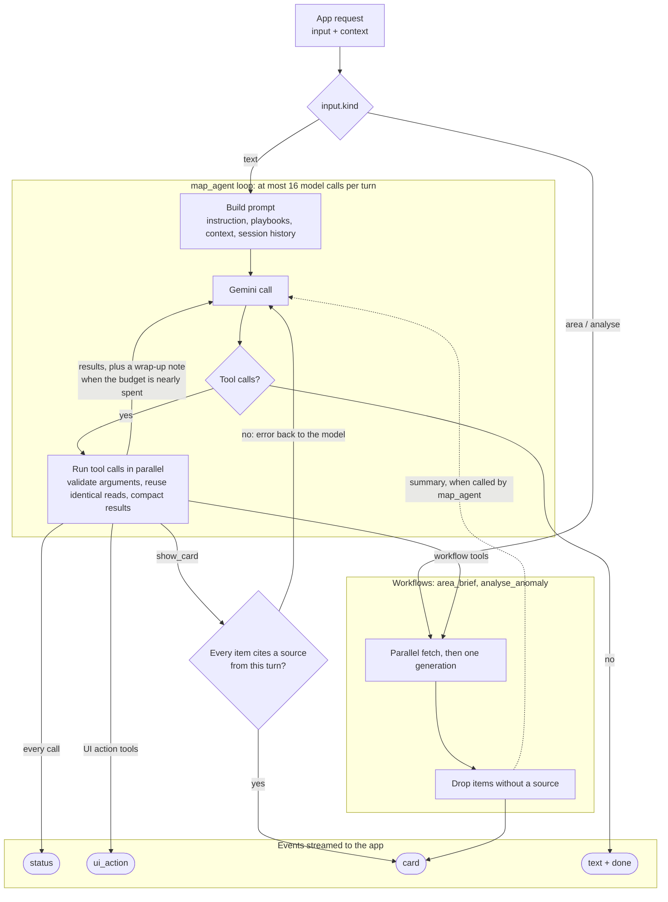

# Agent design

**Status:** Draft. Revised 2026-09-28: one chat agent with the full tool registry replaces the earlier root agent that dispatched to separate discovery and insight agents. Tool names and arguments are working names until plan task F3 fixes the contract.

This file describes the agents inside the product, which run on Cloud Run. The app talks to them through [agent-protocol.md](agent-protocol.md). Instructions for coding agents are in [AGENTS.md](AGENTS.md).

AI does three jobs: it turns messy data into map features (extraction), answers "where should I go and what should I do" (discovery), and explains "why" (insight). The goal is AI as an active part of the map, not a chat box in a corner.

## Three execution modes

Not every AI feature is an agent loop. The split is by who decides the next step.

| Mode | Who decides the next step | Used for | Model calls |
| --- | --- | --- | --- |
| Pipeline | Code, no conversation | Extraction: news to place and summary (UC-06), BYO field mapping (UC-07) | One structured-output call per item, inside ingestion jobs |
| Workflow | Code | `area_brief` (UC-02 first card), `analyse_anomaly` (UC-04) | Parallel data fetch, one generation, then code validation |
| Loop | The model | Everything typed into the chat box (UC-13), including follow-ups for UC-02, UC-03, UC-08 | Up to 16 per turn |

Workflows exist where the steps are known in advance: the user tapped a specific marker or point, so there is nothing for a model to decide. The loop exists for everything else.

## Entry routing

The app's entry point already states the intent, so routing is code, not a model call.

| App input (`input.kind`) | Handled by |
| --- | --- |
| `area`: user selects a point on the map | `area_brief` workflow |
| `analyse`: user taps Analyse on a "?" marker | `analyse_anomaly` workflow |
| `text`: anything typed into the chat box | `map_agent` loop |
| Scheduled ingestion | Extraction pipeline |

The chat agent can call both workflows as tools, so "why is it so busy here?" typed into the chat runs the same `analyse_anomaly` code as the button.

## How a turn runs

Reading it: map taps go straight to a workflow; chat text enters the loop. The loop repeats model call, then tool calls, until the model answers without calling a tool or the budget runs out. Workflows called from the loop send their card to the app and return a short summary to the model. In ADK the loop is the `LlmAgent`'s own run loop; argument validation, read reuse, result compaction and the wrap-up note are model and tool callbacks, and the budget is the run config's model-call limit (check the callback names in the ADK docs for the chosen language).

## The chat agent (`map_agent`)

One agent with the full tool registry. It answers random questions and fulfils precise requests, and the per-use-case behaviour comes from playbooks rather than separate agents. Keeping discovery and insight in one agent keeps the context when a conversation moves from "what's here" to "why is it busy" to "plan me a walk".

### Tool registry

Full definitions (arguments, returns, errors, owners, cost) are in [tools.md](tools.md).

| Group | Tools | Purpose |
| --- | --- | --- |
| Data | `search_features`, `get_feature`, `heritage_lookup`, `get_anomaly`, `pedestrian_pattern`, `nearby_context` | Read our own data |
| Workflow | `area_brief`, `analyse_anomaly` | Run a known multi-step procedure in one call |
| Grounding | `maps_grounding`, `search_grounding` | Answer open questions beyond our data |
| UI action | `show_layers`, `focus_map`, `draw_route`, `highlight_features`, `show_card` | Change what the user sees; `show_card` also validates sources |

UI action tools return to the model straight away and send a `ui_action` or `card` event to the app without waiting for a reply. The next turn's request context reports the real map state.

### Precision

- **Strict argument schemas.** Layer names are enums and required fields are required. The server validates arguments too and returns the error to the model so it can correct itself. After two invalid calls in a row, the turn continues without tools.
- **Workflows for known procedures.** A fixed multi-step job is one workflow tool call, not five tool calls assembled by the model.
- **Tool descriptions say when to use the tool**, not only what it does.
- **Playbooks** carry the method for multi-step jobs: one short file per use case (UC-02, UC-03, UC-04, UC-08, UC-13), with the tools, their order and the output. There are few enough to include them all in the agent's instruction. Keeping them as separate files lets the use-case owner edit prompts without touching code.

### Budget and context hygiene

- At most 16 model calls per turn. On the second-to-last call the agent is told to wrap up and answer. Simple questions end after one or two calls.
- Identical read-only calls within one turn return the earlier result instead of running again.
- Long tool results are compacted: every row shortened, only the first N rows kept, and the total count stated first. A `search_features` call in the CBD can match hundreds of features.
- Grounding results are cached in Firestore by tool, normalised question, place and date, so repeated questions from different users hit the cache. Grounding is billed per call.

## Source rules

Two tiers, enforced in code rather than only in the prompt:

1. **Specific facts and recommendations** about places, events, times, crowds and disruptions go in a card. Every card item must cite a MapFeature id or a URL that a tool, grounding included, returned in this turn. `show_card` rejects items that fail this check and returns the error to the model; workflows drop them.
2. **General knowledge, advice and conversation** may be plain text without a source. They must not present anything as live or current data unless a tool returned it in this turn.

Streamed text carries explanations and transitions only; recommendations appear in cards. When explaining causes, answers give possible causes with a confidence level and never state a cause as fact.

## Workflows

### `analyse_anomaly` (UC-04)

Detection runs before the workflow and involves no model: a scheduled job writes pedestrian counts to BigQuery every hour, compares each sensor with the same hour over the past 7 days (upgrade: BigQuery `AI.DETECT_ANOMALIES`), and writes sensors beyond the threshold to Firestore as "?" MapFeatures.

1. On Analyse, the workflow fetches in parallel: the anomaly and baseline, and nearby news, events and transport disruptions.
2. One generation with Search grounding writes possible causes, a confidence level and sources.
3. Items without a source are dropped, and the `anomaly_analysis` card is sent.

### `area_brief` (UC-02)

1. The app sends the selected point, the current time and the enabled layers.
2. The workflow fetches in parallel: layer features and heritage records within a radius, and Maps grounding for place details.
3. One generation fills the fixed card: neighbourhood character, recommended places, upcoming activities.
4. Items without a source are dropped, and the `area_brief` card is sent.
5. Follow-up questions go to `map_agent`.

## Models

| Used by | Model | Notes |
| --- | --- | --- |
| `map_agent` | `gemini-3.8-flash` | Higher thinking setting than the workflows |
| Workflows | `gemini-3.8-flash` | |
| Extraction | `gemini-3.5-flash-lite` | Cheaper; structured output with a JSON schema |

There is no stable Pro model yet (only `gemini-3.1-pro-preview`), and the product must not depend on preview models. Pro preview may be tried in the eval for `map_agent`, and used only with automatic fallback to flash if it clearly wins.

## Gemini and ADK constraints

- **Grounding with function tools.** If ADK's built-in Search or Maps tools cannot be combined with custom function tools in one agent, wrap each as a sub-agent (`AgentTool`). Every such call is a separate model call, so run Maps and Search in parallel when a question needs both. Verify this early.
- **English only.** Maps grounding supports English only, so the app, prompts and deck are in English.
- **Sessions.** Conversation history lives in the ADK session on the server. On Cloud Run with several instances, in-memory sessions are lost; see Open questions.

## Evaluation

- The example queries in every use-case file are the seed eval set; grow it to about 25 queries.
- Include multi-turn chains that cross use cases, for example: "What's around here?", then "Why is it so busy right now?", then "OK, plan me a quiet walk away from the crowds."
- Checks per answer: a source for every card item, places that exist, correct times. For precise requests, also check the tool trace: the right tool with the right arguments.
- Run the set after every prompt or tool change. Results go into the deck as evidence for the technical score.

## Open questions

- Session storage: max instances = 1 with in-memory sessions for the competition, or sessions persisted in Firestore.
- Whether Gemini's built-in grounding tools can be combined with function tools in one agent.
