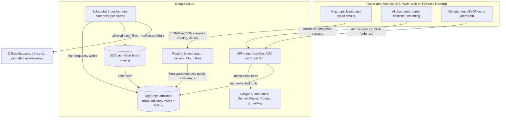

# Architecture

**Status:** Map transport baseline updated on 2026-10-01 by feature 002 T001. Implementation and deployment acceptance remain open. Agent/user-data architecture remains a draft.

Each external source is ingested once. Map clients read bounded public views through a backend; AI tools and clients preserve the same source/version identity.

## Components

The map app does not query BigQuery directly and has no Firestore map listener. The dedicated query service is separate from ingestion and agent streaming. Future authentication/user-data storage decisions do not change the first map transport.

| Component | Runs on | Responsibility |
| --- | --- | --- |
| Flutter app | Android, iOS, Web on Firebase Hosting | Platform-neutral map state/data; first acceptance on Web; native acceptance separately recorded |
| Map query service | Cloud Run, cloud/map | Catalog, bounded viewport/detail/unlocated/member queries, budgets and public-field filtering |
| Agent service | Cloud Run (ADK) | Chat/workflows/tools; streamed events ([agent-protocol.md](agent-protocol.md)) |
| Ingestion | Cloud Run jobs, Cloud Scheduler | Source admission, normalization, publication and provenance in cloud/data |
| BigQuery | Google Cloud | Published query views and historical facts; analytics producer owns anomaly results |
| GCS | Google Cloud | Permitted NDJSON batch staging; not the client wire format |
| Google AI and Maps | Google Cloud | Server-side Gemini tools; Maps rendering/grounding with required attribution |

## Map model and shared boundary

[Feature 002 map contract v1](../specs/002-map-data-presentation/contracts/map-api.md) and its [JSON Schema](../specs/002-map-data-presentation/contracts/map-contract.schema.json) define the client/server boundary. The older MapFeature proposal (geohash, Firestore current store, snake_case fields) is superseded for the first map. A generic MapFeature name may remain in older agent drafts; it must not be interpreted as this wire schema.

Typed MapItem values contain stable id/version/layer, GeoJSON geometry or null, spatial precision/evidence, assertion/lifecycle, known-or-unknown time, public sources and kind-specific details. Coverage, freshness and result completeness are separate. Known times are UTC; clients display Australia/Melbourne. Unknown values/times/locations remain unknown. Predictions use assertionKind=prediction and separate styling.

V1 registers nine layers: pedestrian, anomaly, disruption, event, planning, boundary, news, rent and census. Registration does not imply available data. No unlocated fact gets a guessed point; no sparse sensors become claimed full-city population density.

## Key decisions

- **Cloud Run queries the published store.** Fixed parameterized BigQuery view reads use read-only identity, byte/time/row limits, bounded pagination and five-minute opaque source-version snapshots. Detail/member reads recheck public admission/retraction. The first map introduces no second query store or persistent response cache.
- **JSON/GeoJSON at the client boundary.** Parquet may be useful for source exports/analytics, but clients use the frozen JSON model and explicit development sample mode. A failed live request never becomes sample data.
- **Agents run server-side.** API keys, models and model-facing tools stay in Cloud Run; Flutter never calls a model. Agent tool contracts remain governed by tools.md and are not silently changed by the map contract.
- **Web first.** Firebase Hosting is the submission target. Shared data/state does not prove identical native rendering or 3D support; acceptance is recorded per platform.
- **P0 first.** G0 preparation, G1 development preview, G2 real P0 map, G3 full project P0 acceptance are separate. News/area expansion and optional H3/3D follow the documented gates; counts alone do not prove anomaly acceptance, and roads alone do not prove all transit acceptance.
- **Supporting services.** Secret Manager supplies restricted keys; Cloud Build deploys; Cloud Scheduler triggers ingestion. No real secret enters committed configuration.

## Deployment constraints

The Web origin and map-service CORS allowlist must agree. Only admitted public fields are exposed by the public prototype; no caller SQL, raw/staging records or private admission evidence. The map service identity has no ingestion write role. Build-time Maps/API configuration is documented in app/README.md.

Agent streaming calls Cloud Run directly rather than relying on Firebase Hosting rewrite duration. Keep agent work inside the request or dispatch a managed task; Cloud Run request timeouts, instance policy and logging are owned by deployment configuration and measured before judging.

## Open implementation work

Map endpoints/adapters/deployment are later feature 002 tasks (T011–T014/T019 onward); T001 is a contract freeze, not an implementation claim. Source gates remain in feature 001. Anomaly production, agent tool integration and user-data stores retain separate owners and acceptance.
