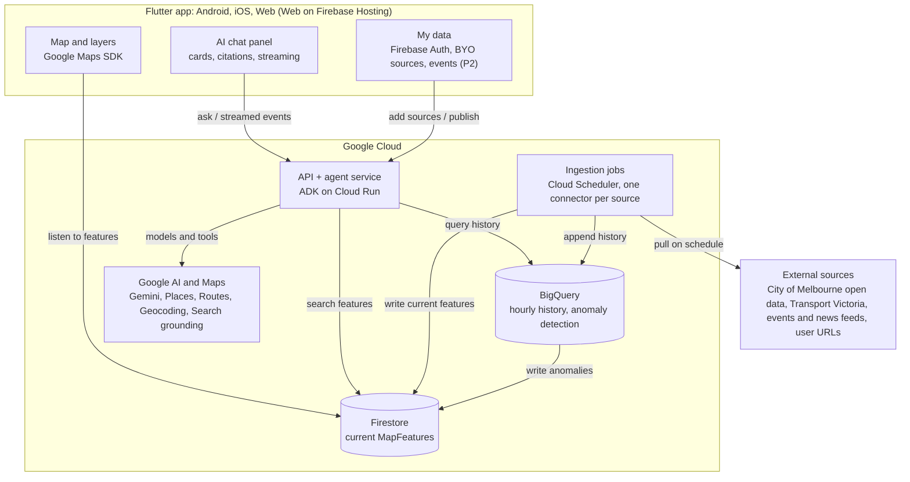

# Architecture

**Status:** Draft from the 2026-09-27 plan. The data contracts are finalised in plan task F3.

The app and the agents read the same map features, and each data source is ingested once.

## Components

The app talks only to Firestore (display) and the agent service (questions and answers). History, map search and models stay in the backend.

| Component | Runs on | Responsibility |
| --- | --- | --- |
| Flutter app | Android, iOS, Web on Firebase Hosting | Map, layer toggles, AI chat panel, anomaly markers, disruption lines, BYO sources |
| Agent service | Cloud Run (ADK) | Chat agent, workflows and extraction; tool calls; streamed events ([agent-protocol.md](agent-protocol.md)) |
| Ingestion jobs | Triggered by Cloud Scheduler | One connector per source; Gemini extracts places and summaries |
| Firestore | Firebase | Current MapFeatures in one schema, nearby queries by geohash, user layers and published events |
| BigQuery | Google Cloud | Hourly pedestrian and parking history; hourly anomaly detection; writes anomalies back to Firestore |
| Google AI and Maps | Google Cloud | Gemini through Agent Platform (formerly Vertex AI), Places, Routes, Geocoding, Search grounding |

## Data model: MapFeature (Draft)

Every item on the map is one MapFeature. A new data source is one connector that outputs MapFeatures. A user's own source (BYO, UC-07) is also just a connector.

| Field (proposed name) | Meaning |
| --- | --- |
| `id` | Stable id; agents cite it as the source of a recommendation |
| `layer` | Layer or topic, for example `pedestrian`, `anomaly`, `disruption`, `event`, `news` |
| `geometry` | Point, line or polygon (GeoJSON) |
| `geohash` | For nearby queries in Firestore |
| `valid_from`, `valid_to` | When the feature is valid |
| `title` | Short title |
| `summary` | One or two sentences |
| `source_url` | Link to the original record |
| `fetched_at` | When the connector fetched it |
| `is_prediction` | `true` for predicted values; the UI styles these differently |

## Key decisions

- **Firestore holds "now", BigQuery holds "the past".** Firestore pushes live updates to the app. BigQuery stores hourly history and runs anomaly detection.
- **Agents run server-side.** API keys and tools stay in Cloud Run, and agents query Firestore and BigQuery directly. Every tool call is logged to Cloud Logging so the demo and deck can show the agent's reasoning trace.
- **Flutter Web for judges.** One codebase builds the Android APK and the Web app. The Web build on Firebase Hosting is the submission URL.
- **Supporting services.** Secret Manager holds API keys, Cloud Build deploys from GitHub, and Cloud Scheduler triggers ingestion.

## Deployment constraints

- Firebase Hosting rewrites to Cloud Run time out after 60 seconds. Streamed agent answers must call the Cloud Run URL, or a custom domain mapped to Cloud Run, directly and not through Hosting.
- The Cloud Run request timeout defaults to 300 seconds (maximum 3,600). Raise it for long agent runs.
- With request-based billing, Cloud Run throttles CPU once the response is sent. Keep agent work inside the request by streaming the answer, or hand it to Cloud Tasks. Do not return early and keep working in the background.
- Set min instances to 1 while judging is open, to avoid cold starts.
- Cloud Logging reads JSON log lines from stdout. Map log levels to its `severity` field.

## Open questions

- Agent service language: Python ADK or TypeScript ADK (`@google/adk`). If TypeScript, Hono is the suggested HTTP layer.
- Ingestion runtime: Cloud Run jobs, or a service endpoint that Cloud Scheduler calls.
