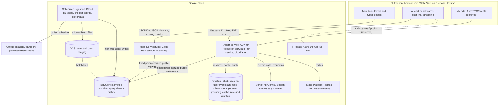

# Architecture

**Status:** Map transport baseline updated on 2026-10-01 by feature 002 T001. Agent service runtime decided on 2026-10-09 (Draft until the team confirms). Implementation and deployment acceptance remain open. User-data architecture remains a draft.

Each external source is ingested once. Map clients read bounded public views through a backend; AI tools and clients preserve the same source/version identity.

## Components

The map app does not query BigQuery directly and has no Firestore map listener. The map query service, the agent service and ingestion are three separate Cloud Run deployments that share one published store. Future user-data storage decisions do not change the first map transport.

| Component | Runs on | Responsibility |
| --- | --- | --- |
| Flutter app | Android, iOS, Web on Firebase Hosting | Platform-neutral map state/data; first acceptance on Web; native acceptance separately recorded |
| Map query service | Cloud Run service, cloud/map | Catalog, bounded viewport/detail/unlocated/member queries, budgets and public-field filtering |
| Agent service | Cloud Run service, cloud/agent | Chat loop, workflows and tools; Gemini through Vertex AI; streamed events ([agent-protocol.md](agent-protocol.md)) |
| Ingestion | Cloud Run jobs, Cloud Scheduler, cloud/data | Source admission, normalization, publication and provenance |
| BigQuery | Google Cloud | Published query views and historical facts; the anomaly detector (a cloud/data job) publishes anomaly results here |
| GCS | Google Cloud | Permitted NDJSON batch staging; not the client wire format |
| Firestore | Google Cloud | Agent-only store, reached only by the agent service: chat sessions per user, user events (`userEvents`), feed subscriptions per user (`userFeeds/{uid}`), grounding cache and rate-limit counters. Not a map data store |
| Firebase Auth | Google Cloud | Anonymous uid for every user; the agent service verifies the ID token |
| Vertex AI | Google Cloud | Gemini models and Search/Maps grounding, called with the agent service identity |
| Maps Platform | Google Cloud | Routes API for `draw_route`; map rendering and grounding attribution in the app |

## Map model and shared boundary

[Feature 002 map contract v1](../specs/002-map-data-presentation/contracts/map-api.md) and its [JSON Schema](../specs/002-map-data-presentation/contracts/map-contract.schema.json) define the client/server boundary. The older MapFeature proposal (geohash, Firestore current store, snake_case fields) is superseded for the first map. A generic MapFeature name may remain in older agent drafts; it must not be interpreted as this wire schema.

Typed MapItem values contain stable id/version/layer, GeoJSON geometry or null, spatial precision/evidence, assertion/lifecycle, known-or-unknown time, public sources and kind-specific details. Coverage, freshness and result completeness are separate. Known times are UTC; clients display Australia/Melbourne. Unknown values/times/locations remain unknown. Predictions use assertionKind=prediction and separate styling.

The app's selected-record panel (`app/lib/features/map/ui/map_details.dart`) is written for readers, not for tracing. It leads with the layer, a readable title, status chips and the facts each kind is about, then a plain-language location basis, time and sources. Record ids, versions, location precision/role/evidence, producer ids and source version refs sit in a collapsed "Technical details" section; they are still shown, not dropped. Several connectors pack their facts into one `summary` sentence (Development Activity Monitor, council consultations, Ticketmaster). The app recovers them with exact-format parsers in `app/lib/features/map/data/source_summaries.dart`; a summary that does not match is shown as written. Changing one of those connector sentences means changing its parser and tests in the same change. Measurements stay exact (no rounding); a derived percentage is shown only beside the supplied values.

V1 registers ten layers: pedestrian, anomaly, disruption, event, planning, boundary, news, rent, census and parking (live bay sensors, UC-15, added 2026-10-15). Registration does not imply available data. No unlocated fact gets a guessed point; no sparse sensors become claimed full-city population density. News articles name places without an event site, so the news layer draws the official areas they name (`areaMentions` aggregates, UC-06), never a point.

Each layer has one glyph and one colour, defined only in `app/lib/features/map/ui/map_layer_style.dart`: its point pins, its lines and areas, its layer chip and its legend entry all use them (anomaly is the "?" pin, disruption is red, community events are violet). Parking is drawn as each sensor's bay to scale (see UC-15), coloured by bay state, with the selected bay also carrying its selected pin, and aggregates stay as count badges. Colours are fixed rather than themed so a layer looks the same in light and dark mode; the selected object switches to the theme accent. Add a style there when adding a layer.

Agent tools and cards use the same identity: a `featureId` in [tools.md](tools.md) is a MapItem `id`, so the app can match cards and UI actions to items it loaded from the map service.

## Key decisions

- **Cloud Run queries the published store.** Fixed parameterized BigQuery view reads use read-only identity, byte/time/row limits, bounded pagination and five-minute opaque source-version snapshots. Detail/member reads recheck public admission/retraction. The first map introduces no second query store or persistent response cache.
- **JSON/GeoJSON at the client boundary.** Parquet may be useful for source exports/analytics, but clients use the frozen JSON model and explicit development sample mode. A failed live request never becomes sample data.
- **Two Cloud Run services face the app.** `melens-ENV-map` and `melens-ENV-agent` are separate services with separate images, identities, timeouts and scaling. The map service serves short JSON queries (30-second deadline, concurrency 32, up to four instances). It is stateless since 2026-10-16: it answers every request from the current layers it holds in memory per publication, with no per-request snapshot or rights recheck ([map-serving-stateless.md](map-serving-stateless.md)). The agent service serves long SSE turns (up to 300 seconds, higher concurrency, Vertex AI, Firestore and secret access). One service failing or rolling back does not take the other down, and the agent's broader identity never runs map query code.
- **Agents run server-side, on Gemini only.** API keys, models and model-facing tools stay in Cloud Run; Flutter never calls a model. Gemini is called through Vertex AI with the service identity, so there is no Gemini API key and no multi-provider abstraction. Agent tool contracts remain governed by tools.md and are not silently changed by the map contract.
- **Chat sessions are persisted per user in Firestore.** Every session belongs to a Firebase uid and is stored with its turns ([agent-protocol.md](agent-protocol.md#sessions)). Instances hold no conversation state between requests, so the agent service can scale out, a new revision keeps conversations, and the app can list and reopen earlier sessions. Only the agent service reads or writes Firestore; client security rules deny all access.
- **Agent tools read the published views directly.** Data tools run fixed parameterized queries over `melens_query`, under the same rules as the map service's query runner: read-only identity, approved views only, dry run, `maximumBytesBilled`, timeouts. They do not call the map service over HTTP (it is single-instance and would become the bottleneck) and do not use Firestore for map data.
- **TypeScript across cloud/.** The agent service uses ADK for TypeScript on Node 24, with the TypeScript and Zod versions already pinned in cloud/data and cloud/map. One language keeps shared validation, query and deployment code reusable.
- **Web first.** Firebase Hosting is the submission target. Shared data/state does not prove identical native rendering or 3D support; acceptance is recorded per platform.
- **P0 first.** G0 preparation, G1 development preview, G2 real P0 map, G3 full project P0 acceptance are separate. News/area expansion and optional H3/3D follow the documented gates; counts alone do not prove anomaly acceptance, and roads alone do not prove all transit acceptance.
- **Supporting services.** Secret Manager supplies restricted keys; Cloud Build deploys; Cloud Scheduler triggers ingestion. No real secret enters committed configuration.
- **Releases.** A `v*` tag releases the services, the Web app and the mobile apps through GitHub Actions ([.github/release/README.md](../.github/release/README.md)). The Android and iOS builds run on a self-hosted Mac that keeps the signing keys out of GitHub, and go to Google Play internal testing and TestFlight; their Firebase and Maps keys come from Secret Manager.

## Deployment constraints

The Web origin and both services' CORS allowlists must agree; the agent service additionally allows the `Authorization` header. Only admitted public fields are exposed by the public prototype; no caller SQL, raw/staging records or private admission evidence. Neither service identity has an ingestion write role. Build-time Maps/API configuration is documented in app/README.md; the app carries two base URLs, `MAP_BASE_URL` and `AGENT_BASE_URL`.

Agent streaming calls Cloud Run directly rather than relying on Firebase Hosting rewrite duration. The agent service allows unauthenticated invocation at the Cloud Run level, because a browser cannot obtain an IAM token; it verifies the Firebase ID token on every request and rate-limits per uid. Its request timeout covers a full turn of 16 model calls (300 seconds; the turn itself times out at 270 seconds so it is stored before the stream is cut). Sessions live in Firestore, so the service may run several instances; it and the map service keep one instance warm (min-instances=1) to avoid cold starts. The Firestore database `(default)` is in `australia-southeast2` (Native mode, delete protection, created on 2026-10-09 by `cloud/agent/infra/bootstrap.sh`) with TTL policies on `expiresAtTs` for the `sessions`, `turns` and `attachments` collection groups. Its identity, `melens-ENV-agent`, holds `melens_query` READER, project `bigquery.jobUser`, `aiplatform.user`, `datastore.user` and, once the Routes API tool reads it, `secretAccessor` on the Maps Platform key only.

Cloud Run, BigQuery, GCS and Firestore stay in `australia-southeast2`. Gemini and both grounding tools are served from the `global` Vertex AI location (`AGENT_VERTEX_LOCATION=global`): on 2026-10-09 `gemini-3.8-flash` answered plain, Search-grounded and Maps-grounded requests there and was not found in `australia-southeast1` ([cloud/agent/infra/README.md](../cloud/agent/infra/README.md)).

## Open implementation work

`cloud/agent` exists (see its README for what the first version covers) and `cloud/agent/infra/bootstrap.sh` prepared its identity and Firestore database; `cloud/agent/infra/deploy.sh` deployed `melens-dev-agent` on 2026-10-09 (immutable image digest, plan by default, identity audit). `cloud/agent/infra/firebase.sh` registered the project with Firebase the same day (anonymous sign-in only, the three apps, client rules denying all access), and the app signs in anonymously for the agent's ID tokens. Map endpoints/adapters/deployment are later feature 002 tasks (T011–T014/T019 onward); T001 is a contract freeze, not an implementation claim. Source gates remain in feature 001. Anomaly production (a cloud/data job writing to BigQuery), the Firebase Hosting release (T054) and the deployed-origin CORS update on both services retain separate owners and acceptance.
