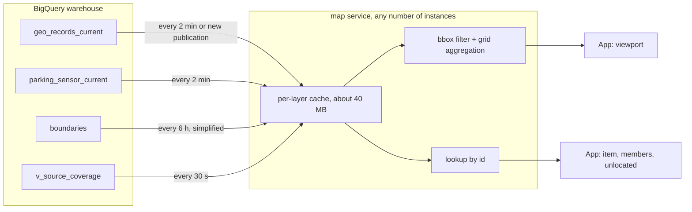

# Stateless map serving

**Draft**, agreed with the project owner on 2026-10-16. Replaces the snapshot store, the public-rights recheck and the pagination cursors of the map service with in-memory serving of the current layers. Supersedes the "Pagination and snapshots" rules in `specs/002-map-data-presentation/contracts/map-api.md` once phase 1 ships.

## Why

Measured on 2026-10-16 (`melens-dev-map`, three days of Cloud Run and BigQuery job logs):

- The whole current dataset is small: `geo_records_current` 16,346 rows / 35 MB, `parking_sensor_current` 6,324 rows / 2.8 MB, `boundaries` 1,527 rows / 77 MB. It fits in one process.
- A viewport request answered from the layer cache still ran 2–4 BigQuery jobs: the source coverage read (0.3 s), and the public-rights recheck of every returned row against `v_geo_records_current`, a view rebuilt from the append-only history tables (3.2 s, 560 MB billed per request; 163 jobs in three days). Viewport latency was p50 1.3 s, p90 9.8 s, p99 20 s. Detail reads p50 0.66 s, p90 4.7 s.
- Each response was stored as a snapshot in process memory (32 per instance, five minutes). Parking requests never reused one, so about 32 searches in five minutes filled the store and every caller got `429 rateLimited` until a snapshot expired. Because snapshots live in one process, the service could not run more than one instance.
- The snapshot's only consumers were the detail read, the aggregate member list and the unlocated list. The app never pages a viewport (`pageSize` 1000, first page only). `GET /v1/map/items/{id}` returns the same `MapItem` the viewport already carried; its only extra work was the rights recheck.
- The published views already filter rights: `v_geo_records_current_served` and `v_parking_sensor_current` join the live source registry, and record rights are applied when the current copies are rebuilt. The recheck only guarded cached results against a withdrawal inside a publication.

Querying BigQuery per request instead is not an option: a job on a 1 MB table still takes 0.3–1 s (p90 3–6 s), the project allows 100 concurrent interactive queries, and every job bills at least 10 MB. Partitioning a 35 MB table changes nothing; the cost is job start-up, not scan size. BigQuery is the warehouse; the serving tier is memory.

## Design

Rules:

1. **No server-side request state.** Every route is answered from the per-layer cache (`cloud/shared/src/query/current-layer-cache.ts`) plus the request parameters. The number of BigQuery jobs per instance is about seven per two minutes, independent of users.
2. **No public-rights recheck.** The cache reloads a layer when any of its sources publishes or after two minutes, and the views it loads from filter by source licence, access and record rights. A withdrawal therefore becomes visible within two minutes instead of immediately. That is the one accepted trade-off.
3. **Deterministic aggregate ids.** An aggregate is identified by its grid cell and semantic key, `aggregate.<layer>.<band>.<cellX>.<cellY>.<semanticKeyHash>`, never by the member set. The grid is already a fixed global Web-Mercator grid of 64-px cells per zoom band (`cloud/map/src/services/aggregation.ts`), so `GET /v1/map/aggregates/{id}/members` recomputes the members from the cache. News area aggregates keep `aggregate.news.area.<boundaryId>`.
4. **Details by id.** `GET /v1/map/items/{id}` looks the id up in every cached layer, so an id cited by an agent card is found whether or not the current viewport contains it. Historical items are read by (id, versionId) from `v_geo_records_history`.
5. **Wire shape kept, semantics changed.** A `snapshotId` is a read token that carries the request's normalized context (`cloud/map/src/services/read-token.ts`, about 200 characters): `v1~west~south~east~north~zoom~layers~mode~from~to~pageSize~areaFilter~boundaryFilter` for a viewport, `u1~…` for an unlocated list. Any instance recomputes the response from it. A `cursor` is `k1~offset~digest`, bound to the token, layer or aggregate and page size. A context longer than the 256-character id limit gets a digest token, read as `snapshotExpired`. Old random snapshot ids also read as `snapshotExpired`, which the app already answers by reissuing its request, so the server ships before the app; the app cleanup is phase 3.
6. **No waiting on reloads.** A layer that reloads (new publication, or past its two-minute age) keeps answering from its previous rows for up to five minutes, still filtered by the current registry's public sources; a failed reload is retried at most every ten seconds. The source registry is cached for 30 seconds and an expired read is served for 90 more while one background read replaces it. A withdrawn source therefore leaves the map within two minutes.
7. **Scaling.** Instances load every cached layer at start, and `/healthz` answers 503 until that load finishes (at most 25 seconds), so Cloud Run's HTTP startup probe keeps traffic off a new instance until it can answer from memory. Without it, a burst that scaled the service out sent requests to cold instances, which took 2–5 s each (2026-10-16). `deploy.sh` allows up to four instances, concurrency 32, 1 GiB and startup CPU boost.

## Phases

| Phase | Scope | Status |
| --- | --- | --- |
| 0 | Evict the oldest snapshot instead of refusing (`fix/map-snapshot-eviction`) | done 2026-10-16, not deployed |
| 1 | Stateless map service: remove snapshot store, rights recheck and stored cursors; read tokens; grid-cell aggregate ids; details and members recomputed; unlocated by offset; no waiting on reloads; multi-instance deploy; tests and docs. App: a detail read may return a newer version, which replaces the shown one (`selection_controller.dart`) | merged as PR #41 and deployed 2026-10-16 (revision `melens-dev-map-00013-l75`): sequential viewport p50 23 ms and p90 69 ms server-side, details p50 17 ms, members p50 15 ms, 374 of 374 requests 200. The startup probe followed in the next change. |
| 1b | Boundaries and pedestrian in memory (simplified outlines every six hours, as the news area loader does) instead of a live query per request; lookup of an id outside the token's request (agent cards) across cached layers | planned |
| 2 | Agent reads through the same layer cache instead of `currentGeoRead: 'authoritative'` (3.3 s, 470 MB per search) and caches coverage | planned |
| 3 | App cleanup: drop snapshotId/cursor handling and the snapshot-expired strings; render details from the viewport item; `getItem` only for ids the map has not loaded | planned |
| 4 | Optional: `CLUSTER BY topic, geometry` on `geo_records_current` for agent bbox reads; review the parking ingest job's BigQuery cost (14,928 SELECT jobs, 695 GB billed in three days) | planned |

Measured after phase 1 on 2026-10-16, in process against the live views on one laptop core (`node live-bench.mjs`, kept out of the repo): warm viewport p50 5.5 ms, p90 19 ms, p99 37 ms over 150 reads of three to five layers; parking at zoom 16–18 p50 5.9 ms; details p50 4.2 ms; members p50 3.2 ms; no BigQuery job across 550 warm reads; 128 simultaneous viewports in 0.66 s; about 460 MB resident. A new instance's first request waited 6.3 s for the initial loads, which the start-up warm-up and `--min-instances 1` absorb. Production before: p50 1.3 s, p90 9.8 s, p99 20 s.

## Rollout

Ship the app change and the map service together, app first. The new app works against the old service (it only stops rejecting a newer detail version). The new service works against the old app, except that tapping a record whose version changed since the map loaded (a parking sensor after its next two-minute publication) shows a detail error until the app ships. Old snapshot ids read as `snapshotExpired`, which the app already answers by reissuing its request.

Once the service answered from memory, the app turned "Search as the map moves" back on by default (2026-10-16, project owner). It had been off since 2026-10-15, with a "Search this area" button, because every move cost seconds of BigQuery time. The setting still turns it off.

## Open questions

- A member list longer than one page (more than 1,000 members) can mix versions across pages after a reload; `aggregate_details.dart` rejects a changed version between its pages. Phase 3 relaxes it.

- Historical mode (`mode: 'historical'`), unlocated lists, pedestrian and boundary layers stay live BigQuery reads per request (and per detail read of their items). They are rare in the app; if one becomes common it needs its own cache.
- A detail read of an id outside the token's request (an agent card citing a record the current view does not show) still returns `notFound`; phase 1b adds a lookup across cached layers.
- `@melens/shared` still contains the public-record query family (`public-record-queries.ts`, the cache's `publicRecords` path), now unused by the map service; remove it once the agent is confirmed not to need it.
- Rent and census have no row adapter and are not served today; this design does not change that.
